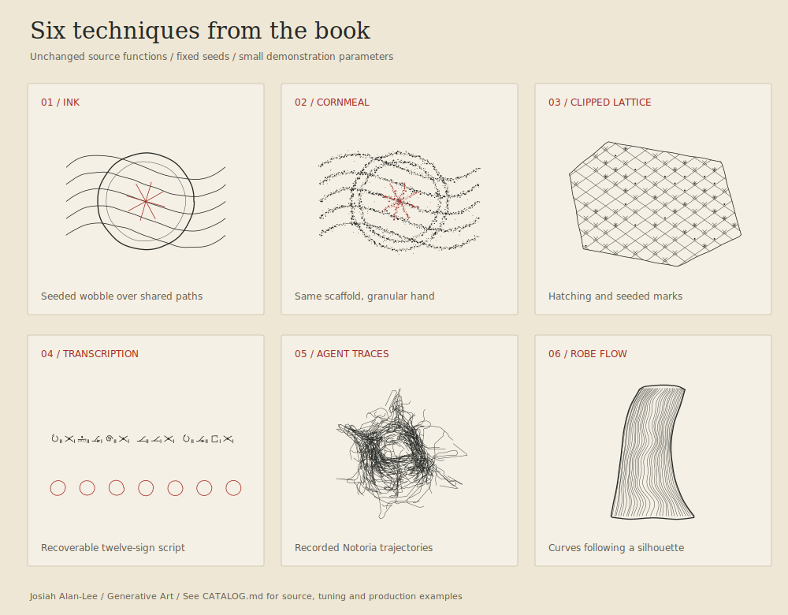

# Generative Art

Reusable techniques and scene studies from Josiah Alan-Lee’s book and generative artwork.

The [additional development generators](techniques/10-development-generators/README.md) include the original Matricis plates, two-culture Physarum, the XI plotter converter and an interactive node lattice.

**Choose an effect in the [technique catalog](CATALOG.md), then follow its family guide.** For a first runnable result, see [Getting started](docs/GETTING_STARTED.md). [Recipes](docs/RECIPES.md) cover combining techniques and choosing an output format.

| I want to… | Start with |
| --- | --- |
| Change exact paths into a drawn, engraved or cornmeal hand | [Linework and materials](techniques/01-linework-materials/README.md) |
| Grow trace networks, flowing contours or a sketch-like figure edge | [Fields and figure growth](techniques/02-fields-growth/README.md) |
| Draw figures, mechanisms, tiers and systems diagrams | [Figures and apparatus](techniques/03-figures-apparatus/README.md) |
| Make meaningful script, encoded ornament or sentence-derived seals | [Ciphers and seals](techniques/04-ciphers-seals/README.md) |
| Bring a raster figure into a drawn page | [Compositing](techniques/05-compositing/README.md) |
| Export physical pen paths or single-stroke lettering | [Plotter and SVG](techniques/06-plotter-export/README.md) |
| Finish pages with vellum, specks and sparse pen flourishes | [Page finishing](techniques/07-page-finishing/README.md) |
| Build a Blender scene, a light-aware culture or a scan engraving | [Existing scene studies](techniques/08-scene-studies/README.md) |
| Turn phrases into AQ values, prime glyphs or numogram routes | [Number systems](techniques/09-number-systems/README.md) |
| Generate hidden-line landscape plates sized to the book's pages | [Landscape plates](techniques/11-landscape-plates/README.md) |
| Put a 2D generator (strata, a quilt, hatching) on a 3D scene's flat walls | [Face patterns](studies/infernal-landscape/FACE-PATTERNS.md) |
| See the face patterns, farm objects, Wisconsin flora and thi.ng ports together in close-camera plates | [Plate studies](studies/infernal-landscape/PLATES.md) |
| Generate painted quilt squares on wood or metal | [Barn quilts](techniques/13-barn-quilts/README.md) |
| Draw the manuscripts' revision history, slime-mould tubes, marbled endpapers or guilloché seals | [Codex palette](techniques/14-codex-palette/README.md) |
| Generate decaying barns, old tractors and abandoned farm implements | [Farm objects](techniques/16-farm-objects/README.md) |
| Halftone or stipple a raster for the pen, redraw shapes in sketchy passes, or build figures from distance fields | [thi.ng ports](techniques/15-thing-ports/README.md) |

[Southwestern Wisconsin flora](studies/wisconsin-flora/README.md) adds six seeded species grammars for plotter studies: little bluestem, side-oats grama, leadplant, prairie smoke, wild bergamot and bur oak. The same 3D geometry supports different camera angles, organ layers and the existing landscape scene builder.

## Process art R&D

[Process-art generators](techniques/12-process-art/README.md) add eroded catchments, folded/faulted strata, chemical fields coupled to vein growth, and CSV-driven recurrence seals or textiles. Includes [research and primary sources](docs/PROCESS_ART_RESEARCH.md), editable stroke exports and a curated demonstration pack.

## Where things live

| Path | Purpose |
| --- | --- |
| `techniques/` | Guides grouped by visual operation, with source links and tuning advice |
| `examples/` | Small working examples and committed visual samplers |
| `lib/` | Small implementations written for this collection, not imported from the book: AQ, numogram and Tic Xenotation; process art; barn quilts; the Codex palette studies; the thi.ng ports (halftone, fuzz, sdf2d); face patterns (2D generators on flat 3D faces) |
| `sources/development-art/` | Art-only generators selected from the development repository, with portability changes recorded |
| `sources/codex-intervallorum/` | Unchanged source snapshot; original internal paths preserved |
| `studies/` | Infernal Engine, Photophobic, Scanned Statue, Driftless Plates, and the Three Gates perspective integration |
| `catalog/` | Machine-readable technique catalog, Python module index and per-file provenance |
| `docs/` | Setup, recipes, full code index, snapshot scope, validation results and [outside techniques](docs/HEN_CCRU_TECHNIQUES.md) with their license status |
| `tools/` | Snapshot import and collection verification |

The source snapshot is pinned to public book main commit [`b789e03`](https://github.com/JosiahAlanLee/Codex-Intervallorum/tree/b789e03f30034bc8403f8a40aaf83842885aaad5). It retains all 117 tracked Python modules, their selected technical inputs, fonts and source SVGs. Large raster art and edition PDFs stay in the book repository; this collection is not a complete illustrated-book distribution. See [provenance and updates](docs/PROVENANCE.md).

The existing studies use their own dependencies and build instructions. Their manifests and source attributions are retained. See [notices](NOTICES.md) before redistributing inherited work.

[The Three Gates](studies/three-gates/README.md) combines modeled architecture and water, surface-aware crosshatching, and depth-ordered Driftless plant strokes through one perspective camera. It includes a finished SVG, previews, a camera comparison, and reproduction checks.

[Terrain symbols](studies/terrain-symbols/README.md) executes the Blender integration on a displaced hillside: 2D field marks drape onto evaluated triangles, upright Driftless symbols retain their silhouettes, and both share the crosshatching renderer's occlusion. Two cameras and independent native Blender ray checks accompany the study.

[Infernal Engine 0.2](studies/infernal-landscape/README.md) turns the book's executable task graph into generative buildings: duration bays, dependency conduits, release lifts and unavailable gates. The four exterior studies combine Driftless field marks and foreground symbols with actual 3D trees, evaluated Blender geometry and print-sized engraving.

The [erosion comparison](studies/infernal-landscape/EROSION.md) gives the same
estate a raised terrain shelf and three matched erosion exposures. It combines
the repo's runoff/incision model with protected building sites, actual cut-bank
geometry, field marks that retreat from steep slopes, and shared ray visibility.

[Spillway works](studies/infernal-landscape/SPILLWAY.md) follows Claude's PR #23
review with a new five-hall scene: horizontal duration bays, a release-wait
passage, front-routed conduits, lighter eroded ground and two verified cameras.

[Workshop interiors](studies/workshop-interiors/README.md) reconstructs four remaining diffusion-based workshop plates from their recorded briefs as editable Blender scenes and layered, stroke-only SVGs. The study includes the maintained workshop, empty cabinet, extraction of the hand and office without a seal, with native Blender visibility and scene-specific checks.

The separate [development-art manifest](catalog/development-art-manifest.json) records the authorized art-only additions. Book manuscripts, personal records and repository history are excluded.

A [textile/process comparison](techniques/12-process-art/TEXTILE.md) adds a shared-port grammar, adaptive transport, confined chemistry, dissolution and portable fragments for use inside larger compositions.

[Occult print, cipher systems, code art and weird Americana](research/occult-americana/README.md) surveys thirteen source groups and ten generator concepts, with four original form/carrier sketches. This is research and ideation, separate from the implemented-technique catalog.

[Barn quilt squares](techniques/13-barn-quilts/README.md) add eight geometric block families, four painted-support studies, adjustable texture and wear, and shared-edge outline SVGs. Includes [research on conventions and materials](research/barn-quilts/README.md).

[Codex palette research](docs/CODEX_PALETTE_RESEARCH.md) maps what the manuscripts name but no plate draws to public datasets, with their terms checked, and to techniques this collection lacked. Four leads are runnable [studies](techniques/14-codex-palette/README.md): a History Flow of the manuscripts' Git revisions, Tero tube networks on Nota V's nodes, marbling on polylines, and guilloché credentials from the Escalationum catalogue.

[Three combination trials](techniques/14-codex-palette/COMBINATIONS.md) put quilt
geometry around chemical growth, shear catalogue engravings with marbling
combs, and use recorded manuscript edits to dissolve a textile scaffold.

[thi.ng and toxiclibs](docs/THING_TECHNIQUES.md) surveys Karsten Schmidt's
art tools against this stack, with licence status and the note that his
repositories now live on Codeberg. Three groups are implemented as the
[thi.ng ports](techniques/15-thing-ports/README.md): dithering, bitmap run
tracing and Poisson stipples for the pen; fuzzy multi-pass outlines,
composable fills, subdivision curves and polygon-to-Bézier conversion; and
2-D distance fields with blended booleans, repeats, nested contours and
sign-tested hatching. The survey also states what an archived fxhash work
needs to run again, and that `genart-api` is not it.
