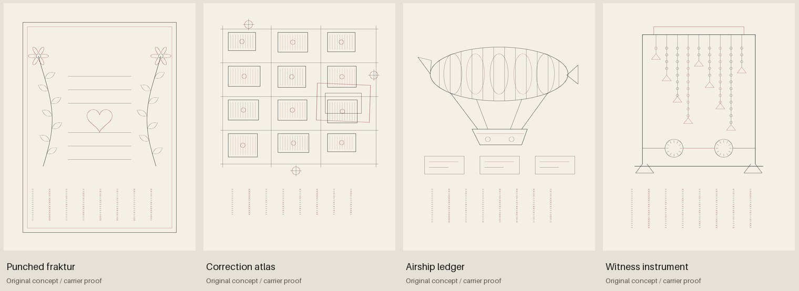

# Occult print, ciphers, code art and weird Americana

Research and ideation, 20 October 2026. Prepared with ChatGPT/Codex for Josiah
Alan-Lee. This is a set of source pools and proposed combinations for the Codex,
with four original form/carrier sketches. It does not install a style across
the book or claim a common historical origin for the objects discussed.

The strongest failure mode is treating an unfamiliar sign, devotional drawing
or resemblance between forms as evidence of a shared occult code. The research
below records what each source supports. The generator proposals are new work
inside the author's brief, not historical conclusions.

## Findings that change the design brief

**Algorithmic illumination already has a direct precedent.** Roman Verostko's
practice includes illuminated computer code, plotter manuscripts and artist
books with variations generated from shared parent code. The artist's studio
description and the Verostko Center supply a more precise precedent than a
generic comparison between computers and grimoires. Alice Wagstaff's role in
monitoring plotters/inks and loading brushes is documented too. [S01–S02]

**A mnemonic and a decryptable cipher demand different readers.** The Scottish
Rite Masonic Museum distinguishes compressed prompts for already memorized
ritual from the keyed encryption of Rob Morris's *Written Mnemonics* (1860).
That makes an operational difference: a page can be legible to an initiated
performer without containing enough information for a stranger to recover the
full text. [S06–S07]

**Some American devotional print explicitly recruits its next copier.** The
Free Library's cataloged Himmelsbrief asks that others be allowed to copy it,
and its text promises protection to a bearer/household. These are claims made
by that document. Its copying instruction supplies a concrete transmission
mechanism worth modeling separately from the truth of its promises. [S05]

**Correction can be an image-generating operation.** The Library of Congress
describes Sanborn maps updated with pasted correction slips and a correction
record. A changing legend, replaced parcel or patched page can carry actual
version history rather than merely looking old. [S13]

## Source pools and their limits

| Source pool | Documented foothold | Boundary on the inference | Useful formal material |
| --- | --- | --- | --- |
| **Verostko's electronic scriptorium** [S01–S02] | Algorithm-driven plotter illumination, code and artist books | This is an existing artistic practice; our book does not invent algorithmic illumination | Shared parent code; unique copies; separate text, brush and ornament layers |
| **Shaker gift drawings** [S03] | Drawings made as spiritual gifts, associated with named women including Hannah Cohoon | A spiritual message is not thereby an encrypted plaintext; these are not Quaker works | Paired branches, carefully apportioned leaves, tokens, borders and large quiet fields |
| **Pennsylvania German fraktur** [S04] | A collection containing certificates, writing exercises, house blessings, heaven-letters and other imagery | Fraktur is not uniformly magical; a birth certificate and an amulet have different functions | Structured fields, floral registers, named recipients, copied/printed/hand-colored layers |
| **Himmelsbrief** [S05] | A specific letter with copying instructions and protection claims | Record the claims as the document's claims; do not make efficacy a premise of the generator | Copy lineage, distribution, alterations, custody and repeated clauses |
| **American ritual cipher books** [S06–S07] | Both mnemonic prompts and a keyed encrypted ritual publication | Neither a single universal Masonic alphabet nor a single reading procedure follows | Columns, reading orders, stage directions, oral supplementation and personal annotations |
| **Fraternal initiation machinery** [S08] | DeMoulin manufactured regalia/paraphernalia and initiation devices | These belong to particular fraternal settings; “all Masonic apparatus” would be too broad | Theatrical machinery, invented instruments, instruction sequences and operator roles |
| **Charles Dellschau's notebooks** [S09] | Drawings, collages and accounts of airships and the Sonora Aero Club | The notebook account does not independently establish the club or its technology | Cutaway balloons, index labels, supporting members, revision notes, image/text collisions |
| **James Hampton's ledger and assemblage** [S10] | A materially ordinary ledger containing an unfamiliar script, related to his devotional work | The inspected evidence does not provide a decoding key; “unknown” does not mean random or meaningless | Repeated signs, accounting-page rhythm, foil, tabernacle-like arrangements and dense/empty contrasts |
| **Emery Blagdon's Healing Machine** [S11] | An installation with wire/foil/material components and the artist's stated healing purpose | The title/purpose is an attributed belief, not a verified therapeutic function | Suspended networks, loops, beads, folded foil, aggregate composition and local repairs |
| **American Jacquard coverlets** [S12] | Punched-card control and a cataloged nineteenth-century U.S. coverlet | This is material/program control, not evidence that all textile ornament is a cipher | Binary decisions, repeated fields, names/dates, border programs and reversible figure/ground |
| **Sanborn insurance maps** [S13] | Encoded construction/risk information, edition-specific keys and correction slips | The symbols are purpose-built and can vary by edition; the map is not an occult diagram | Parcel grammars, layered legends, revisions, access/water/fire relations and operational omissions |

## Ten generator concepts

These are design proposals. The “failure” is the strongest reason to reject or
revise a prototype before extending it. Rank reflects fit with current code,
formal promise and how clearly its behavior can be checked.

### 1. Correction atlas — prototype next

**Failure:** a picturesque map covered in arbitrary runes would add atmosphere
while discarding what makes a map useful.

**Construction:** invent a small town from typed records: building material,
access, water, occupancy and observation date. Generate a compact legend and
parcel geometry from those records. Apply a dated correction as a real record
change, then replace only affected geometry with an attached-slip layer. An
invented ward vocabulary can be a separate legend for this fictional town.

**Combination:** Sanborn revision mechanics + the existing catchment drainage
field + book apparatus symbols. A ward boundary could follow an actual computed
catchment while the insurance parcels follow a different administrative grid.
Keep those classifications visibly distinguishable.

**Check:** decode every plotted record under its stated legend; old/new versions
must disagree exactly where the source records changed. The sketch supplied
here is only a synthetic map/slip composition, not this complete compiler.

### 2. Punched fraktur — prototype next

**Failure:** decorative bits can become an unreadable border, especially after
grain, clipping or reduction to book size.

**Construction:** generate a certificate from explicit fields, then encode one
short clause in a Jacquard-like border program. Use a documented byte/bit order
and a clear start marker. Flowers and branches may derive their spacing from
the program without being the sole carriers of the text.

**Combination:** fraktur field structure + actual textile/program control + the
existing biliteral carrier or a new byte strip. A subsequent generation can
copy the clause with declared errors, while a separate receipt preserves what
changed. This would be an invented computational heaven-letter, not a claim
that the historical certificates used binary encryption.

**Check:** round-trip the untouched carrier; reduce/render it at placement size
and measure readability. Keep encoded geometry separate from discretionary
Physarum/grain decoration. The sketch implements a small cross/bar byte strip.

### 3. Ritual score compiler — prototype next

**Failure:** a beautiful state diagram can mistake outward performance for
understanding, agreement or belief.

**Construction:** represent a wholly invented ceremony as roles, cues, responses,
guards and stage transitions. Export three related objects: a complete script,
a memory prompt that intentionally omits information, and a keyed carrier that
does preserve the text. They can look related while having different recovery
conditions. Every page should retain its own declared carrier type in metadata.

**Combination:** the documented mnemonic/keyed distinction + theater-machine
forms suggested by fraternal apparatus + the book's observer/recipient diagrams.
One fictional instrument could record that a response was received without
certifying why it was produced.

**Check:** a decoder must recover the keyed version. A mnemonic should report
its missing prerequisite text, not manufacture a unique reconstruction.

### 4. Gift drawing from a run log — geometry preparation

**Failure:** converting every branch into the same measurement will merely
redraw an ordinary chart in devotional dress.

**Construction:** use a branching grammar to allocate zones for observations,
unresolved states, recipients and copy history. Leaf count can show a declared
quantity; red empty sockets can show missing observations rather than zero.
Reserve substantial blank paper. Use original geometry, not traced gift imagery.

**Combination:** Shaker gift-drawing composition + actual model telemetry +
space-colonization or the existing shared-port textile graph. Compare a quiet
paired layout with an asymmetric variant; resist filling every available gap.

**Check:** every quantitative visual channel needs a stated mapping. Other
ornament can remain decorative. This is an invented use, not a historical
interpretation of Shaker diagrams as measurements.

### 5. Airship correction ledger — geometry preparation

**Failure:** piling on pseudo-engineering can produce unsupported components
and an unreadable collection of decals.

**Construction:** assemble an invented airship from a small vocabulary of
envelopes, ribs, cables, fins and suspended compartments. Give every suspended
part a support path and every label an index target. Add separate revision
slips instead of adding more disconnected machinery to the silhouette.

**Combination:** Dellschau's notebook format + current native apparatus +
ray-lit/hidden-line scene methods. A program trace can control revision order
or part provenance; any claim of lift remains outside this form generator.

**Check:** support/attachment graph and line occlusion first, then caption/index
references. The supplied sketch is a form/carrier proof, not a flight model.

### 6. Witness instrument — geometry preparation

**Failure:** wires and foil can look like an already validated instrument if
the caption quietly supplies it with an invented real-world function.

**Construction:** generate hanging networks and folded elements with explicit
support points, material thickness and a small repeatable part vocabulary.
Keep an operation record in a separate carrier. A later variant could really
visualize a simulated field, with its units/model declared outside the artwork.

**Combination:** the material/form questions suggested by Blagdon and Hampton,
without asserting a lineage between them, plus the existing transport graph,
granular hand and scan/scene lighting. Avoid making every object symmetrical.

**Check:** each apparent physical attachment should exist in geometry. A
depicted field must be a real model output, otherwise label it as decoration.
The supplied original sketch has no therapeutic/electrical function.

### 7. Two books from one press — geometry preparation

**Failure:** pairing real code with unrelated ornament can imply a relationship
that the generating procedure does not actually contain.

**Construction:** one page holds a small program or declarative rule; its facing
image is produced by that exact rule, seed and input. Distinguish instructions,
execution trace and rendering. One shared parent program can generate unique
frontispieces for individual copies, with a compact identifier in the border.

**Combination:** the direct Verostko precedent + current deterministic fields,
plotter exports and ciphers. The project's contribution would be its chosen
models, apparatus and accountability, not the invention of algorithmic scripture.

**Check:** regenerate from the stored input and compare the output hash. Prefer
a tiny inspectable program to a pasted source-code texture.

### 8. Register of unfamiliar letters — archive work first

**Failure:** an unknown script can be prematurely declared either a solved
cipher or meaningless mark-making.

**Construction:** maintain separate fields for observed glyph shapes, proposed
transcription, asserted encoding rule, and demonstrated recovery. For generated
art, use an independently designed glyph family and state whether a payload was
authored. It may sit near a real carrier without inheriting the carrier's claim.

**Combination:** the interpretive problem raised by Hampton's ledger + current
reversible alphabets + an original decorative script. Never silently turn an
artist's unresolved script into the font for our own message.

**Check:** metadata must distinguish authored plaintext, prerequisite-dependent
mnemonic, intentionally decorative marks and unresolved historical meaning.

### 9. Legend-dependent concordance — prototype after the atlas

**Failure:** presenting several arbitrary readings can manufacture the mystery
that a later page congratulates itself for resolving.

**Construction:** create a small finite symbol grammar with explicit versioned
keys. Show an ambiguous isolated fragment, then demonstrate exactly which
context disambiguates it. A missing key, missing observation and contradictory
reading should have different result states.

**Combination:** edition-specific map legends + mnemonic prompts + existing
sentence/cipher validation. Ornament could carry the legend version while the
main diagram carries the data.

**Check:** enumerate the permitted readings under each key; do not claim a
unique answer until the stated constraints make it unique.

### 10. Mail-order instrument catalog — archive work first

**Failure:** a grab-bag of fake antiquarian advertising would supply a visual
joke without enough internal organization to sustain a page.

**Construction:** make an original part catalog with stable item numbers,
compatible fittings, operator roles, replacement diagrams and correction slips.
Cross-references can assemble larger fictional machines. A repeated product
number can be a real data key rather than a random string.

**Combination:** documented fraternal manufacturing + native apparatus +
invented devotional bureaucracy. A later research pass could add carefully
identified mail-order occult catalogs; that transmission research is not
supplied by the DeMoulin evidence alone.

**Check:** cross-references resolve and assembled supports agree; keep literal
historical quotations separate from invented advertising copy.

## The small proof packet

`python examples/make_americana_ideation.py` produces four original sketches:
Punched fraktur, Correction atlas, Airship ledger and Witness instrument. Each
has an independently invented border carrier: UTF-8 bytes in row order, eight
cells per row most-significant bit first; a cross is one and a bar is zero.
The distinct shapes also distinguish bits in monochrome. Payloads and bit
matrices are disclosed in the manifest, and each logical round-trip is checked.
This is a readable code demonstration, not secure encryption.

The sketch script implements forms and a carrier, not the full ten proposals.
It has no historical ritual transcription, recovered Hampton plaintext,
flight solver, therapeutic simulation, or complete map-revision compiler.
Physical scan/plot decoding was not tested. Source art and scans are linked
for research; none are bundled or traced into the sketches.

## References

The [source register](sources.json) gives institutions, links and the limited
claims used. The [concept register](concepts.json) records priorities and reuse
hooks without mixing proposals into the implemented-technique catalog.

- **S01:** Roman Verostko, [Manchester Illuminated Universal Turing Machines](https://www.verostko.com/manchester/manchester.html), artist's project account.
- **S02:** Verostko Center, [Art, Logic, and the Decision Problem](https://www.verostkocenter.org/art-logic-and-the-decision-problem---roman-verostko-and-the-cloud-of-unknowing.html).
- **S03:** American Folk Art Museum, [Anything but Simple: Gift Drawings and the Shaker Aesthetic](https://folkartmuseum.org/exhibitions/anything-but-simple-gift-drawings-and-the-shaker-aesthetic/).
- **S04:** Library of Congress, [Pennsylvania German fraktur, broadsides, and related drawings](https://www.loc.gov/item/91706456/), collection LOT 12683.
- **S05:** Free Library of Philadelphia, [A Letter from God / Ein Brief von Gott](https://libwww.freelibrary.org/digital/item/frk01084), item frk01084, associated with Augustus Kollner.
- **S06:** Scottish Rite Masonic Museum & Library, [Written Mnemonics — Deciphering a Controversial Ritual](https://www.srmml.org/written-mnemonics-deciphering-a-controversial-ritual/).
- **S07:** Scottish Rite Masonic Museum & Library, [Masonic Ritual Cipher: A Personal Object](https://www.srmml.org/masonic-ritual-cipher-a-personal-object/).
- **S08:** DeMoulin Museum, [Factory History](https://www.demoulinmuseum.org/factory.html) and [museum collection description](https://www.demoulinmuseum.org/museum.html).
- **S09:** American Visionary Art Museum, [Charles Dellschau](https://www.avam.org/artists/charles-dellschau); American Folk Art Museum, [collection label booklet, Dellschau entry](https://folkartmuseum.org/content/uploads/2020/02/AP-Label-Booklet-Aug17.pdf).
- **S10:** Smithsonian American Art Museum, [The Book of the 7 Dispensation](https://americanart.si.edu/artwork/book-7-dispensation-9898) and [Reading Into the Throne](https://americanart.si.edu/blog-post/1337/reading-into-the-throne-on-james-hamptons-notebook); Smithsonian Archives of American Art, [James Hampton writings finding aid](https://sirismm.si.edu/EADpdfs/AAA.hampjame.pdf).
- **S11:** Smithsonian American Art Museum, [individual element from the Healing Machine](https://americanart.si.edu/artwork/untitled-individual-element-healing-machine-110153), object 2015.31.2.
- **S12:** National Museum of American History, [Punch Cards](https://americanhistory.si.edu/collections/object-groups/punch-cards) and [John LaTourette, Jacquard double-cloth coverlet, 1844](https://www.si.edu/object/john-latourette-jacquard-double-cloth-coverlet-1844%3Anmah_620485).
- **S13:** Library of Congress, [Interpreting Sanborn Maps](https://guides.loc.gov/fire-insurance-maps/sanborn-interpreting).

The research draws on collection records, museum interpretation and artist
statements; it is a design-oriented source survey, not a full historiographic
review. Proposed combinations are credited as project inventions. No new
blanket license is assigned to source material or generated work by this packet.
