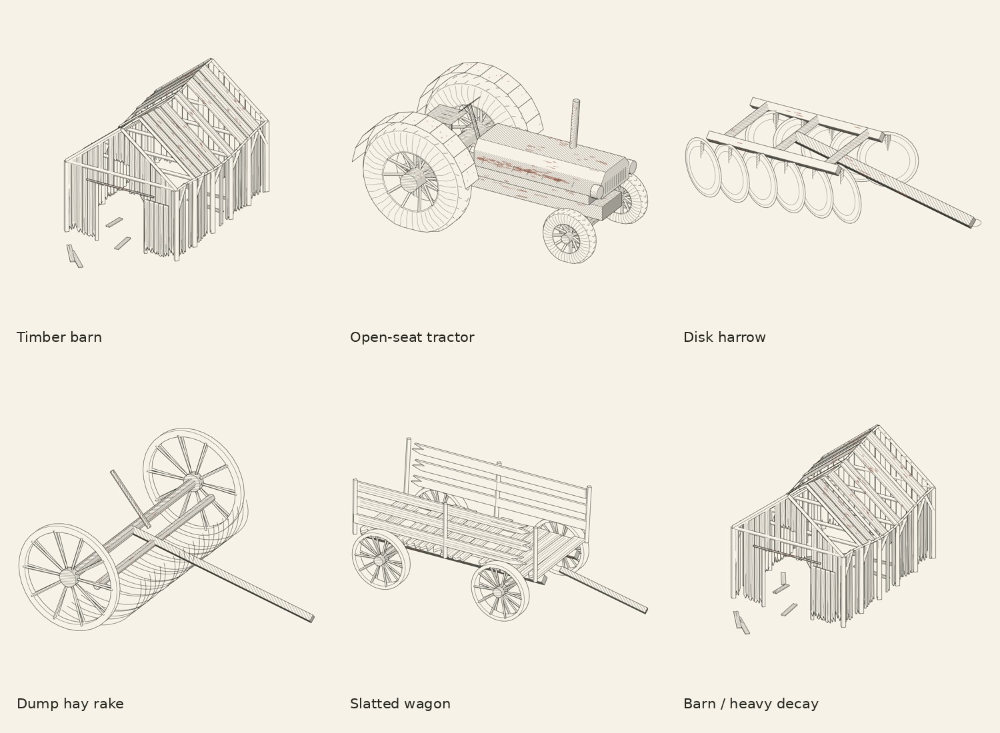

# Farm remnants



Five original object grammars for abandoned farm scenes, prompted by Josiah's
memory of rusting equipment and decaying wooden barns. These are invented
composites; they do not reproduce his particular farm, a named tractor model,
or an agricultural engineering specification.

| Family | Seed changes | Decay changes |
| --- | --- | --- |
| Timber barn | Width, length, height, gable/gambrel roof, damage positions | Missing siding and roof sheets, ragged board ends, split grain, sag, fallen boards |
| Open-seat tractor | Wheelbase, track, tire radius, hood height | Flattened tires, checking, missing fender segments, leaning exhaust, steel corrosion |
| Disk harrow | Gang width and number of disks | Missing disks, frame corrosion |
| Dump hay rake | Axle width and wheel radius | Bent/missing curved teeth, frame corrosion |
| Slatted wagon | Deck length and width | Missing floor/side boards, leaning stakes, split grain, corrosion |

The seed produces a family member. `decay` is an artistic control from 0 to 1,
not elapsed years or a physical degradation simulation. Barn dimensions stay
fixed as decay increases, with a nested set of missing boards/roof sheets.
Material marks are 3D polylines attached to surfaces. Missing parts are genuine
mesh gaps: camera changes see through them. There is no solid backing wall.

## Build

From the repository root, Python 3.10+:

```sh
python -m pip install -r studies/farm-remnants/requirements.txt
python studies/farm-remnants/build.py
python -m unittest discover -s lib/farm_objects/tests -v
```

Default output: five specimens (seeds 22–26), barn decay 0/.38/.9 with seed 22,
and a combined yard. Each specimen is 190 × 140 mm; the yard is 280 × 210 mm.
`--seed` sets the base seed; successive family members use base + 0 through 4.
Use `--only tractor`, `--only farmyard`, `--decay .9`, `--out /path`, or
`--no-png`. Standalone APIs accept an exact seed directly.

```python
from lib.farm_objects import make_object, write_obj
from lib.farm_objects.render import render_svg

tractor = make_object('tractor', seed=41, decay=.8)
render_svg(tractor.record(), 'tractor.svg', view=(-1, -1.6, .8))
write_obj(tractor, 'tractor.obj')
# Place directly in the existing NumPy or Blender SceneBuilder:
tractor.add_to(builder, location=(4, -2, 0), rotation=.4, scale=1.)
```

Placement rotates all mesh and stroke geometry together. Z is up, coordinates
are metres, and scale is positive/uniform. Tractors/wagons face +X; barn doors
face -Y. Materials reuse the maintained SceneBuilder's seven slots.

The generator reuses `studies/infernal-landscape/geometry.py` and the engraver
reuses `studies/infernal-landscape/vendor/raycore.py`. Those files are unchanged.
Do not copy only this package without those dependencies. The orthographic
specimen renderer supplies its own camera, face hatching, and SVG writer;
it does not invoke the task-graph renderer or its scene-specific global state.

## Blender

The runner exports per-object `.obj` meshes and full `.json` records alongside
the drawings. JSON retains the surface strokes, material assignments, parameters,
and mesh faces; OBJ retains geometry/group names only. These larger rebuild
outputs are ignored by Git. Regenerate them with the command above.

To import one record without clearing an existing scene:

```sh
blender -b -P lib/farm_objects/blender.py -- \
  studies/farm-remnants/output/tractor-23-d72.json --save /tmp/tractor.blend
```

The adapter creates a collection, separate mesh objects and bevel-free 3D
curves by pen. It refuses to overwrite an existing `.blend` path. Curves are
editable drawing paths, not renderable ink with a world-space thickness.
Native Blender execution was unavailable in this environment, so no `.blend`
is claimed or supplied. Mesh/JSON export and SVG rendering ran in NumPy.
The shared-builder placement path was exercised in the tests.

## Plotting and validation

The SVGs use explicit stroke paths in four layers: structure, shade, material,
and rust. No raster image, filled polygon, clipping mask or lettering is needed.
Rust can use a brown pen, or all layers can use black. Previews alone have paper
color and sampler labels. Nominal widths are .09–.20 mm. Use native dimensions
for the first physical proof; pen width and paper determine the actual result.

Visibility uses a BVH of the real faces and samples strokes every ≤.14 mm.
Fragments shorter than .24 mm are removed. This is sampled visibility, not an
exact analytic line/triangle intersection. Contact regions below that scale can
lose tiny marks. There is no plot travel sorting or physical plotter validation.
`output/metrics.json` reports path counts and pen-down metres, excluding travel.

Tests cover seed determinism/variation, bounded and nondegenerate mesh geometry,
monotonic barn damage, unchanged dimensions under decay, placement of attached
marks, invalid controls, and a hidden stroke behind an opaque block. The proof
script validates SVG bounds and PNG integrity and creates the visual samplers.

The first pass is deliberately an object library. A more specific reconstruction
would need references for the actual tractor types, barn profile and arrangement;
these models are ready to place into the existing terrain/vegetation studies.
