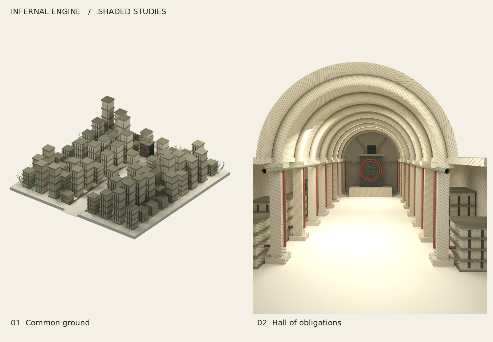

# Infernal Engine — Blender starter, 0.1



[Editable Blender scene](Infernal_Engine_0_1.blend) · [Ink studies](preview.png) · [Artist reference research](RESEARCH.md)

A small, working Geometry Nodes generator for architectural illustrations. Tested with Blender **4.5.3 LTS**. The two compositions are initial studies, with a shared machine vocabulary and two output treatments. They are not finished book plates or an exhaustive scene generator.

## Open and vary

1. Open `Infernal_Engine_0_1.blend` in Blender 4.5 LTS. The original startup scene is retained; choose one of the scenes beginning **IE** using the scene selector.
2. Select the object named **EXTERIOR • select to edit nodes** or **INTERIOR • select to edit nodes**. Its Geometry Nodes modifier exposes the controls below.
3. Open the Geometry Nodes workspace to edit the actual graphs. Repeated towers and vaults are shared node groups. Nodes are arranged by dependency depth.
4. Press F12 for the shaded view. Set the render output path to a folder on your computer first: the supplied file retains its build-time output path.

| Scene | Controls | Meaning in the picture |
| --- | --- | --- |
| Common ground | Seed, Height, Growth | Repeated archive towers flank a clear avenue. Their services converge on a collector; plants occupy the complex. |
| Hall of obligations | Seed, Bays, Cabinet height | Repeated vaults and service cabinets surround a central aisle. Connected pipes return to the collector at the far end. |

The machinery, cameras, lights, floor and service routes are editable scene objects. Their composition is established by Python. Geometry Nodes handles architectural repetition, tower heights and vegetation distribution. This is a hybrid starter, not a claim that every part is controlled by the modifier.

**Bays is a repetition control.** The interior floor, walls, pipe manifold and collector stay fixed. Use 8 for the composed hall. Lower counts remove repeated modules; they do not shorten the building. A later version should make the enclosing architecture and all service connections follow the bay count.

Growth is an independent density layer. Changing Growth does not move the towers. Plants are allowed to intersect building footprints in this study; there is no climbing, collision avoidance or ecological simulation. The clear central avenue remains excluded.

## Included output

- `exterior.png`, `interior.png`: 1200 × 1500 transparent-background Cycles proofs, 20 samples. These are review images. Increase resolution and samples for final shaded prints.
- `exterior_ink.svg`, `interior_ink.svg`: separate camera-visible outline and hatch groups, without embedded raster images or filled background shapes. The nominal page is 7 × 8.75 inches. Scale it in a page layout or vector editor.
- `preview.png`: the two ink studies on a neutral paper background.
- `build_infernal.py`: reconstructs the scenes, graphs, embedded growth source, materials, lighting and cameras. No downloaded models, textures or add-ons.
- `export_ink.py`: regenerates both SVG drawings from the current scene geometry and cameras.
- `RESEARCH.md`: references and next directions, with built versus proposed features separated.
- `verification.json`: recorded checks from the supplied build.

### Rebuild

Use Blender's Scripting workspace: open `build_infernal.py`, edit `ROOT` near the top to a writable output folder if needed, and Run Script. It creates two new scenes without deleting your existing scenes. Repeated runs create additional scenes rather than updating the previous pair; use a fresh file for a clean rebuild.

Or use Blender from a terminal:

```bash
blender --background --python build_infernal.py -- --render
```

`INFERNAL_OUTPUT` optionally sets the output folder; `INFERNAL_RES` sets image width, with height at 1.25 times width. Without `--render`, the builder saves the Blender file without rendering. For example, 3000 × 3750 pixels gives 300 ppi at 10 × 12.5 inches. Print quality still depends on lighting, antialiasing, line size and the actual printer.

### Ink export

Open the `.blend`, then open `export_ink.py` in the Text Editor and Run Script. Change `ROOT` to your output directory first. The exporter temporarily realizes instances, restores the node connections afterwards, and does not save those temporary changes into the `.blend`.

The SVG exporter ray-tests against the evaluated scene, including generated instances. Visibility boundaries are sampled at about 1.4 viewBox units, roughly 0.16 mm at the nominal size; they are not mathematically exact. Long occlusion intervals can cut paths into many strokes. Inspect intersections before plotting. Hatch density responds to face orientation against a fixed direction, independently of the Cycles lights. Shader stripes in the PNG and geometric hatch strokes in the SVG are different drawing treatments.

For true single-pen plotting, the SVG uses strokes rather than background masks. Plot order is hatching followed by outlines. There is no path ordering optimization or pen-width compensation. Test a small section first.

## Development priority

First improve the architecture and camera composition. Next replace fixed service routes with a connectivity graph that generates pipes, sockets and supports together. Then add controlled structural asymmetry, a second plant family and surface-aware growth. A seed browser and final print presets follow after those scene rules are convincing.

## Provenance

Created for Josiah Alan-Lee by ChatGPT/Codex (Sol), 20 October 2026. The architecture, Geometry Nodes graphs, shaders, growth asset and SVG exporter were written for this study. Zancan, Yazid and Ge1doot are documented artistic references; their source code is not incorporated.

`manifest.json` records SHA-256 hashes of the committed study files, excluding itself. It records the delivered files rather than claiming that Cycles images or Blender binaries rebuild byte for byte. `verification.json` records geometry variation, seed repeatability, plant removal and nonempty SVG checks from Blender 4.5.3 LTS.
