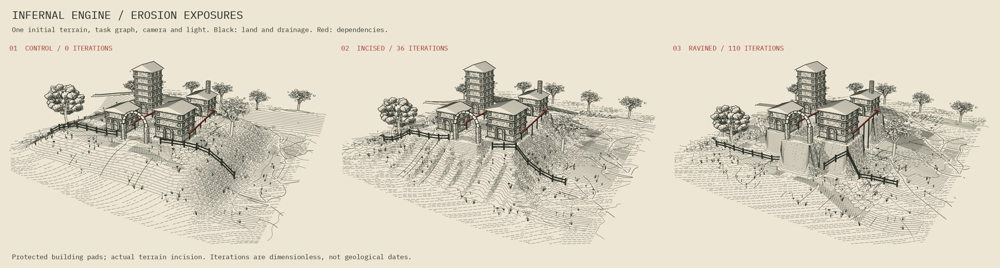

# Eroded terrain: three exposures of the same estate



The process-art collection already had two quite different erosion methods:
`lib/process_art/models.py:catchment` cuts a height field using accumulated
runoff and slope, with hillslope diffusion; `lib/process_art/textile.py:dissolve`
removes a drawn scaffold with a diffusion/reaction front. The former is used
here. Textile dissolution remains useful for ornamental screens, rather than
being silently substituted for terrain evolution.

## Implemented combination

The same initial field, seed, task graph, building layout, camera, light and
drawing settings are used for a control (0 iterations), an incised exposure
(36), and a ravined exposure (110). The numbers are algorithm iterations, not
geological dates. A new reusable `erode_heightfield` adapter accepts a supplied
grid and fixed sites; it reuses the existing priority-flood and D8 routing.
The original catchment generator is unchanged.

The simulated height changes the actual Blender terrain mesh. It is not a
decorative displacement of the final image. Protected pads hold the building
sites and approach threshold at their initial elevations on every iteration.
The task programme, explicit architectural strokes and red dependency geometry
remain identical. Fence posts, tree roots and service-support feet follow the
changed ground.

Black channels come from the actual receiver graph; contours come from the
resulting height field. Field marks withdraw from steep banks and high-runoff
corridors. Surface-normal-dependent hatching gives the cut slopes more weight.
All three new plates use those same rendering rules. Red remains reserved for
the task dependencies, so drainage is not confused with the book's signal path.

The three-exposure control includes shared seeded microrelief. It is distinct
from the earlier smooth-terrain plate; the earlier four arrangement studies
retain their original output paths and default rendering treatment.
The shared initial composition also includes a broad raised site shelf, giving
the process relief to expose banks at the page scale. Channel and contour paths
receive a 0.9-cell drawing smooth before draping; the physical simulation grid
and receiver graph are retained without that drawing smooth.

## Model limits

This is a dimensionless art model inspired by stream-power incision, with a
per-step loss capped by downstream drop and linear hillslope diffusion. It
does not simulate sediment transport, deposition, floods, groundwater or soil
loads on buildings. Boundary elevations are fixed at supplied values. Depression
conditioning is used for routing, while the exported physical surface remains
the evolved ground. Channels through conditioned depressions are a routing
convention; they are not a calibrated prediction of running water.

The fixed pads are an explicit compositional input. Their survival does not
establish a foundation-engineering result or protection from actual erosion.
Grid-direction effects can remain visible. The renderer's visibility checks
remain sampled, and the output has not been physically plotted.

## Rebuild

Use the existing engraving requirements and Blender 4.5 environment:

```sh
python run_erosion.py --blender-python /path/to/blender-env/bin/python \
  --engraving-python /path/to/engraving-env/bin/python
```

Terrain evolution runs in the engraving environment. Blender needs only NumPy
for interpolation; a second SciPy installation inside Blender is unnecessary.
`erosion.py` writes the three `terrain-state.npz` records. `model.py` consumes
them when `INFERNAL_TERRAIN=control`, `incised` or `ravined` and embeds the fields
needed for drawing into `scene.json`. Engraving then uses that scene record and
the pinned Driftless patches. The NPZ files preserve simulation inputs and audit
fields; Blender's evaluated triangles still provide the drawing surface.

Run `python -m unittest discover -s lib/process_art/tests -v` from the repo root
for process tests. `erosion_checks.py` compares the three delivered scenes,
protected sites, unchanged task strokes, runoff invariants, and native Blender
visibility records. The three plates retain the 156 x 117 mm print size.

The source pack includes the source, the reusable process modules, three
editable Blender scenes, the SVG plates, clay proofs, simulation fields and
visibility audits. This is an exterior study; it changes no bound book pages.

Prepared for Josiah Alan-Lee with ChatGPT/Codex, 21 October 2026. New terrain
adapter, composition and integration: ChatGPT/Codex. The inherited Driftless,
hatching and visibility credits remain in the study README and vendor notices.
Right of reply: invited; no objection.
