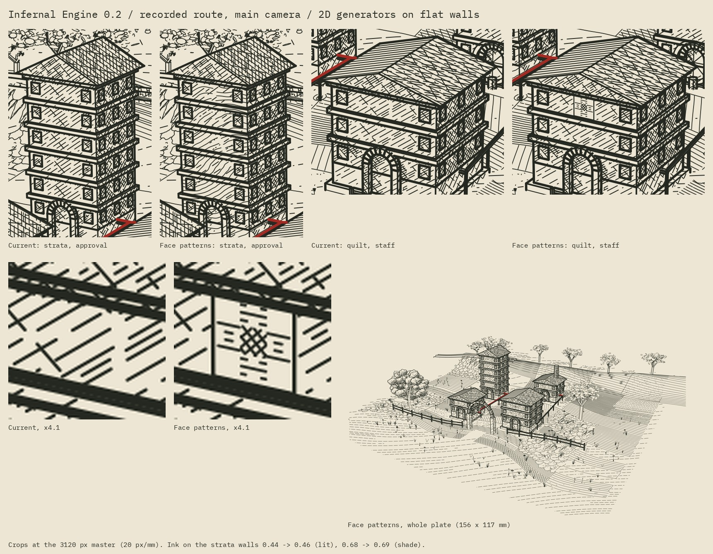

# Face patterns: 2D generators on flat walls



A planar face has an exact two-dimensional frame, so the collection's 2D
generators can draw on it directly; no curvature field is involved.
[`lib/face_patterns`](../../lib/face_patterns/mapping.py) does the mapping. This
study is its first use: the process-art stratigraphy as bedding on the approval
tower's limestone walls, and an Ohio Star barn quilt on the staff building's top
storey, through the same camera, rays and tone allocator as everything else on
the plate.

The [plate studies](PLATES.md) show both patterns at close range, with a third
(a seal) and a barn quilt on an actual barn. It is off by default. With it off, the recorded route's main SVG is
byte-identical to the build before this change (SHA-256 `84235df0…`).

## How it works

**World-anchored frames.** A face's coordinates are (u, v) = (P · U, P · V),
with U horizontal and V up the plane's steepest slope, measured from the world
origin rather than from the face. Coplanar faces share coordinates, so a pattern
continues across storeys, and a course drawn at a fixed v meets itself at the
same height around a corner. The face hatcher (`hatch_on_face`) still measures
from each face's first vertex; only the patterns are world-anchored.

**Strata (a solid field).** `Strata` places the process-art `stratigraphy`
section, unchanged, in the vertical plane along the facade's run (world x) and
extrudes it across. Each wall is contoured where it cuts that field. The front
wall shows the folds and a fault offset, the side wall shows level beds, and
their lines meet at the corner: in the unit test, all 24 levels that reach the
corner end at the same height on both walls.
A horizontal stretch of 2 halves the dips, and the model's blank fault seams
stay blank, so no line bridges a fault. Bed spacing (0.28 units) is set in the
world, and the screen is checked: alternate beds are dropped by level index,
for the whole building at once, until neighbouring beds are at least the
study's 0.22 mm family gap apart on the page. Here the tightest tenth of the
spacing between neighbouring beds is still 7.4 px (0.37 mm), so every bed is
drawn. Lines are 0.085 mm, the field-mark weight.

**Quilt (a motif).** `quilt` takes a `barn_quilts` block, unchanged, and draws
paint as value:

- light ground is left blank;
- main paint is a horizontal hatch, so each star point tapers to its tip;
- contrasting paint is a crosshatch.

Both hatches land at least 4.4 px (the minimum gap) apart on the page; the world
spacing comes from the camera Jacobian at the square's most foreshortened corner. Only the board's edge
is outlined (0.12 mm). At this size, drawn piecing seams read as a window grille,
so they are off (`paint_edges=True` draws the seams between different paints).
Paint replaces light: the wall's own hatching is kept out of the square.

**Tone.** Pattern strokes are architecture ink. They reserve tone in the
allocator like the edges do, so the light hatching thins under the strata instead
of doubling. They go through `stroke_project` and the shared ray test, then the
planar plants' owner clipping, and land in their own layer,
`02 architecture face patterns`. `checks.py` re-tests every delivered pattern
sample (`face_pattern_samples_visible`).

## Result: recorded route, main camera, Blender build

Both plates come from one scene record (SHA-256 `a88e94b4…`) and differ only in
the engraving. Every check passes on both: 22 on the current plate, 23 with the
pattern audit (8,949 samples, none hidden).

| Measure | Current | Face patterns |
| --- | --- | --- |
| Crosshatching | 4,358 paths, 3.396 m | 4,144 paths, 3.243 m |
| Face-pattern layer | none | 247 paths, 0.319 m (216 strata, 31 quilt) |
| Ink on the tower's lit walls | 0.439 | 0.463 |
| Ink on the tower's shaded walls | 0.678 | 0.685 |
| Ink in the quilt square | 0.257 | 0.330 |
| Buildings, mean ink (`checks.py` zones) | 0.434 | 0.439 |

Oaks, open ground and sky are unchanged, and so are the darkest 4 mm cell (0.568) and
the 90th percentile (0.252); the tone hierarchy holds. The full record is in
[output/face-patterns-validation.json](output/face-patterns-validation.json).

## Rebuild

From this directory, with the environments in the main README:

```sh
python run.py --blender-python /path/to/bpy-python --engraving-python /path/to/engraving-python \
  --cases recorded_route --no-clay
python run.py --blender-python /path/to/bpy-python --engraving-python /path/to/engraving-python \
  --cases recorded_route --no-clay --face-patterns
python face_patterns_preview.py
```

`--face-patterns` sets `INFERNAL_FACE_PATTERNS=1` and writes to
`output/<case>-face-patterns/`, beside the delivered build. It also works with
`--dry-run`, but `face_patterns_preview.py` refuses dry runs, failed checks and
mismatched scene records. Which building and facade receive which pattern is
set in `surface_patterns.py` by task id; other cases build too, but only the
recorded route was examined.

## Limits

- **Scale.** At true barn-quilt size (8 ft against a storey of about 3 m, here
  0.78 units) the quilt is about 2.5 mm wide on the 156 mm plate. It reads as a
  small starred plaque, and as a star only in the zoom. A closer camera or a
  bigger host face would let a quilt read as one.
- **Strata.** These are the model's kinematic drawing extruded in one direction,
  not a 3D geological model. A wall is treated as cut from inside the specimen,
  so the model's weathered outline is not applied.
- **Planar faces only.** Curved surfaces (the mesh-hatching proposal) remain
  separate.
- **Keep-outs.** A keep-out is per face; a painted region that spans several
  faces needs one for each.
- **Tone reservation.** The reservation is the allocator's existing
  approximation, a blurred raster at one fifth of the master resolution.
- **Plotting.** Physical plotting was not tested.

Prepared with Claude on 22 October 2026 at the author's request. The two
generators are the collection's own, called unchanged; no outside code is used.
