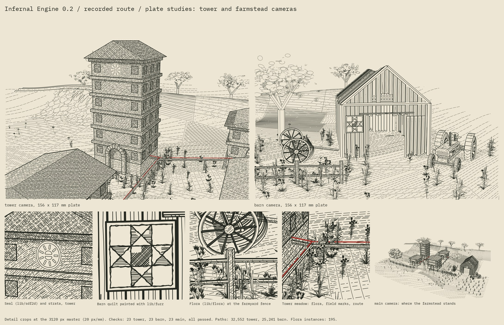

# Plate studies: close cameras on the estate



These two close-camera plates of the recorded route's estate put the collection's newer
pieces into one scene, at a scale where they can be read:

- the [face patterns](FACE-PATTERNS.md);
- a farmstead from [`lib/farm_objects`](../../lib/farm_objects);
- southwest Wisconsin plants from [`lib/flora`](../../lib/flora);
- three of the thi.ng ports: [`lib/halftone`](../../lib/halftone) places the plants,
  [`lib/fuzz`](../../lib/fuzz) paints a barn quilt and [`lib/sdf2d`](../../lib/sdf2d)
  shapes a seal.

Everything is drawn through the study's own camera, model rays and tone
allocator, and all 23 checks pass on each plate.

The plates are off by default. `run.py --plates` writes to `output/<case>-plates/`.
Without the flag none of this code runs, and two earlier outputs are
byte-identical to the builds before this change: the recorded route's delivered
main SVG (`84235df0…`) and the face-pattern comparison (`7a6bb489…`).

## The plates

| Camera | Eye → target (m) | Focal | Subject |
| --- | --- | --- | --- |
| `tower` | (2.4, −4.2, 8.8) → (−4.7, 10.3, 4.6) | 3,300 px | The approval tower over the open approach arch: strata, the seal on the top storey, the tower meadow and the red critical path |
| `barn` | (13.4, −9.4, 4.6) → (16.3, 6.4, 2.75) | 3,450 px | The farmstead in the east meadow: the barn and its quilt board, the tractor, the hay rake, and flora along the farmyard fence |

Focal lengths are in pixels on the 3,120 px master: 156 × 117 mm at 20 px/mm,
the same units as the estate's own cameras. The build also renders the main
camera with the farmstead in place. The preview sheet shows it small, to locate
the two plates.

## How it works

**The farmstead.** `plates.add_farmstead` places three farm-remnants specimens
through the scene builder, so the Blender model and the NumPy dry run receive
the same geometry.

| Object | Seed | Decay | At (x, y), turn | As built |
| --- | --- | --- | --- | --- |
| Barn | 22 | 0.45 | (16.6, 8.4) | 4.9 × 6.8 m, 5.1 m to the ridge; 11 of 100 board slots and 8 roof sheets missing |
| Tractor | 23 | 0.72 | (19.9, 3.9), −2.3 rad | Open-seat composite, 2.22 m wheelbase |
| Hay rake | 25 | 0.72 | (11.6, 5.2), 0.2 rad | 2.8 m wide, 2 teeth missing |

- **Bases.** Each base sits 5 cm into the ground, because Blender's Displace
  moves the surface by up to 4 cm. The barn's boards hang free above its sills,
  so it rests at the lower quarter of the ground under it. The wheeled objects
  rest on the ground at their centres.
- **Footprints.** Each footprint, enlarged by 0.4 m, keeps field marks and
  plants off the object.
- **Weight and tone.** All three objects are drawn as the estate's furniture:
  every edge at crease weight (0.16 mm, where a building's silhouette is
  0.25 mm) and lighter hatching. In the tone zones the barn and its board count
  as building; the tractor and the rake count as furniture.

**The quilt board.** `front_quilt` measures the barn's own geometry to find room
for a square board. It tries the gable first. On seed 22 the loft opening
reaches too close to the roof line even for a 3 ft board, so the board goes on
the wall left of the door. There it clears the door jamb and sits under the
sliding door's rail. The board is 0.92 m (3 ft) square and hangs 6 cm in front
of the siding, where warped boards cannot poke through it.

**The barn quilt (`lib/fuzz`).** This is the same Ohio Star block (seed 23) as on
the staff building, but painted rather than drawn:

- **Paint.** The main paint is a horizontal hatch and the contrasting paint is
  a crosshatch. Both are spaced at the 4.4 px minimum gap on this camera, which
  is 18.6 mm on the board at its finest.
- **Jitter.** `hatch_fill` shifts each line by a normal deviate of a fifth of
  its spacing, and stops lines 15% of a spacing short of each patch's edge.
- **Flaking.** A smooth noise, about seven cells across the board, flakes the
  paint off wherever it exceeds 0.55. `keep_where`, new in
  `lib/face_patterns`, keeps 85% of the fill length.
- **Seams.** The seams between paints and the board's inner square are
  `fuzzy_line` double passes, 58 in all.
- **Keep-out.** Paint replaces light: the board's own hatching is kept out.

**The seal (`lib/sdf2d`).** The seal sits on the approval tower's top storey,
on the tower's axis. It is one signed distance field with three parts:

- a ring band 2.8 cm wide at 0.36 m radius;
- nine rounded teeth, repeated in polar sectors and smoothly joined inside the
  ring;
- a core disc cut by a stepped bar.

It is drawn as nested level lines, as an incised stone would be: the outline,
plus inner offsets where the shape is thick enough. Levels 2 cm apart would
land 3.9 px apart on this camera, under the minimum gap. The camera check
therefore draws every second level, at 0, 4 and 8 cm inside the outline. The
strata (`cut_discs`, also new) and the wall's hatching both stop 4 cm outside
the seal.

**Strata at close range.** The tower camera sees the walls at more than three
times the estate plate's scale. The bedding is therefore twice as dense (0.14 m
beds instead of 0.28 m) and heavier (0.12 mm lines instead of 0.085 mm). The
camera check would still drop beds that land under the minimum gap. Here the
tightest tenth are 11.7 px apart, so all 316 bed lines are drawn.

**Flora (`lib/flora`, placed with `lib/halftone`).** Five southwest Wisconsin
prairie species grow in two zones:

- the farmyard, in front of the barn and between the near oak and the barn's
  west wall;
- the tower meadow, east and south of the approval tower.

*Placement.* Positions come from a variable-density Poisson-disc sample
(`poisson_sample`):

- spacing grows from 0.30 m within reach of a fence or wall to 1.10 m in the
  open yard (0.28–0.95 m in the meadow);
- there are no plants on the cart track or under the farm objects;
- near an edge, little bluestem, side-oats grama, wild bergamot and leadplant
  dominate, and in the open, prairie smoke and little bluestem;
- in all there are 195 plants: 61 little bluestem, 46 prairie smoke, 38 wild
  bergamot, 32 side-oats grama and 18 leadplant.

*Drawing.* Eleven specimens are drawn once per camera by lib/flora's own
renderer, which resolves a plant's leaves over its own stems:

- each is drawn from the camera's azimuth and elevation and at the zones' scale
  (15.5 mm per metre on the barn plate, 10.9 on the tower plate, 3.5 on the
  main);
- they are drawn at detail 0 with every second seed, flower and hair mark; at
  about 10 mm a plant on the plate, hundreds of florets would merge into a
  blot.

*Planting.* Each specimen is then planted on the evaluated terrain as a
view-facing instance in the estate's compositor (`occlusion.py`):

- model rays hide plants behind buildings, and nearer plants hide farther ones;
- inside the zones these plants replace the Driftless meadow plants;
- for the tone zones, each plant's convex outline counts as vegetation, as an
  oak's crown does.

**Where the terrain is hatched.** The estate's terrain atlas (x −20 to 20, y −11
to 35) is also the main view's vignette: the drawing stops along its edges.

- **Main view.** The farmyard reaches past the atlas's east edge, so the plates'
  main view adds the yard to it (x 19.5–24.2, y −6.6–6.6). The plants and the
  tractor then stand on drawn ground.
- **Plate cameras.** These stand inside the atlas and look out past it, so they
  hatch the ground their rays actually hit, out to the terrain mesh:
  - barn: x 4.1–29.9, y −1.9–29.0;
  - tower: x −29.9–3.9, y 3.3–43.9.
- **Fade.** The ground's hatching eases to nothing over the last 6 m before the
  mesh ends, so the plates fade out instead of stopping at a ruled edge.
- **Faces.** Hatched faces that are wholly off the page, or that reach behind
  the camera, are skipped on the plate cameras. Lines laid behind a close
  camera project to enormous lengths; the first tower build ran out of memory.

**Camera audit.** `model.py` compares Blender's camera with the scene's
projection at reference points. The plate cameras see only some of the
estate's points, so the audit uses the points on the page. Where fewer than
four are visible, it adds points around the target. The largest error is
0.0006 px. The main camera's audit is unchanged.

## Result: recorded route, Blender build

All three views come from one scene record (SHA-256 `07258dc8…`).

| Measure | Tower | Barn | Main |
| --- | --- | --- | --- |
| Checks | 23 of 23 | 23 of 23 | 23 of 23 |
| Native Blender rays (samples, hidden) | 1,600, 0 | 1,600, 0 | 1,600, 0 |
| Face-pattern samples re-tested (hidden) | 30,313 (0) | 5,143 (0) | 13,625 (0) |
| Crosshatching | 17,017 paths, 18.30 m | 2,913 paths, 2.89 m | 4,474 paths, 3.62 m |
| Architecture, farm objects, volume foliage | 2,283 paths, 5.03 m | 4,691 paths, 10.30 m | 8,369 paths, 8.55 m |
| Face patterns | 466 paths, 2.08 m | 177 paths, 0.38 m | 348 paths, 0.41 m |
| Driftless field and contour | 781 paths, 3.45 m | 1,034 paths, 3.67 m | 3,464 paths, 5.82 m |
| Planar plants and trees (Driftless and flora) | 11,980 paths, 5.97 m | 16,426 paths, 10.61 m | 14,464 paths, 6.46 m |
| Red critical path | 25 paths, 0.08 m | out of view | 12 paths, 0.02 m |
| Pen-down in all | 34.9 m | 27.8 m | 24.9 m |
| Mean ink: buildings, oaks, terrain, sky | 0.314, 0.276, 0.083, 0.003 | 0.220, 0.210, 0.089, 0.002 | 0.483, 0.319, 0.073, 0.000 |

The tone hierarchy holds on every view: buildings lead, then oaks, then
terrain, then sky, and open ground is the lightest drawn surface. On the barn
plate the margin between buildings and oaks is narrow (see Limits).

The full record is in
[output/plates-validation.json](output/plates-validation.json). It holds the
SVG hashes, the cameras, the farmstead as placed (including where the quilt
board went), every face-pattern statistic, the flora per camera and the
hatched domains.

## Rebuild

From this directory, with the environments in the main README (`lib/fuzz`
needs shapely, now in `requirements.txt`):

```sh
python run.py --blender-python /path/to/bpy-python --engraving-python /path/to/engraving-python \
  --cases recorded_route --no-clay --plates
python plates_preview.py
```

- **Views.** `--plates` renders the main, tower and barn views; `--views`
  picks some of them. The tower and barn cameras exist only with `--plates`,
  which already includes the face patterns.
- **Time.** On two cores the Blender build takes about 25 minutes.
- **Dry runs.** `--dry-run` works too, but `plates_preview.py` refuses dry runs
  and failed checks.
- **Where things go.** Farmstead placement, the zones and the cameras are in
  `plates.py`. The seal and the barn quilt are in `surface_patterns.py`.

## Limits

- **Scope.** The plates are composed for the estate profile only; the spillway
  and window profiles refuse the flag. Only the recorded route was examined.
- **Planar flora.** Each specimen is drawn once per camera, from the
  direction of the zones' centre. Plants near a plate's edge are therefore
  seen from slightly the wrong angle. They are line drawings, neither lit nor
  hatched.
- **Paint wear.** The quilt's wear is noise, not a weathering model. Because
  the fill lines are jittered, neighbouring lines can come closer than the
  minimum gap, as painted lines do.
- **Ground beyond the field.** The close cameras hatch beyond the main view's
  vignette, where the Driftless field marks do not reach; the patches are
  generated for x −19 to 19 and y −9 to 30. Ground east of the field carries
  hatching only.
- **The barn plate.** It shows no red, because the critical path is out of its
  view. Its building–oak margin is narrow (0.220 against 0.210).
- **Tone and plotting.** Tone reservation is the allocator's existing
  approximation. Physical plotting was not tested.

Prepared with Claude on 22 October 2026 at the author's request. The farm
objects, the flora, the barn-quilt blocks, the stratigraphy model and the three
thi.ng ports are the collection's own, called unchanged. `cut_discs` and
`keep_where` are new in `lib/face_patterns`. `lib/farm_objects/render.py`,
which the plates do not use, now loads this study's ray kernel under the
study's own module name, so the two no longer break each other's numba cache
([validation](../../docs/VALIDATION.md)). No outside code is used.
