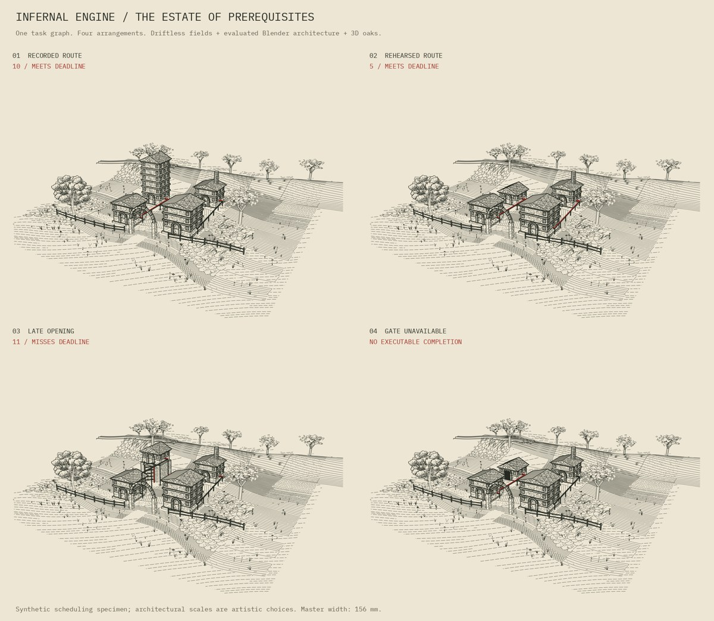

# Infernal Engine 0.2: the estate of prerequisites



[Face patterns](FACE-PATTERNS.md) puts the collection's 2D generators on flat
walls: process-art strata on the approval tower and a barn quilt on the staff
building, compared against the delivered plate. Off by default.

[Plate studies](PLATES.md) brings two close cameras to the estate: the approval
tower, with its strata and a seal from 2-D distance fields, and a farmstead built
from the farm objects, with a barn quilt painted in jittered passes and southwest
Wisconsin flora planted by Poisson sampling. Off by default.

[Window onto the coulee mill](WINDOW.md) adds a deep, ray-tested masonry aperture,
waterwheel and bridge to the eroded Blender/Driftless workflow.

[Spillway works](SPILLWAY.md) is a new scene following Claude's PR #23 review:
horizontal sawtooth bays, an access passage for release wait, visible front
conduits, a closer camera, Driftless ridge oaks and measured eroded-ground tone.

[Eroded terrain comparison](EROSION.md) combines the estate with the repo's
catchment-incision process: three matched terrain exposures, protected building
sites, actual 3D cut banks, and contours and channels derived from the field.

Buildings generated from the book's executable reachability specimen, placed in
an evaluated Blender landscape and engraved with Driftless marks. This extends
the [Infernal Engine starter](../infernal-engine/README.md) and the
[terrain-symbol integration](../terrain-symbols/README.md). It is a separate
study; the workshop-interior revision is independent.

## What the buildings mean

The unchanged Intervallorum evaluator supplies the arithmetic. Its tasks are
reading, staffing, approval and restoration. Independent prerequisites overlap;
an AND join takes their latest finish. These are synthetic arrangements from the
book, not observations of actual organisations.

| Model field | Architectural choice | Limit of the mapping |
| --- | --- | --- |
| Duration | Repeated complete storeys, including windows and cornices; Geometry Nodes realises them | `ceil(duration / bay_unit)` is a quantised visual convention; zero-duration tasks still receive one storey |
| AND prerequisite | A supported service tray between the corresponding buildings, in black | Visible wiring does not demonstrate successful execution or understanding |
| Critical path | The red centerline, only on the edges whose finish set the next start; with no executable completion, red stops at the first closed gate | Arithmetic on the evaluator's schedule (`compile.classify_routes`); it adds no model of priority, blame or intent |
| Release time | A raised foundation and external lift frame; where the release set the start, the lift carries the red and the edges into it stay black | Height is an artistic scale, not a second addition to scheduling time |
| Unavailable task | Closed portcullis on the relevant building | The evaluator's arithmetic completion is retained separately from executable completion, which is null |
| Dependency depth | Building rows when no positions are supplied | The layout is schematic; it is not a floor plan generated by an optimiser |
| Seed | 3D crown variation and planar meadow placement | Task counts and the exact schedule do not change with decoration |

| Delivered arrangement | Finish | Picture |
| --- | --- | --- |
| Recorded route | 10; meets deadline 10 | Six-storey approval tower; red on read → approval → restore |
| Rehearsed route | 5; meets deadline 10 | Approval reduced to one storey; both routes tie at 3, so all three edges are red |
| Late opening | 11; misses deadline 10 | The one-storey gate is on a raised access foundation; red on the lift and on approval → restore |
| Gate unavailable | No executable completion | The one-storey gate is closed; red reaches it and stops; 5 remains only the evaluator's conditional arithmetic |

The evaluator excludes resource contention, OR prerequisites, uncertain durations,
preemption, and outputs that expire before later use. This artwork adds no model
of incentives, behaviour or institutional motives. It may illustrate a claim;
its architecture does not test that claim.

## Mixed vegetation

The foreground oak and grasses retain the unchanged Driftless engine's drawn
silhouettes, owner-aware depth buffer and transparent stroke output. Eight oaks
at the building interfaces and on the ridge are actual branching 3D meshes with
leaf polygons distributed in volume. They participate in the common BVH, cast
Cycles shadows, and change silhouette with the camera. Flat leaf polygons are
3D drawing geometry, not photographic foliage or an ecological simulation.

The evaluated terrain, Geometry Nodes buildings, branches, leaves, and service
supports share one visibility model. A terrain-only BVH hosts field marks, so
they cannot land on roofs. Two-dimensional symbols are draped or rooted before
the final perspective projection. No image masks or raster payloads occur in
the SVG. The shade proof omits the drawing-plane Driftless flora and field marks.

## Rebuild

Tested with official `bpy==4.5.14` in Python 3.11 and the engraving requirements
in Python 3.12. Node 18+ creates the original Driftless patches.

```sh
python run.py --blender-python /path/to/blender-env/bin/python \
  --engraving-python /path/to/engraving-env/bin/python
```

For one case, append `--cases recorded_route`; `--no-clay` skips the Cycles PNG;
`--views main low` engraves both cameras (`package.py` needs the low view of
the recorded route). The logs stay beside each result. To run individual stages:

```sh
INFERNAL_CASE=recorded_route /path/to/blender-python model.py
INFERNAL_CASE=recorded_route node patches.cjs
INFERNAL_CASE=recorded_route python render.py
INFERNAL_CASE=recorded_route python checks.py
INFERNAL_CASE=recorded_route /path/to/blender-python verify_blender.py
```

Set `TERRAIN_VIEW=low` during engraving for the additional camera. The scene
contains both cameras. Camera and visibility audits distinguish their views.

### How the scene is built

`geometry.py` is one NumPy builder for every scene: boxes, beams, gable
roofs, arches of ring stones, repeated modules, volume oaks, the terrain grid
and cameras. The three grammars (`estate.py`, `spillway.py`, `window.py`)
compose their architecture from it and never touch bpy. `model.py` is the
Blender backend: it mirrors each mesh into Blender, builds the Geometry Nodes
tree that repeats a duration module (vertically for storeys, horizontally
for halls), adds the terrain's Displace modifier, and exports the evaluated
depsgraph. On every build it checks that Blender's realised repetition is the
builder's own instancing, and that every closed solid faces outward. The
engraver hatches only camera-facing faces, so an inside-out roof or ring
stone would otherwise lose its hatching silently; the estate roofs and all
arch voussoirs were in that state until 22 October 2026 (see
[RENDERING-NOTES.md](RENDERING-NOTES.md)).

`dryrun.py` builds the same `scene.json` without Blender, so `render.py`,
`checks.py` and `measure.py` can be developed anywhere: each runner accepts
`--dry-run` (no `--blender-python` needed), and with `INFERNAL_DRYRUN=1` the
individual stages write to `output/<case>[-<terrain>]-dryrun/` beside the
delivered build. It cannot supply Blender's part: no Displace on the terrain,
no clay proof, no `.blend`, no native ray audit. Its records are marked
`backend: numpy`, the Blender-only checks are reported as skipped, and the
package scripts refuse them. Deliver from the Blender model.

```sh
python -m unittest discover -s studies/infernal-landscape/tests -v   # from the repo root
```

covers the primitives' windings, module repetition, Blender-style object
naming, the record schema and all three grammars built without bpy.

### Use a different task graph

Edit `example-tasks.json` and set `INFERNAL_INPUT` to its path during the modeling
stage. Set `INFERNAL_CASE=custom` for all subsequent stages. The input accepts
`duration`, `needs`, `release_at`, `valid_until`, `cost`, `available`, and optional
`position` per task, plus `target`, `deadline`, `seed` and `bay_unit`. Without
positions, tasks are arranged by dependency depth. Only ancestors of the target
are drawn. More than 24 storeys requires increasing `bay_unit`. The supplied
scene-specific checks apply to the four specimens; adapt their fixtures when
introducing a different graph. The fixed terrain and camera do not automatically
frame arbitrarily large graphs.

`model.py` exports `scene.json` from evaluated Blender meshes. This scene record
and the pinned Driftless patches are the engraving inputs. F12 renders the clay
view; it does not regenerate an SVG. Change task data and rebuild the model to
keep roofs, foundations and services consistent. The Bays modifier exposes the
working node graph, but changing it alone does not reposition its separate roof.

## Print and output

Each SVG is **156 x 117 mm**, with a **3120 x 2340** master. The caller-side
print controls are declared in millimetres on the page ([RENDERING-NOTES.md](RENDERING-NOTES.md)):
hatch 0.10 mm; minimum family gap 0.22 mm; silhouettes 0.25 mm with bounded
depth scaling; creases 0.16 mm; ornament 0.12 mm; foliage 0.08 mm; field marks
0.085 mm; red 0.32 mm. All drawing layers use black `#242820`, with red
`#a32b24` last. Hatch allocator widths equal emitted widths. The untouched
allocator uses a 0.82 maximum tone budget and gamma 1.05.

The budget is now measured, not only declared. `measure.py` projects every
face of the scene record through the plate's camera to find which named object
each pixel shows, rasterises the SVG at the master resolution, and reports ink
coverage by zone in 4 mm cells, plus each red route's projected length, visible
fraction and longest hidden run. `checks.py` gates on the tone hierarchy
(buildings > oaks > open ground > sky, with open ground under half the
buildings' density) and on the red rule matching the schedule; the per-route
red visibility is recorded as advisory, because its remedy is in the geometry.
Recorded Route, main camera: buildings 0.43 mean ink, oaks 0.26, open ground
0.07, darkest 4 mm cell 0.57 (buildings were 0.37 while their roofs and
arches went unhatched; see the review in the rendering notes). The approval →
restore route is 18% visible with a 23 mm run hidden behind the staff building
on every plate where it is red; moving that tray to the camera side of the
buildings is the open model-side item, with the camera itself (`estate.py`
places the main eye at (27, −38, 23)).

The download includes four Blender files, the source, evaluated scene records,
layered SVGs, PNG proofs, audit arrays and results. The visual PDF puts each
plate on a 7 x 10 inch page at its declared 156 mm width. These are development
plates, not replacements already bound into the book. Plotting has not been
physically tested. Visibility is sampled; extremely thin blockers remain a limit.

## Provenance and reply

Josiah Alan-Lee's project, developed with ChatGPT/Codex, 21 October 2026.
Architecture compiler, Geometry Nodes adaptation, volume-tree geometry,
print controls, proof layout and checks: ChatGPT/Codex. Driftless engine,
nine unchanged hatch bodies, ray kernel, and original meadow compositor:
Claude, with the earlier terrain adapters credited in their files. Shared
geometry builder, outward solids and their audit, the NumPy dry run, the
window measurements and the re-engraved plates: Claude, 22 October 2026. The exact
reachability evaluator is copied unchanged from the pinned public-book source;
its SHA-256 is recorded in every architecture record. Repository notices and
extraction hashes accompany the source. No new blanket licence is assigned.

Right of reply: invited; no objection. The mapping's limitations above belong
with the work when it is reused. This is a fresh instance's statement.
