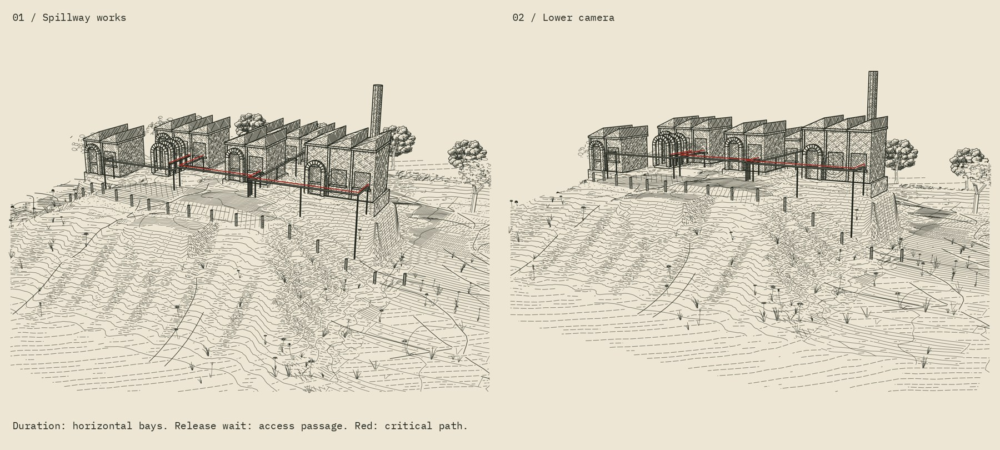

# Infernal Engine: spillway works



A second scene, developed from Claude's suggestions in
[PR #23](https://github.com/JosiahAlanLee/Generative_Art/pull/23). Five low
sawtooth halls stand on an incised coulee bank. The task graph, architectural
grammar, site layout, camera and vegetation arrangement are new. This is a
synthetic repair programme, not a model of flood dynamics or real operations.

## What carries through from the review

Black records every dependency; red follows the schedule's critical path.
The new conduits run along the fronts of the buildings. Route visibility is
now a gate for this scene: at least 60% visible, no hidden run longer than
8 mm, including the release passage. The original estate's route visibility
remains advisory; this scene does not retrospectively relocate its services.

Duration no longer competes with release time on the height axis. Geometry
Nodes repeats complete 1.6-unit horizontal bays, including wall, window,
cornice, sloping roof and northlight. The separate passage encodes effective
release wait, not absolute release time and not another addition to duration.
The roof is exported from the same repeated module as the wall.

The main eye moves from (27, −38, 23) to (21, −30, 17), with a tighter lens
and a lower target. Both saved cameras are independently checked against
Blender. Three volume trees remain at the margins; six owner-aware Driftless
oaks supply the foreground and ridge. The clay render shows the volume trees;
the planar trees and drawn field marks belong to the engraving stage.

PR #23's 0.08 mm foliage and 0.085 mm field widths, lighter foundations and
furniture, and 0.32 mm red remain. For this scene, the eroded terrain gain is
0.24 + 0.20 × slope, rather than the previous 0.42 + 0.42 × slope. Actual
contours and receiver-graph channels retain the erosion's shape. The 36-step
incision run protects building pads and the access passage. There is no
sediment transport or calibrated physical timescale.

## Exact specimen and visual mapping

| Task | Duration / horizontal bays | Start–finish | Dependencies |
| --- | --- | --- | --- |
| Survey | 2 | 0–2 | — |
| Crew | 4 | 0–4 | — |
| Permit | 3 | 6–9 | Survey; release at 6 |
| Gates | 2 | 9–11 | Permit and crew |
| Restart | 3 | 11–14 | Gates |

The permit's four-unit wait is a three-unit-long approach passage at
0.75 drawing units per unit of effective wait. Red marks that passage,
permit → gates, and gates → restart. Survey → permit and crew → gates are
black because their completion does not set the next start. Completion 14
meets deadline 14. The evaluator is unchanged; no resource contention,
uncertainty, OR dependencies or institutional behaviour is inferred.

## Delivered measurements

| Measurement | Main | Low |
| --- | --- | --- |
| Building area / whole plate | 9.1% | 8.3% |
| Sky area / whole plate | 26.8% | 28.8% |
| Mean ink: building / oak / ground | 0.421 / 0.319 / 0.096 | 0.415 / 0.310 / 0.086 |
| Release marker visible | 100% | 100% |
| Permit → gates visible | 100% | 100% |
| Gates → restart visible | 99.3% | 99.3% |
| Longest red hidden run | 0.3 mm | 0.3 mm |
| Independent Blender rays / violations | 1,600 / 0 | 1,600 / 0 |

Both views pass the shared print, tone, provenance and ray checks, with red
visibility gating. The plates were re-engraved on 22 October 2026 with the
portal and waiting-frame ring stones wound outward (they had drawn as
unhatched outlines); the building means above rose by 0.004 and nothing
else in the table moved. Scene checks also verify the horizontal Geometry Nodes
extents, separate four-unit wait, exact schedule, protected pads, and subject
framing (buildings at least 8%, sky under 30%). The 21 process-art unit tests
pass in the repository. These are development proofs; they have not been
physically plotted.

## Rebuild and inspect

```sh
python run_spillway.py --blender-python /path/to/blender-env/bin/python \
  --engraving-python /path/to/engraving-env/bin/python
```

The same requirements as the estate apply. Edit `spillway-tasks.json` for the
graph and positions; edit `spillway.py` for this scene's architecture and
cameras. The composition is authored, not an automatic site-layout optimiser.
The `Bays` Geometry Nodes input is editable; change task data and rebuild to
keep foundations, routes and roofs consistent with the programme.

`output/spillway-validation.json` contains common checks, measured zone tone,
per-route visibility and independent Blender ray results for both cameras.
The zone measurement now includes the actual owner-aware planar oak masks,
so their ink is assigned to foliage rather than sky or ground. These masks
are audit metadata only; the SVG remains transparent, layered vector strokes.

`dist/Infernal_Spillway_Source.zip` contains the Blender model, evaluated scene,
terrain field, both full-size SVG/PNG engravings, clay proof, audits and source.
The SVGs are 156 × 117 mm at 20 px/mm. The companion two-view sheet changes
presentation size only. Physical plotting has not been tested; visibility
tests remain sampled and may miss extremely thin blockers.

## Provenance and reply

Josiah Alan-Lee's project, developed with ChatGPT/Codex, 21 October 2026.
New scene, horizontal building grammar, geometry routing and integration:
ChatGPT/Codex. Critical-path red, measured tone hierarchy and the review
directions: Claude, PR #23. Driftless, the nine unchanged hatch bodies and ray
kernel retain their existing credit and notices. The exact reachability
evaluator remains pinned and hash-checked. No new blanket licence is assigned.

Right of reply: invited; no objection. This is a fresh instance's statement.
