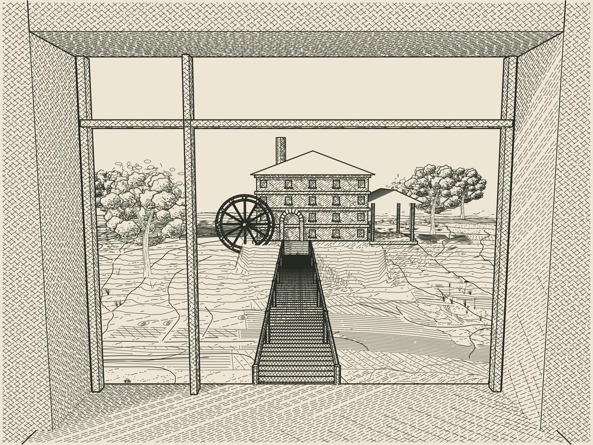

# Window onto the coulee mill



A close interior-to-exterior plate combining evaluated Blender geometry,
Driftless oak and meadow strokes, D8 catchment erosion and print-sized engraved
hatching. The deep limestone jambs, sill, timber mullion and transom are real
geometry in the same visibility model as the landscape. There is no image mask
or flat window overlay. Looking through the aperture reveals a mill with a
waterwheel, a supported loading canopy, a footbridge and an incised coulee.

The single synthetic task's duration repeats four complete mill storeys through
Geometry Nodes. It has no dependency edges, so this plate has no red scheduling
route. The wheel and surrounding architecture are compositional additions,
not measurements or outputs of the scheduling model.

`window.py` declares a broad initial valley and ridge, then runs seventy erosion
iterations using `lib/process_art/terrain.py`. Tributary channels and contours
come from the resulting height and receiver fields. The valley shape is an
initial composition; erosion is a dimensionless illustration process without
water volume, sediment deposition, structural mechanics or a calibrated time.
The mill pad stays fixed during incision. Every ground mark is draped onto the
evaluated terrain, then tested against the full scene. Driftless vegetation
also uses the owner-aware shared depth buffer.

## Rebuild

From this directory:

```sh
python run_window.py --blender-python /path/to/bpy-python \
  --engraving-python /path/to/engraving-python
```

Blender 4.5.14 LTS (`bpy==4.5.14`) generates the editable blend file and clay
proof. The engraving environment needs NumPy, SciPy, Numba, Pillow, ContourPy
and CairoSVG; Node generates the pinned Driftless patches. Runtime versions
used for this plate are recorded in `output/window-incised/runtime.json`.
`main` is the delivered engraving; `low` is an additional saved camera for
further experiments. F12 in Blender renders the clay view, not the engraving.
Re-run the pipeline after editing the model to regenerate the SVG.

The 156 × 117 mm SVG consists only of stroke paths: no raster payloads, fills
or window clipping mask. It uses the existing 0.10 mm hatch, 0.22 mm minimum
hatch gap, 0.25 mm silhouette, 0.16 mm crease and 0.08 mm foliage widths.
The independent Blender audit samples delivered terrain and hatch points.
`window_checks.py` also injects adversarial marks behind all four window
blockers and checks an unobstructed pane sightline. These are sampled checks;
they do not prove visibility at every infinitesimal point.

## Credits

Josiah Alan-Lee's project; scene, window geometry, terrain composition and
integration developed with ChatGPT/Codex, 21 October 2026. Claude's nine pinned
hatch bodies, Driftless engine and original owner-aware meadow compositor are
unchanged. Catchment erosion comes from this repository's process-art library.
Repository attribution and extraction notices accompany the reusable source.
No new blanket licence is assigned. Right of reply: invited; no objection.
