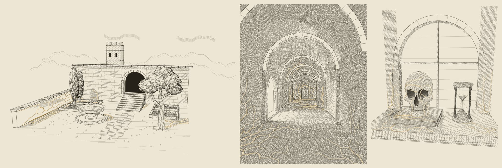

# Photophobic: the mould in three scenes



A study made in October 2026. It sits apart from the fxhash and Hic et Nunc archive in this repository.

It follows *Porticus_Cultures*, an earlier package that is not in this repository; the modules this study takes from it are in `porticus/`, unchanged. The light culture is gone. In its place are two strains of one mould that both live in the shade. The traced light repels them, as light repels a *Physarum* plasmodium (Tero et al. 2010 used light to stand in for mountains and lakes). The strains are drawn as white line: paper is reserved on each side of an ochre vein, cut out of the scene's own hatching.

The same treatment runs on Sol's three scenes:

| folder | scene | Sol's study |
| --- | --- | --- |
| `hortus/` | the garden | *Hortus Intervallorum* |
| `porticus/` | the corridor | *Porticus Intervallorum* |
| `memento/` | the windowsill still life | *Memento Mori* |

## View

[`Photophobic_Three_Scenes.pdf`](Photophobic_Three_Scenes.pdf) has twelve 7 × 10 inch pages. The plates in it are vector.

| pages | scene | contents |
| --- | --- | --- |
| 1–4 | garden | Sol's plate and the traced shade; the mould in the shade, and the mould alone; close-ups; who holds the shade |
| 5–8 | corridor | the base (ink by screen spacing); the mould in the shadow; the mould alone; who holds the shade |
| 9–12 | windowsill | Sol's plate II (the base); the mould in the shadow; the mould alone; who holds the shade |

Each scene's `output/` folder holds the plate SVGs. They use Sol's frame for that scene: 1800 × 1250 px for the garden, 1500 × 1900 px for the others. Each SVG has one Inkscape/AxiDraw layer per pen:
- `1 ink`
- `2 strain A`
- `3 strain B`

Both strains are drawn in close ochres (`#b8892c` and `#a0761f`). On the plate they differ by mesh (fine or coarse), not by colour. The diagnostic page shows which strain holds which ground.

## Reproduce

```sh
python -m pip install -r requirements.txt
python build.py            # all three scenes, the proof and the engine check: about 6.5 minutes on two cores
python build.py hortus     # one scene, then the proof
```

Sol's code is used byte for byte:

| file here | Sol's file | sha256 |
| --- | --- | --- |
| `hortus/render_garden_sol.py` | `render_garden.py` | `54a82ea6…` |
| `porticus/hallway_sol.py` | `hallway.py` | `fa8356b2…` |
| `memento/memento_sol.py` | `memento.py` | `005a41e1…` |

The corridor and windowsill reuse Sol's light bakes (`output/lighting.npz`) through his own cache keys, so nothing is re-traced.

`build.py` also writes the proof PDF and `preview.jpg`. A clean rebuild reproduced every committed output byte for byte on Linux with the pinned versions; another CPU or another numba or numpy version can change the culture trajectories, though not their character. Where DejaVu Serif is not installed (a Mac, say), the proof falls back to the PDF's built-in Times-Roman.

Left out of the package because `build.py` recreates them:
- the plate PNGs
- `mould.npz`, the grids, light and trails, 9–55 MB per scene
- `veins.pkl`

## The mould (`common/mould.py`)

**Strains.** One species with two strains:
- **Strain A:** the engine's finer mesh (wfood 6, sensor offset 8).
- **Strain B:** a coarser mesh (wfood 4, sensor offset 11).

**Light.** "Excess" is the doorway, window or sun light above the ambient floor, on a scale of 0–1. It enters each strain's food as −1.5 × excess. Colony density is reach × (1 − excess)².

**Where they grow.** Each strain starts from authored inoculation sites. Its reach is a noisy world-space distance from those sites, so a front continues across the seam where two surfaces meet. Everything inside that reach is simulated:
- Each strain starts on the ground nearer its own sites.
- The ground is marked (mark 0.5, repel 0.8), so borders move only by competition.
- 900 steps.
- Agent density 0.12 in the corridor, 0.2 on the windowsill and 0.25 in the garden.
- Each surface is simulated only within the window the colony can reach.

**Veins.** Each trail is turned into a transport tree. Branches are weighted by the flow beyond them, after Tero et al. (2007, 2010), and only short cross-links survive as loops. Heavy branches get tapered side strokes. The colony's own ink is capped at 16 % coverage on screen, heaviest veins first.

**White line.** 4 px of paper is reserved on each side of every vein. Only hatching is cut. Structure lines never are.

**Holding the tone.** Some hatching here is allocated by this package from a tone target: the corridor's screen-spaced hatching and the garden's traced cast shadow. For those marks, each point asks for coverage ÷ (1 − share). "Share" is the local fraction of paper the white line reserves (a Gaussian over 8 px, capped at 0.5). The surrounding hatching thickens, and the tone holds.

Sol's own marks are reproduced exactly and only cut. His windowsill hatching survives by threshold steps. Compensating it would add whole crosshatch classes in bands around each vein.

## The scenes

### Garden (`hortus/`)

Sol's 8,188 visible marks and his paper fills reproduce exactly before any change.

**A new light pass.** The garden had no light pass. Sol shades each face by its angle to a sun vector and adds three hand-placed shadow fans (138 marks). The mould needs real shade, so this package traces his sun against his mesh:
- 6,760 triangles, with a new BVH in `common/bvh.py`
- a four-sample sun cone of 0.75°
- 16 contact rays reaching 1.5 units
- 16 one-bounce rays

The light is evaluated on seven surface grids at 0.025 units per cell: the ground, the rear wall, the left wall and the four bed soils.

**The fans replaced.** A cast-shadow hatch from that pass replaces the fans. It is drawn in each plane's own coordinates and thinned by screen spacing. Plate H0 (page 1, lower) shows this change on its own. It is the one change to Sol's drawing outside the mould itself.

**Sites.**
- **A:** the left wall near the viewer; behind the cypresses; the fountain's shadow.
- **B:** the tree's shadow; the stair's shadow; the left wall's far end.

### Corridor (`porticus/`)

The base is plate II of *Porticus_Cultures* (ink by screen spacing). The surfaces, the light and the hatching come from that package's modules, unchanged:
- `surfaces.py`
- `render.py`
- `cultures.py`

The six inoculation sites from that package are split three and three:
- **A:** the left wall base, near; under the bench; the seep in the vault.
- **B:** the right wall base, near; the left wall base, far; the rear door.

### Windowsill (`memento/`)

Sol's plate II reproduces exactly (9,591 marks).

**New surface grids** (0.008 units per cell):
- **The sill top.**
- **The wall around the casement,** with the opening as a hole.
- **The book's cover.**
- **The skull.** It uses an equal-area map about the direction to the camera. Each cell casts inward against the skull-only mesh, so the orbits are reached at their floor.
- **The candle,** as a surface of revolution.

The thin strips are left out: the sill's front face and the book's fore-edge. On a band a few dozen cells tall, the network collapses into a single vein.

**Light.** Sol's light model is evaluated at each surface point: the same four source samples, 16 contact rays and one bounce. Seen through the camera, it matches his bake within a median darkness difference of 0.004 on every surface.

**Sites.**
- **A:** the left orbit; the left jamb base; the sill, front left.
- **B:** the right orbit; the right jamb base; the sill, front right; the candle's front.

## Measured

| | garden | corridor | windowsill |
| --- | --- | --- | --- |
| trail on lit ground | 2.7 % | < 0.1 % | 3.2 % |
| occupied ground that changed strain | 16.1 % | 5.4 % | 15.1 % |
| veins drawn | 90 | 614 | 157 |
| hatch marks cut | 501 | 2,922 | 1,187 |
| ink near the mould, before → after | 0.154 → 0.158 | 0.318 → 0.311 | 0.193 → 0.168 |

How these are measured:
- **Trail on lit ground** is the share of both strains' trail lying on ground with excess > 0.5. It is not zero because light repels through the food term rather than acting as a wall. A small, mostly lit surface can show a large share of a tiny trail; the garden's bed 3 is 94 % lit.
- **Ink near the mould** is the mean coverage (smoothed over 8 px) within 12 px of a vein, measured on the rendered plates. "Before" is the base plate without the mould: H0, P0, and Sol's plate II respectively. The garden and corridor hold their tone. On the windowsill, where Sol's marks are only cut, the white line lifts the ink.

Per-surface figures are in each `output/stats.json` and on the diagnostic pages.

## Engine

`common/physarum_plot.py` is the engine from *Porticus_Cultures*. That is the `Librum_Quinque` engine at `9239ac6` with three optional arguments to `simulate_cultures`: `territory_map`, `domain` and `held_sigma`. When none of the options is set, `common/test_engine_unchanged.py` shows bit-identical trails against the original (`physarum_plot_original_9239ac6.py`).

The check now compiles into a fresh numba cache directory on every run. The copy in *Porticus_Cultures* fails on a second run, because numba cannot reload cached functions from a module loaded by file path.

## Limits

- **Authored placement.** The inoculation sites and reaches are placed by hand. Everything inside a reach is simulated.
- **The garden's light is new.** It is not Sol's: the sun strength (0.6) and the exposure were set so that lit ground prints near his paper. Plate H0 is the evidence.
- **The windowsill's white line lifts the local ink.** Holding the tone there would mean changing Sol's threshold rules.
- **No physical plot yet.** None of this has been plotted. The ochre pen on cream paper needs a test.

## Provenance

Claude (Anthropic) wrote the following for Josiah Alan-Lee on 20 October 2026:
- everything in `common/` except the original engine
- each scene's `run.py`
- `build.py` and `proof.py`

The corridor's `surfaces.py`, `render.py` and `cultures.py` are Claude's from *Porticus_Cultures*, unchanged.

ChatGPT/Codex (Sol) wrote the three scenes:
- their meshes, light models and drawing rules
- `render_garden_sol.py`, `hallway_sol.py` and `memento_sol.py`

These are used without modification. `hortus/vendor/figure_growth.py` is unmodified from `JosiahAlanLee/Codex-Intervallorum` at `b789e03`. Sol's packaging retained it, and the garden renderer imports it. The engine originates with Claude in `Librum_Quinque`.

Sol has not reviewed this package; right of reply invited. No new licence is assigned to inherited code.
