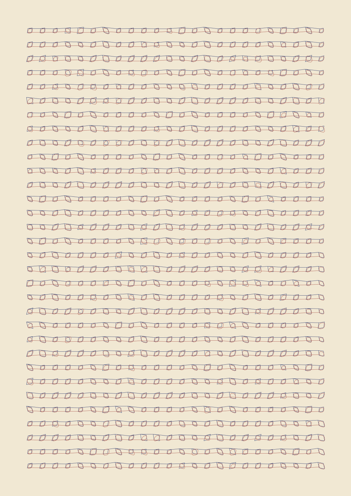

# Motor counterpoint



An offline experiment prompted by Josiah Alan-Lee's Blender Geometry Nodes /
pen-plotter score. One timed motor score produces both a two-ink drawing and
musical events. Python 3.10+ generates it without Blender, Rack, Pd or third-party
Python packages. It does **not** operate a plotter.

The central constraint: two signed motor rates fix pen velocity. You cannot
freely choose two pitches, a drawing and their timing independently. The
acoustic fundamental may follow commutation, a harmonic or a structural
resonance rather than microstep pulses. Supplied profiles are illustrative
assumptions, not settings for a named machine. Physical recordings and controller
identification are required to turn this into a tuned instrument.

## Generate

From the repository root:

```sh
python studies/plotter-score/build.py
python -m unittest discover -s lib/plotter_score/tests -v

# Small first study:
python studies/plotter-score/build.py --rows 4 --columns 8 --bpm 120

# Different kinematics, same musical alphabet:
python studies/plotter-score/build.py \
  --profile studies/plotter-score/profiles/cartesian-demo.json
```

Default: A4 portrait, seed 22, 32 rows × 24 cells per ink, C3-based pentatonic
material, 100 bpm, 30-second audition. Controls: `--seed`, `--root` (MIDI note),
`--rows`, `--columns`, `--bpm`, `--disconnected`, `--audio-seconds`, `--no-audio`,
`--out`. Dense grids, slower tempos or higher pitches can fail the cell-fit
check. Change the inputs; there is no hidden geometry scaling.

| Output | Meaning |
| --- | --- |
| `counterpoint.svg` | Ordered stroke-only indigo/oxide layers, native millimetres |
| `score.json` | Full timeline: coordinates, signed integer motor pulses, milliseconds, pen state, intended notes and assumed acoustic rates |
| `events.csv` | Timeline; intended Vastish V/OCT values, blank for inactive voices |
| `intended-notes.mid` | Full intended two-voice composition on channels 1 and 2; travel and connecting lines are rests |
| `motor-model-excerpt.wav` | Synthetic stereo motor-rate surrogate, **including pen-up travel and links**; motor 1 left, motor 2 right |
| `vastish-excerpt.txt` | Intended-note excerpt for DSP_Emulation's existing headless renderer / Pd qlist dialect; Comb Pluck program, 1.2-second release tail |

The SVG contains no durations. An ordinary SVG plot preserves the drawing but
does **not** reproduce this timeline or promise these pitches. Event-range
attributes connect its paths to `score.json`. Preserve pass/path order,
direction and scale. `vpype` sorting, reversal, merging, simplification, scaling
or driver retiming changes the music. Optimize before compiling the final timed
score, or regenerate the motion and audition afterward.

## How pitch becomes form

The profile matrix maps page displacement in mm to signed motor pulses; its
inverse maps timed pulses back to pen movement. In the illustrative CoreXY
profile, motor1 = 80(x+y), motor2 = 80(x−y). In the Cartesian profile each
motor controls one coordinate.

1. A seeded repeated theme chooses two pitches from a pentatonic collection.
2. Target Hz × assumed pulses per acoustic cycle × leg duration gives an
   integer pulse count. Millisecond durations and integer counts cause reported
   tuning error; equal temperament is approximate.
3. Balanced signs make four-leg and eight-leg closed figures. Pitch ratios
   change proportions; tempo changes physical size. Inactive motors in the
   eight-leg figures are rests in their corresponding voices.
4. Figures connect in rows. Links have their own rates, audible in the motor
   surrogate. `--disconnected` replaces links with pen-up movements, still audible.
5. Indigo runs first, oxide second. These are sequential ink passes, not
   simultaneous colored voices. Both motors can sound in each pass. The manual
   pen change is an explicit untimed boundary.

The checked default build (seed 22, 32 × 24, 100 bpm) has an ideal timeline of
1,373.842 seconds, about 27.33 m of pen-down movement and a maximum rounding
error of about 10.12 cents. Homing, startup, manual pen-change time and return
home are excluded. These are score metrics, not measured physical performance.

## DSP_Emulation bridge

No DSP code is copied and no audio engine changes are needed.

| Destination | Route |
| --- | --- |
| Vastish in Pd | Sequencer playing `intended-notes.mid` → `pd/vastish/vastish.pd` |
| Vastish in Rack | Sequencer/DAW MIDI → Rack MIDI-CV → Vastish V/OCT and GATE; assign channels 1 and 2 to voices/modules |
| OTIS | Load a rendered WAV; choose a channel or downmix the stereo surrogate for the mono sampler |
| Spoon Bender | Process the synth or a physical plotter recording, then capture into OTIS using the existing chain |

Vastish uses 0 V = MIDI 60; CSV columns give `(note−60)/12` volts. CSV is an
interchange record, not a ready-made Rack automation player.

For actual portable Vastish rendering without Rack or Pd, place a current
`DSP_Emulation` checkout alongside this repository:

```sh
g++ -O2 -std=c++17 ../DSP_Emulation/vcv/vastish/tests/render.cpp \
  -o /tmp/vastish-render
/tmp/vastish-render studies/plotter-score/out/vastish-excerpt.txt \
  studies/plotter-score/out 24000
```

This unchanged existing renderer writes `vastish-excerpt.wav`. Integration was
exercised against DSP_Emulation commit
`e8b559ddf24486c732ad4287a02d53227938ca0a`, with zero engine faults. This is a
synth interpretation of intended notes, not a physical-motor simulation.

## Physical-performance boundary

The author's hardware target is an **A4 iDraw**, confirmed 22 October 2026.
The study's 210 × 297 mm page matches that nominal paper size. The exact iDraw
revision, usable travel, controller/firmware and motor conversion have not yet
been verified. Neither demo profile is a calibrated iDraw profile.

The model checks page bounds, pulse-rate limits, tool speed, closure and
quantization. It reports velocity jumps but does not plan acceleration,
cornering, torque, missed steps or controller buffering. Instantaneous polygon
reversals require a different motion plan on hardware. Audition oscillator
envelopes prevent clicks; they do not simulate that plan. Nominal 120 ms pen
actions also require actual servo measurement. There is no serial/G-code export.

The next adapter needs the plotter/controller model, firmware, kinematics,
microstep setting, mechanical conversion and known-rate stroke recordings.
Measure each motor alone and together at several rates, loads and directions.
A constant pulses-per-cycle factor may fail; use measured stable bands or a
lookup table when it does. Compile bounded acceleration transitions, then
recompute geometry, timing and pitch before emitting device commands.

Official sources checked 22 October 2026:

- [EBB command set](https://evil-mad.github.io/EggBot/ebb.html): step counts,
  durations and mixed-axis interpretation; a possible adapter, not a claim
  about the author's machine.
- [AxiDraw Python API](https://axidraw.com/doc/py_api/): SVG/interactive XY,
  acceleration and constant-speed options. Constant speed alone does not make
  SVG playback pitch-calibrated.
- [Vastish manual](https://github.com/JosiahAlanLee/DSP_Emulation/blob/e8b559ddf24486c732ad4287a02d53227938ca0a/vcv/vastish/docs/MANUAL.md)
  and [OTIS manual](https://github.com/JosiahAlanLee/DSP_Emulation/blob/e8b559ddf24486c732ad4287a02d53227938ca0a/vcv/otislab/docs/MANUAL.md).

Original Python geometry, score and exporters prepared with ChatGPT/Codex,
22 October 2026, from the author's reference and brief. Reference photograph
not bundled; no third-party generator or DSP source copied.
