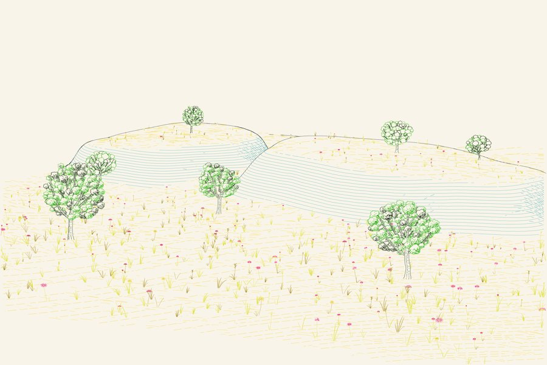

# Prairie bluffs and oaks — CMYK engraving



A variation of the evaluated Blender / Driftless terrain integration. Rounded,
eroded bluff shoulders rise above open prairie, with nine seeded oak symbols
and hundreds of grass / flower symbols. Limestone strata follow the terrain triangles;
plant strokes remain upright. Both are clipped against the evaluated Blender
mesh and the inherited owner-aware plant silhouettes. There are two cameras.

Four process-ink channels replace the previous drawing palette. The ground is
primarily yellow, limestone is cyan, oak foliage combines cyan and yellow with
a black key, and flowers introduce magenta. Crosshatch families remain separate
during ink allocation. No registration offset is applied, so ink separation
does not move a clipped path through an occluder.

## Files

The build writes the following to `output/`:

- `Prairie_CMYK.png`: warm-paper preview, calculated from the four channel masks.
- `Prairie_CMYK.svg`: editable C, M, Y and K ink groups using multiply blending.
- `Prairie_CMYK.tif`: actual four-channel, 8-bit device CMYK, LZW compressed.
- `Prairie_CMYK_C.svg`, `_M.svg`, `_Y.svg`, `_K.svg`: black separation masters
  with tonal stroke opacity, plus matching PNG separations.
- `Prairie_CMYK_Separations.png`: four-color separation contact sheet.
- `Prairie_CMYK_Low.*`: the same scene from the lower camera.
- `Prairie_Bluffs_CMYK.blend`: editable terrain, live displacement, cameras,
  lighting and materials. The vector plants are created by the drawing stage;
  they are not volumetric Blender trees.
- `scene.json`, `.npz` audits and JSON check results: evaluated geometry and
  delivered visibility evidence.

The SVG's nominal size is 300 × 200 mm; the 2400 × 1600 TIFF has matching
203.2 ppi metadata. The TIFF is unprofiled device CMYK. A printer's output
profile and physical proof are required to predict press color. The warm-paper
preview is an illustrative subtractive composite, not an ICC soft proof. The
SVG's process ink colors and CSS multiply style are screen-viewing conventions;
the TIFF and separation masters carry the channel values directly.

## Rebuild

Use Blender 4.5 LTS (or the official `bpy==4.5.14` wheel with Python 3.11),
Python 3.12 with `requirements.txt` for vectors, and Node 18 or newer.

```sh
blender --background --python model.py
node patches.cjs
python render.py
TERRAIN_VIEW=low python render.py
blender --background --python verify_blender.py
python checks.py
TERRAIN_VIEW=low python checks.py
python package.py
```

For the official bpy wheel, replace each Blender invocation with that
environment's `python script.py`. Each scene stage uses at most four threads.
The final vector drawing is generated from the exported evaluated geometry;
pressing F12 produces the Blender clay proof instead.

Bluff relief, terrain grid, seed texture and cameras live in `model.py`.
Plant placements, prairie density, strata and stroke-to-process-ink assignments
live in `render.py`. `patches.cjs` samples six oak crown variants and 92 meadow
variants from the unchanged Driftless Plates engine. There are no farmland
patches, pines, architectural objects or imported picture assets.

## Checks and limits

The checks compare camera projection with Blender's native camera API, test
delivered terrain / hatch points against scene visibility, inspect plant owner
depth, exercise genuinely hidden strata, and compare every TIFF channel byte
against its separation mask. The native Blender ray test independently reopens
the model and samples both views, including a deliberately buried point.
Upstream hatching function and engine hashes are checked as well.

Visibility is sampled. Ground strokes use 0.012 world-unit sampling; upright
symbols and background clipping use the inherited 0.55 pixel samples and 2×
silhouette buffer. Very thin objects can fall between samples. Plants occupy
upright drawing planes, have no volume and cast no shadows. The downward host
projector assumes a height surface, so overhangs need a different atlas. This
is a stylized prairie / limestone study rather than a surveyed place or a
botanically exact restoration model.

## Provenance

Project: Josiah Alan-Lee. Prepared with ChatGPT/Codex as a variation of
`studies/terrain-symbols` after its merge in Generative_Art PR #17.

Claude's Driftless Plates 1.2.0 engine, nine Porticus hatching function/class
bodies and ray kernels are unchanged. The plant compositor and mask-capture
adapter inherit Claude's meadow work and the previous perspective adaptation.
ChatGPT/Codex supplies the prairie relief, evaluated terrain adapter, scene
composition, four-ink separation exporter, native ray checks and packaging.
Inherited notices, extraction hashes and the IBM Plex Mono font license remain
in `vendor`. No new blanket license is applied.
