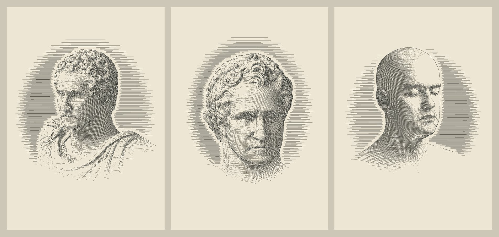
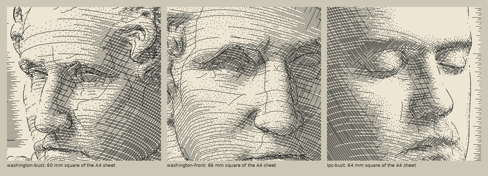

# Scan portraits



Portrait plates for the pen plotter, drawn from two Creative Commons head scans by ray tracing. Each plate is a stroke-only A4 SVG inside the Codex plot master's extent, with hidden lines removed, tone carried by hatching and stipple, and a ruled ground behind the head.

The engine is Scanned Statue v2's, set for a head that fills the sheet rather than a figure in a niche. Its ray kernels, mesh level sets and suggestive contours are imported from that study unchanged. New here are the subjects, the portrait light, ridge and valley lines, cross-hatching that chooses its direction, a stipple for the light half-tones (placed by the collection's [thi.ng Poisson-disc port](../../lib/halftone/poisson.py)), a ruled ground with a halo, and a vignette.



## Subjects

| | George Washington, after Ceracchi | Lee Perry-Smith |
| --- | --- | --- |
| What it is | Marble bust, ca. 1819, after Giuseppe Ceracchi's 1792 original; Smithsonian National Portrait Gallery, NPG.70.4 | A photogrammetry scan of a living man's head and shoulders, by Lee Perry-Smith of Infinite-Realities |
| Licence | CC0 (public domain dedication) | CC BY 3.0: credit required, and changes must be indicated |
| Copy used | [`pyvista/data@5a3de12`](https://github.com/pyvista/data/tree/5a3de12d34c24aa5dd5e5db1cbc2defebc0d4da3/Data/washington_bust), which mirrors the Smithsonian release and quotes its CC0 statement | [`three.js@r150`](https://github.com/mrdoob/three.js/tree/r150/examples/models/gltf/LeePerrySmith), with the scan's licence file |
| Mesh | 150,000 triangles, 75,004 vertices | 17,684 triangles, 8,844 positions |
| Drawn from | Loop-subdivided once: 600,000 triangles | Loop-subdivided twice: 282,944 triangles, plus the colour map for local tone |
| Eyes | Carved, without pupils | Closed |

The files in [`models/`](models/) are byte-identical to those copies (`checks.py` tests their hashes); the Washington OBJ is stored gzip-compressed. Each plate's SVG carries the subject's credit in its `<desc>`.

Both are the best freely licensed heads this environment could reach. Ten24's free head scan is licensed for non-commercial use only, and the Lincoln life mask has closed eyes and no back of the head. The Smithsonian's own 3D site and Infinite-Realities' original download could not be reached from here, so the CC0 and CC BY terms are as recorded in those two copies.

## Plates

| Plate | View | Pen down | Pen up | Paths | Of them dots | Estimated plot |
| --- | --- | --- | --- | --- | --- | --- |
| [`washington-bust.svg`](output/washington-bust.svg) | Head and drapery, a strong three-quarter turn | 44.7 m | 17.2 m | 8,963 | 3,260 | 1.2 h |
| [`washington-front.svg`](output/washington-front.svg) | Head, full face | 42.0 m | 18.9 m | 11,203 | 4,967 | 1.4 h |
| [`lps-bust.svg`](output/lps-bust.svg) | Head and shoulders, three-quarter | 40.6 m | 10.9 m | 5,662 | 3,342 | 0.9 h |

All three are drawn for a 0.15 mm pen with hatch candidates 1.75 pen widths apart. The estimate assumes 25 mm/s drawing, 50 mm/s travel and a quarter second per pen lift. Every dot is a lift, so the stipple accounts for 14–21 minutes of each estimate; `--set dots=0` draws a plate without it. Settings, line lengths per layer and the camera are in each `output/*-report.json`.

Each SVG has one Inkscape/AxiDraw layer per stroke class, all in the Codex ink:

1. `1 ground`
2. `2 hatch`
3. `3 cross-hatch`
4. `4 stipple`: each dot a ring of 0.05 mm radius, which the pen fills
5. `5 fold lines`: suggestive contours, ridges and valleys
6. `6 outlines`

The layers are drawn in that order, so the outlines go down last. Each layer is ordered to shorten pen-up travel. The preview widths differ by layer (outlines 1.25 pens), but one pen can plot them all; for a heavier outline, plot layer 6 with a broader pen.

## Run

Tested with Python 3.13 and the same pinned packages as Scanned Statue v2, whose folder must sit beside this one:

```sh
python -m pip install -r requirements.txt
python build.py                    # the three plates, preview.jpg, detail.jpg and manifest.json: about 3¼ minutes on two cores
python checks.py                   # about a minute, including one plate rebuilt from scratch
python portrait.py --subject washington --view profile
python portrait.py --subject lps --view head --pen-mm .1
python portrait.py --subject washington --view front --sheet codex --set head_mm=110
python portrait.py --subject washington --view bust --set key_azimuth=40 --set gamma=1.4
python portrait.py --subject lps --view bust --set dots=0          # lines only, no stipple
```

`--set` takes any view, light or tone setting from `subjects.py`, as JSON or a bare number. Light is cached in `output/cache/`, keyed by geometry, rig and kernel source, so tone and view changes after the first run skip the ray tracing.

| Option | Choices |
| --- | --- |
| `--subject` | `washington`, `lps` |
| `--view` | Washington: `bust`, `head`, `front`, `profile`. Lee Perry-Smith: `bust`, `head`, `front` |
| `--sheet` | `a4`: the Codex plot master, 210 × 297 mm, every stroke within 8–202 × 10–288 mm. `codex`: the book's 7 × 10 in page, 6 mm inside the trim |
| `--pen-mm` | Pen width in mm; candidate spacing and every length threshold scale with it |
| `--spacing` | Closest hatch spacing in pen widths |

## How a plate is drawn

1. **Scan.** Load the mesh and weld vertex records that share a position. Bring it into one frame: z up, facing −y, one unit tall. Loop-subdivide it (`subdivide.py`); the UV layout is refined on the source's seam-split records alongside the welded positions, so the colour map stays aligned.
2. **Light** (`light.py`). For every vertex, store three terms separately: a soft key (a 1.2-unit square light, 49 shadowed samples, high to one side), an unshadowed fill from near the viewer, and ambient occlusion within 0.06 units. The rig is given in azimuth and elevation about the sitter, so it reads the same for both heads.
3. **Candidates.**
   - Three families of plane sections across the surface, set against the camera.
     - The first leans away from the viewer, so each section bows over the form.
     - Two mirror-image families are candidates for the cross-hatch.
   - Interpolated contours, where n·v = 0.
   - Suggestive contours, from Scanned Statue v2.
   - Valley lines (`creases.py`), where the more concave principal curvature is at a minimum along its own direction, and ridge lines likewise for crests. They draw eyelid margins, the line of the lips, the wings of the nose and the hollows between curls.
4. **Visibility.** Cast a ray from every candidate sample to the eye, from a point lifted a quarter of the median edge off the surface.
5. **Tone.**
   - Darkness is 1 − light. Below 0.06 it is left as paper; above that it is rescaled to run from 0 to 1, and ink coverage is 0.85 × d^1.25.
   - On Lee Perry-Smith, the light is multiplied by the colour map's luminance relative to his skin's median, so brows and stubble read darker.
   - A section stays on where coverage × spacing on paper ÷ pen width exceeds its place in a nested 64-step order, so darker passages fill in between the lines of lighter ones.
   - In the light half-tones part of the coverage goes to the stipple instead (step 6): 85 % of it on Lee Perry-Smith and 50 % on the marble, which keeps more of its lines, falling to none by a darkness of 0.75.
   - Past a darkness of 0.45, up to a third of the line coverage moves to the cross-hatch. At each point it goes to whichever candidate family crosses the first at the wider angle on paper: in full above 50°, fading to nothing at 30°. Where neither crosses well, which happens near every silhouette, the first family carries the tone alone.
   - Weak creases are kept only where the form around them is in shade; on a lit plane they read as cracks.
6. **Stipple** (`stipple.py`).
   - The dot coverage the light asks for is ray cast through the camera at 0.1 mm, so dots land only on the visible scan.
   - The collection's Poisson-disc sampler, [`lib/halftone/poisson.py`](../../lib/halftone/poisson.py), places them. Its exclusion radius is read at each candidate from that coverage.
   - A candidate whose dot would touch a drawn line is refused, so the dots sit between the hatch lines and in the open lozenges of the cross-hatch, not on them. The gap is asked for on the 0.1 mm raster, so the closest dots come within a few hundredths of a millimetre of touching.
   - Between the lines the open paper is a set of narrow strips, where the sampler packs tighter than on open ground. So the dot count is compared with what the light asks for, and the packing is corrected and the dots resampled until they agree to within 4 %.
7. **Ground** (`ground.py`). Ruled horizontal lines fill an oval behind the head, kept by the same nested order. The oval is darkest behind the lit side of the face, so that edge carries against it. A 2.5 mm halo of bare paper surrounds the drawn head. Where the vignette has faded the head out, the ground still stays about a millimetre clear of the scan.
8. **Vignette and sheet.** Toward the foot of the bust, ink fades out over an oval, and short pieces are dropped, more strictly the fainter the place. The drawing is centred across the sheet, with its middle at 46 % of the plotting extent's height. It is then clipped to the extent and written as millimetre SVG.

Nothing is fitted to one picture: a subject sets its scan, rig and tone, and a view sets the camera, the vignette and any change of light. The stipple's sampler is seeded from the subject, view and sheet, so a rebuild reproduces every committed file byte for byte.

## Checks

`checks.py` writes `output/checks.json` (not committed). The last run passed all 47:

- **Models:** every model file matches its pinned upstream hash, and both licence files are present.
- **Plates:** each committed plate is stroke-only, has every point inside the plot extent, carries its subject's credit, and has a report whose line totals and path counts match the SVG.
- **Visibility:** each plate's camera is rebuilt from its report and the scan is ray cast at 0.1 mm. Every head-layer point lies on the scan as the camera sees it, to within 0.6 mm. Every ground point lies at least 0.3 mm clear of it.
- **Stipple:** on each plate, the closest dot is 0.21 mm from the centre of any line, where 0.20 mm would be touching; each plate's dot count is within 5 % of what its light asks for; and on a uniform field the sampler packs as `stipple.PACKING` assumes (0.641 against 0.64).
- **Subdivision:** Loop subdivision of a flat sheet stays flat and keeps its UV layout on its triangles, across a seam.
- **Creases:** on a corrugated sheet, valleys and ridges land on the troughs and crests (4 of 4 and 3 of 3 lines).
- **Light:** the key on a sphere follows the cosine law to within 0.004, and a convex sphere gets no occlusion.
- **Ordering:** path ordering keeps every path, and on 400 random segments it cuts pen-up travel from 41 m to 2.4 m.
- **Rebuild:** `lps-bust.svg` and its report, rebuilt from scratch, are byte-identical to the committed files.

## Limits

- **No physical plot yet.** At about 45 m a plate and 0.15 mm lines 0.26 mm apart, plot a test patch first to see whether the paper takes this density.
- **Pens.** The tone assumes a 0.15 mm line. A pen that spreads on the paper darkens every passage; rerun with its real width.
- **The sitters.** The bust is marble: its curls are carved and its eyes have no pupils. Lee Perry-Smith's scan is of a living face, but his eyes are closed, and the three.js copy is a reduced mesh, so his plates are softer than Washington's. Two levels of subdivision round off what the reduction lost; they cannot restore it.
- **Stipple and plot time.** Every dot is a pen lift, which is most of the 14–21 minutes the stipple adds. The dot's size is the pen's: a broader pen makes heavier dots, which `dot_ring_mm` and `dot_gain` can offset.
- **Cross-hatching.** Plane sections cannot cross one another well everywhere. Near silhouettes the cross family is withheld and the first family alone carries the tone, so the deepest shadows there are lighter than elsewhere.
- **The vignette's edge** is ragged by design, but it can leave a few short strokes at the foot of a bust.
- **Likeness.** CC BY covers the scan, not Lee Perry-Smith's likeness. Any use that suggests his endorsement would need more than the licence.

## Provenance

Claude (Anthropic) wrote `portrait.py`, `subjects.py`, `subdivide.py`, `light.py`, `creases.py`, `ground.py`, `stipple.py`, `build.py` and `checks.py` for Josiah Alan-Lee on 22 October 2026. The stipple uses `poisson_sample` from the collection's thi.ng port, [`lib/halftone/poisson.py`](../../lib/halftone/poisson.py), unchanged.

From [Scanned Statue v2](../scanned-statue-v2/README.md), imported unchanged from that folder:
- `raycore.py`: BVH traversal and visibility rays
- `meshlines.py`: level sets chained by edge
- `suggestive.py`: shape operators and suggestive contours

The rule that keeps a hatch section where coverage × spacing ÷ pen width exceeds its rank in a nested order is Sol's (ChatGPT/Codex), from *Scanned Statue*, as v2 reproduced it.

Credits for the scans, as their licences ask:
- *Bust of George Washington*, after Giuseppe Ceracchi, Smithsonian National Portrait Gallery (NPG.70.4). 3D scan released by the Smithsonian under CC0.
- *Infinite, 3D Head Scan* by Lee Perry-Smith, licensed under [CC BY 3.0](https://creativecommons.org/licenses/by/3.0/). Based on a work at www.triplegangers.com; permissions beyond the licence may be available at ir-ltd.net. The three.js copy was converted by Morgan McGuire and Guedis Cardenas. Changed here: Loop-subdivided twice and drawn as a line engraving.

No new licence is assigned to this study's code.

## Sources

- Smithsonian 3D, [Bust of George Washington, NPG.70.4](https://3d.si.edu/), CC0.
- Lee Perry-Smith, *Infinite, 3D Head Scan*, CC BY 3.0, via [three.js r150](https://github.com/mrdoob/three.js/tree/r150/examples/models/gltf/LeePerrySmith) and [keijiro/InfiniteScan](https://github.com/keijiro/InfiniteScan), whose licence file records the conversion credits.
- D. DeCarlo, A. Finkelstein, S. Rusinkiewicz and A. Santella, "Suggestive Contours for Conveying Shape", SIGGRAPH 2003.
- S. Rusinkiewicz, "Estimating Curvatures and Their Derivatives on Triangle Meshes", 3DPVT 2004.
- Y. Ohtake, A. Belyaev and H.-P. Seidel, "Ridge-Valley Lines on Meshes via Implicit Surface Fitting", SIGGRAPH 2004. Its ridge and valley definition is used here, computed from the mesh's own curvature estimates rather than its implicit-surface fit.
- C. Loop, *Smooth Subdivision Surfaces Based on Triangles*, MS thesis, University of Utah, 1987.
