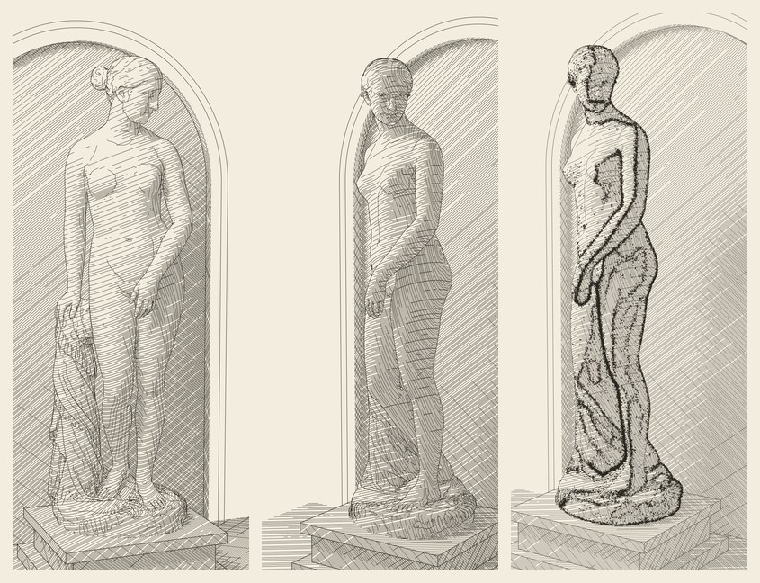

# Scanned Statue v2: where the resolution went



A study made in October 2026. It sits apart from the fxhash and Hic et Nunc archive in this repository.

It follows Sol's two studies of one scan, which are not in this repository:
- *Scanned Statue* renders the scan as a ray-lit engraving.
- *Trail First* runs the Trail First sampler on the same scan from a second angle.

The v1 plates this study compares against are in `reference/`.

Both lost detail. The face came through as a few dashes, and Trail First collapsed into one trunk. This package finds where the detail went and recovers it. Sol's scan, pose, cameras, light, exposure and tone curve are unchanged.

The scan is Hiram Powers, *Model of the Greek Slave* (1843), Smithsonian American Art Museum 1968.155.8, published CC0. All 149,999 triangles are used, and the photographic texture is not.

## View

[`output/Statue_v2_Study.pdf`](output/Statue_v2_Study.pdf) has four 7 × 10 inch pages:

| page | contents |
| --- | --- |
| 1 | the front view, crosshatched (vector) |
| 2 | the second angle, the Trail First camera (vector) |
| 3 | the head before and after, and what changed |
| 4 | Trail First at plate resolution |

The plates in `output/` use Sol's 1500 × 1900 frame and are sized in millimetres: 148 mm wide, or 296 mm for `front-296mm-*`.

Each engraving SVG has one Inkscape/AxiDraw layer per stroke class, all in the same ink:
- `1 setting`
- `2 hatch`
- `3 cross-hatch`
- `4 fold lines`
- `5 outlines`

| plate | what it is |
| --- | --- |
| `front-cross.svg`, `front-contour.svg` | v2 of Sol's `03-cross-engraving.svg` and `02-contour-engraving.svg` |
| `second-cross.svg`, `second-contour.svg` | the same at the Trail First camera |
| `front-296mm-cross.svg`, `front-296mm-contour.svg` | the front view laid out for 296 mm, same pen |
| `trail-original-plate-scale.svg` | Sol's Trail First rules, unchanged, on a 0.12 mm grid |
| `trail-guided-plate-scale.svg` | Sol's contrast-guided extension on the same grid |
| `trail-network-20000.svg` | guided food and swarm, with marks placed on the trails (new) |

Each Trail First plate also comes as `-supported`, which adds `second-cross` beneath it at 72 % opacity, as in Sol's plate 08.

## Reproduce

```sh
python -m pip install -r requirements.txt
python build.py              # every plate, the proof, preview.jpg and manifest.json: about 4½ minutes on two cores
python engrave.py --camera front --plate-mm 210 --pen-mm 0.1
python engrave.py --camera second --tone-gamma 0.9 --prefix second-fuller
python trail_v2.py --mode guided --sampling original --cell 1.0 --count 30000 --name trail-finer
```

A clean rebuild from this folder reproduced every file in `manifest.json` byte for byte on Linux with the pinned versions. That covers the plates, the reports, the proof PDF, `preview.jpg` and the manifest itself. The light pass is cached in `output/light-<key>.npz`. Its key covers the geometry, the camera, the samples and the shading source.

Left out because `build.py` recreates them:
- the plate PNGs
- the proof page PNGs
- the light caches

## Where the detail went

Sol's engraving was rebuilt first, and it came out byte-identical to his `03-cross-engraving.svg`. Every figure below is measured against it.

**Outlines.** The GLB is split along its texture atlas: 94,531 vertex records for 74,939 positions, with about 37,000 open seam edges. v1 found silhouettes by vertex index, so they broke at every seam. That gave 4,101 chains with a median of 3 vertices, drawn as dashes. The face profile and the eyelids mostly vanished.
- v2 welds the seams by exact position. This changes connectivity only, not geometry.
- The outline is the zero set of n·v on vertex normals, joined edge to edge: 430 chains.
- Each sample is tested for visibility from a point lifted 0.003 units off the surface, so grazing rays do not clip the outline.

**Fold lines.** These are new: suggestive contours (DeCarlo et al. 2003). They are zero crossings of radial curvature where its derivative along the view is positive and strong. They draw the eyelids, the side of the nose, the line of the lips, the jaw, the hairline and the drapery folds. On a lit face at 148 mm, tone alone cannot carry these. Curvature comes from per-face shape operators (Rusinkiewicz 2004) on normals smoothed over two rings.

**Light.** v1 read the light back from a 600 × 760 screen buffer (750 × 950 at the second camera):
- one ray per texel, flat triangle normals
- 4 light, 16 occlusion and 4 bounce samples
- a 3 × 3 median

That is 2.5 plate units per sample, with stair-stepped dashes and bleed across silhouettes.

v2 evaluates Sol's same shading model in object space:
- each scan vertex: 64 light, 32 occlusion and 12 bounce samples
- each setting face: a texture grid at 0.01 units with 36, 16 and 6 samples
- values interpolated to every stroke sample

Over the statue, mean light is within 0.02 of v1's (0.441 against 0.426).

**Line spacing.** v1 spaced section planes 0.008 scene units apart, about 3.1 pen widths, at any plate size:
- On the lit face, kept lines averaged ~7 px apart, about 14 from brow to chin.
- A bigger plate only spread the same lines out.
- The darkest single-family tone was capped near 32 % ink.

v2 spaces candidates in pen widths on paper (`--spacing 1.75`), from `--plate-mm` and `--pen-mm`. The nested on/off order has 64 steps (v1: 32). Tone is smoothed along each stroke before the on/off test, short gaps are closed, and fragments are dropped.

**What stays.** At 148 mm the face is about 10 mm from brow to chin. Under Sol's tone curve a lit face asks for about 11 % ink; with a 0.09 mm pen that is one line every ~0.8 mm. The outlines and fold lines are what make it legible at this size. For tone in the lights, there are three options:
- plot larger
- use a finer pen
- lower `--tone-gamma` from Sol's 1.30 (0.9 gives 53 m of line at 148 mm, and a visibly fuller face)

## Trail First

The vendor sampler works in grid cells: sensors 6–8 cells, steps of 1.25 cells, 3 × 3 diffusion. v1 loaded every source at 384 px wide and halved it for the swarm:
- One cell was 7.8 plate units on the full frame and 2.45 on the crop.
- On the full frame the sensors reached 47–62 plate units, about a third of the head's height, and the colonies merged into one trunk.

`trail_v2.py` sets the cell in plate units (`--cell 1.25`, 0.12 mm):
- Agents scale with the statue's area: 0.05 per statue cell, 10,450 per colony.
- Mark radii are in millimetres (0.08–0.20), so a finer grid shrinks the network without shrinking the marks.
- Food is v2's statue-only light at plate resolution.
- `vendor/primitive_growth.py` is used unchanged.

At this scale:
- Sol's original rules give a branching network inside the figure.
- Under Sol's guided extension, the trail field traces the face and the drapery, but its marks are placed mostly by food, so they still read as stippling.
- `trail-network-20000` keeps the guided food and swarm, and places marks on the trails by Sol's original rule. The figure is drawn as a network.

The mark budget is the other half of the resolution. Sol's 7,200 marks come to about one per 45 square plate units over the figure. In his three runs, 440–510 of them landed in the head and neck.

## Measured

| | v1 | v2 |
| --- | --- | --- |
| outline chains (front) | 4,101, median 3 vertices | 430 |
| light | 600 × 760 buffer; 4 / 16 / 4 samples | per vertex; 64 / 32 / 12 samples |
| candidate spacing | ~3.1 pen widths | 1.75 pen widths |
| line, front cross, 148 mm | 38.3 m | 39.1 m |
| line, second cross, 148 mm | 48.3 m | 48.7 m |
| line, front cross, 296 mm, same pen | — | 149.9 m |
| ray traversal on two cores | 0.19 M rays/s | 0.64 M rays/s |
| Trail First grid cell (crop) | 2.45 plate units | 1.25 plate units |

Per-plate settings, line totals and paths per layer are in `output/*-report.json`. The Trail First settings are in `output/trail-*.json`.

## Code

- `engrave.py`: the pipeline and its command line.
- `scene.py`: the scan load and weld; Sol's plinth, arch and recess; the camera presets.
- `raycore.py`: BVH traversal (ordered, with any-hit for shadow and visibility rays) and Sol's shading model. Every input is passed as an argument. Sol's kernels read the camera from module globals, which numba freezes into its cache.
- `meshlines.py`: level sets on the mesh, chained by shared edge. The section hatching and the outlines both use it.
- `suggestive.py`: shape operators, then radial curvature, then suggestive contours.
- `trail_v2.py`: Trail First on a grid set in plate units.
- `proof.py`, `manifest.py`, `build.py`.
- `engraving_core.py`: Sol's, used for the setting geometry and RDP simplification. The only edit is `set_num_threads(4)` → `min(4, available)`, because the original raises an error on a two-core machine.
- `reference/`: the v1 plates the proof compares against.

## Limits

- **No physical plot yet.** None of this has been plotted.
- **Scan noise.** Fold lines on a 150k-triangle photogrammetry mesh carry some noise, most visibly on the rough base. `--suggestive-threshold` and `--suggestive-smooth` trade lines for noise.
- **The mesh is the next limit.** It projects to about 3.9 plate units per triangle edge. At 296 mm about five hatch lines cross each triangle, so a much larger plate would want the museum's higher-resolution download.
- **The network variant is new.** `trail-network-20000` combines two of Sol's rules in a way he did not. It is a proposal, not his design.
- **The filled primitives** in the Trail First plates are as in Sol's study; a pen plotter would draw them as dots or need a fill.

## Provenance

Claude (Anthropic) wrote the following for Josiah Alan-Lee on 20 October 2026:
- `engrave.py`, `scene.py`, `raycore.py`, `meshlines.py`, `suggestive.py`
- `trail_v2.py`
- `proof.py`, `manifest.py`, `build.py`

ChatGPT/Codex (Sol) wrote *Scanned Statue* and *Trail First*:
- the scene: plinth, arch and recess
- the cameras, the light model and exposure
- the tone curve, the section-plane families and the retention rule
- the Trail First and contrast-guided sampling rules

v2 reproduces those, and `engraving_core.py` is his file, with one line changed.

`vendor/primitive_growth.py` (`a96a621e…`) and `vendor/trail_study.py` (`7c8cd2f9…`) are unchanged from *Primitive_Growth_Book_Art_Experiment*, as in Sol's package. The scan is the Smithsonian's (CC0; GLB sha256 `85ddf6ce…3d98`).

Sol has not reviewed this package; right of reply invited. No new licence is assigned to inherited code.
