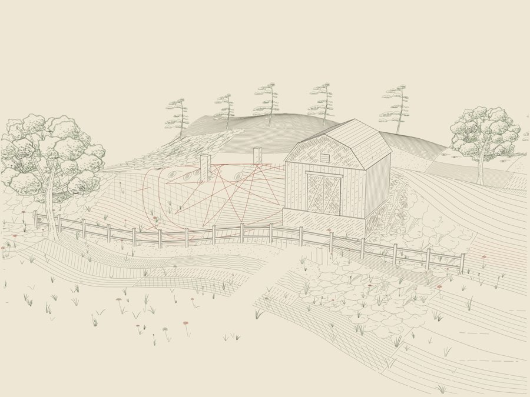

# Driftless terrain symbols — evaluated Blender integration



A terrain / symbol / crosshatching study, built and rendered with Blender
4.5.14 LTS. The same evaluated mesh and perspective camera generate the final
stroke-only SVG. The scene includes a gambrel barn, a two-rail fence, stone
markers, overlapping Driftless trees, meadow plants, field textures, and an
invented geometric rosette. Two camera views exercise different occlusion.

## What is integrated

Ground marks and upright symbols use different mappings:

| Element | Mapping | Visibility |
| --- | --- | --- |
| Driftless farmland and geometric rosette | Sample local 2D paths at 0.010 world units; cast down onto evaluated terrain triangles; lift 0.006 along the triangle normal | Ray-tested against the complete model; split at hidden samples |
| Oak, pine, grass, flowers | Root on the evaluated ground; map their local paths to parallel upright drawing planes | Complete model rays plus the inherited, owner-aware plant silhouette buffer |
| Crosshatching | Two surface / face hatch families, using the perspective Jacobian for spacing | Same complete model; directional shadow and short contact rays |
| Barn, fence, stone edges | Evaluated mesh edges and explicit modeled details | Same complete model |

The terrain has a real Blender Displace modifier. Projection uses its evaluated
triangles, including that modifier, rather than reconstructing the original
height formula. A separate terrain-only projection BVH prevents field marks
from landing on a barn roof. The full geometry BVH then hides those marks where
the barn stands. Missing host hits create gaps. Sampling precedes projection,
so long 2D segments follow the terrain instead of cutting across its folds.

Field / structure ink reserves tone before the two hatch families allocate
their remaining coverage. Upright symbols use the original engine's recorded
leaf / branch silhouettes and halos. A nearer tree can therefore remove field
and hatch strokes without drawing an opaque background shape into the SVG.

## Rebuild

Use a fresh Blender document. `model.py` creates a new scene without deleting
existing scenes. Blender itself or a Python 3.11 environment with
`requirements-blender.txt` runs the modeling stage. The engraving stage uses
Python 3.12, `requirements.txt`, and Node 18 or newer.

```sh
blender --background --python model.py
node patches.cjs
python render.py
TERRAIN_VIEW=low python render.py
blender --background --python verify_blender.py
python checks.py
TERRAIN_VIEW=low python checks.py
blender --background --python add_curves.py
python package.py
```

For the official `bpy` wheel, replace each Blender command with that
environment's `python script.py`. Both Blender and the vector ray kernels use
at most four rendering threads. `TERRAIN_RENDER=0` skips only the Cycles proofs.

`model.py` is the modeling source. `render.py` is the drawing source; re-running
F12 alone does not regenerate the vector engraving. Camera settings live in
`model.py` and are exported into `scene.json`. Rebuild after geometry or camera
changes. Cached Numba kernels receive the current eye and BVH as arguments.

`add_curves.py` adds the mapped fields and 216 upright symbol instances to two
editable Blender collections. They are hidden in Cycles renders by default;
toggle collection visibility to inspect them. These contain the full mapped
strokes, including hidden portions. The vector renderer resolves final ink
visibility. They are not replacements for the terrain host or its geometry.

## Outputs

Rebuilt outputs (large files are excluded from Git):

- `Terrain_main.png` / `.svg`: the elevated three-quarter plate.
- `Terrain_low.png` / `.svg`: the lower view, with more terrain hiding the marks.
- `Terrain_*_unplanted.*`: hatching / structure / fields before upright plants.
- `Terrain_*_plants.*`: the upright symbol layers alone.
- `Terrain_Symbols.blend`: editable terrain modifier, objects, cameras, lighting,
  and, after `add_curves.py`, the mapped stroke collections.
- `blender-main.png`, `blender-low.png`: executed Cycles clay proofs.
- `scene.json`, mapped stroke JSON, and `.npz` audits: evaluated geometry,
  mappings, and delivered sample coordinates.

The download archive includes the mapped Blender curves and audit arrays;
the large intermediate mapped JSON is regenerated by `render.py`.

The SVG has transparent background, separate stroke layers and no embedded
raster, opaque mask, or clipPath. Its nominal drawing size is 240 × 180 mm.
The PNG uses warm paper. The proof does not include a physical plot test.

## Verification and limits

`checks.py` checks the displaced triangle host, projection beneath the roof,
host misses, delivered ground / hatch visibility, planted-owner depth,
reversed plant input order, deliberate hidden-stroke injection, whole-frustum
plant ordering, perspective derivatives, and unchanged upstream functions.
`verify_blender.py` reopens the `.blend` and independently checks 4,800 samples
against native Blender `scene.ray_cast`. Both camera adapters are compared to
Blender's `world_to_camera_view` during model export (under 0.002 pixel error).

Visibility remains a sampled drawing approximation. Field samples are spaced
0.010 world units; plant / background clipping uses 0.55 pixels and a 2×
silhouette buffer. Extremely thin objects can fall between samples. Upright
plants have no volume and cast no shadows. Field texture may contain stylized
vegetation shapes from Driftless's original farmland routine; here they are
ground marks. The terrain-only downward projector assumes a height surface:
overhangs and vertical walls require a different atlas / projection direction.
Blender Cycles and the vector hatching use different light transport.

## Provenance

Project: Josiah Alan-Lee. Prepared with ChatGPT/Codex, 20 October 2026.
Source snapshot: `JosiahAlanLee/Generative_Art` at
`e54ee59fd5391999761a6e9219cf9ec9f0a078dd`.

- Claude: unchanged Driftless Plates 1.2.0 engine; nine unchanged Porticus
  hatching function / class bodies; CPU ray core; original meadow mask capture
  and parallel-plane depth compositor.
- ChatGPT/Codex: Blender terrain / architecture, evaluated-triangle draping,
  shared camera adaptation, composition, native Blender verification,
  editable curve export and packaging. Perspective / plant adapters inherit
  the earlier `studies/three-gates` integration.

Inherited repository notices and extraction hashes are retained in `vendor`.
No downloaded models, raster reference images, or generated-image assets are
used. No new blanket license is applied.
