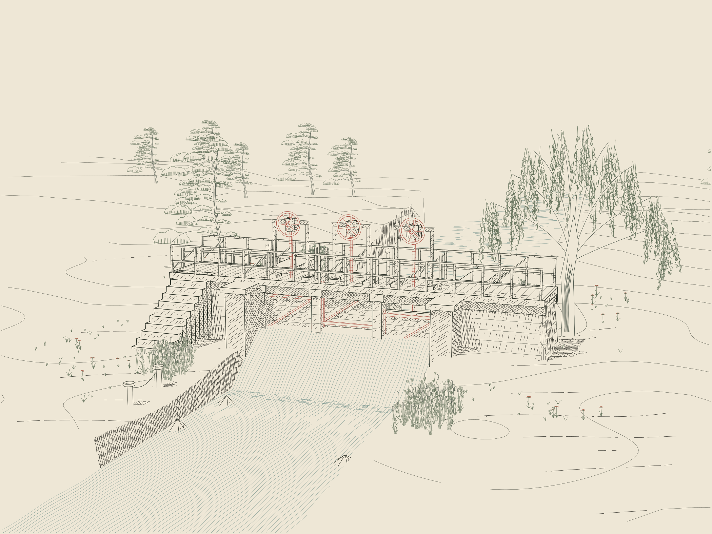

# The Three Gates - lower perspective



A camera and composition variant of the sluice study. The bridge is viewed
from a lower three-quarter angle with a perspective camera. The banks and river
continue beyond the picture rather than ending as a visible model tile. Small
pines on the extended terrain supply a distant band.

## View and rebuild

The finished PNG/SVG, camera comparison and recorded manifests are committed.
The other outputs listed below are generated by `render.py`.

- `output/03-three-gates.png` / `.svg`: the finished perspective drawing.
- `output/01-massing.png`: the mesh rendered through the same camera.
- `output/02-engraved.png` / `.svg`: architecture, terrain and water without plants.
- `output/04-landscape.png` / `.svg`: the plant drawings alone.
- `output/00-orthographic-reference.png`: the previous camera for comparison.
- `output/camera-comparison.png`: the two drawings side by side.
- `output/three-gates.obj`, `.mtl` and `scene.json`: the modeled scene and camera.

From this directory, use Python 3.12, Node 18 or newer, and the supplied Python requirements in a dedicated environment:

```sh
python -m pip install -r requirements.txt
python render.py
python checks.py
python package.py  # source/image archive in dist/
```

The delivered run used Python 3.12.14 and Node 24.19.0. The renderer uses a CPU
BVH and Numba. Blender is optional. `open_in_blender.py` reconstructs the model,
perspective camera, lens and image shift. It creates a new scene. It was syntax
checked but not executed in Blender here. Vegetation remains in the SVG and is
not exported as volumetric Blender geometry.

## Perspective changes

The camera looks from `(14, -36, 12)` toward `(0, 1.5, 3.6)`. Its horizontal
field of view is about 35.3 degrees, equivalent to about a 56.6 mm lens on a
36 mm-wide sensor. The principal point is recorded in `scene.json`.

Projection, primary rays, point-to-camera visibility and the screen Jacobian
all use that same camera. The Jacobian supplies perspective-aware spacing to
the unchanged hatch functions. Changing only the final SVG projection would
leave their spacing and the visibility queries inconsistent, so those adapters
are updated together.

Claude's plant compositor still orders parallel vertical drawing planes by
their common normal offset. This remains valid under perspective as long as
every image ray has a positive dot product with that normal. The checks verify
that condition at the frustum corners and center; positive corner values cover
the rectangular frustum. Silhouettes project through the new
camera; primary model depth uses the same perspective rays. Halo widths use
the local camera scale at the instance root, with the existing screen halo
minimum. They remain a drawing approximation, not a volumetric plant model.

## Provenance

Pinned source: `JosiahAlanLee/Generative_Art`, commit
`5bf920e3a7babef8085f67682f9e5212207f487c`.

- Claude: original Porticus hatching, Driftless Plates 1.2.0 and scanned-statue
  CPU ray kernels. All vendor files and the nine extracted hatch bodies remain
  unchanged; extraction hashes and inherited notices are retained.
- Claude: parallel-plane depth compositor from the supplied
  `Receiving_Works_Meadow.zip`. This version adds perspective ray/scale adapters
  and the owner-depth audit.
- ChatGPT/Codex: sluice geometry and willow/reed motifs from The Three Gates,
  this camera adapter, terrain extension, checks and packaging; prepared for
  Josiah Alan-Lee on 20 October 2026.

The new willow and reed heads use Driftless's Scene, local masks and post
processing. Pine, tuft and umbel drawing routines are original Driftless code.
The composition takes its lower viewpoint and overlapping bands from the
original generator's plates; it is not a traced source image.

## Checks and limits

`checks.py` verifies terrain/water intersections, bridge and gate connections,
full plant placements and root heights, source identity, image frames,
stroke-only SVGs and Blender syntax. It also checks the perspective Jacobian
against finite differences, ray/projection round trips, camera-plane depth
ordering and the 2:1 projected size change between equal spans at 30 and 60
units along a view ray. Controlled overlapping plants and an injected illegal
stroke test owner-aware occlusion. The surviving-sample depth audit is included.

Vegetation has no volume and casts no shadows. The lens and camera must be
used to regenerate the drawing; the SVG itself contains only the chosen view.
The sluice is an artistic mechanism, not an engineering design or fluid
simulation. Physical plotting and placement in the book were not tested.
