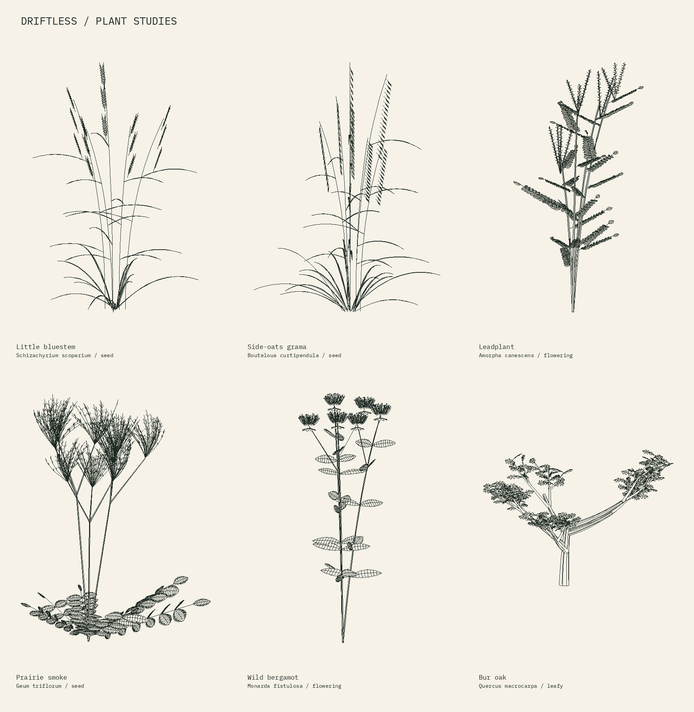
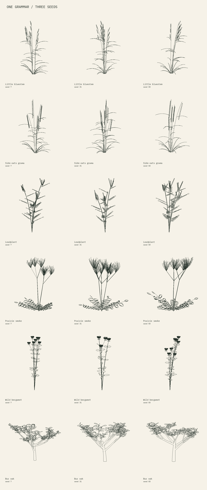
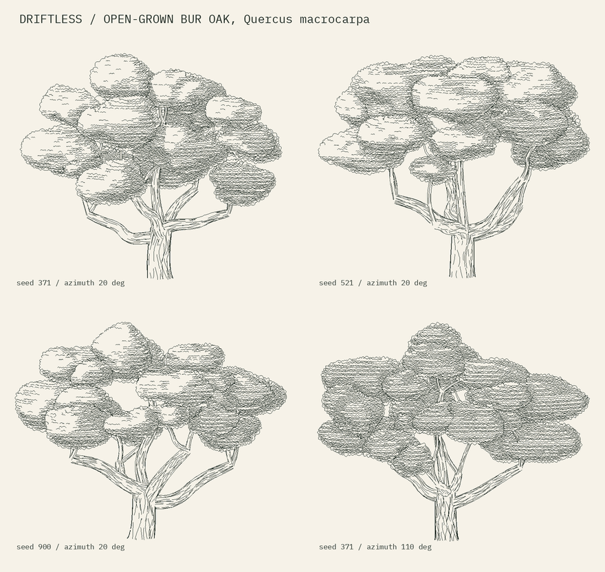

# Southwest Wisconsin plant studies

Six seeded plant grammars for pen plotting, landscape composition and the
Codex. Geometry is generated in Python, in metres with Z up. Each seed builds
new stems, leaves and reproductive structures. These are early illustrative
models informed by regional flora, not botanical identification plates or
simulations of plant development.



## What is implemented

| Generator | Distinguishing drawing rules | Available stages |
| --- | --- | --- |
| Little bluestem / *Schizachyrium scoparium* | Bunched culms, narrow blades, slender terminal and lateral racemes with fine hairs | `seed`, `leafy` |
| Side-oats grama / *Bouteloua curtipendula* | Short pendant spike branches along one side of the upper culm | `seed`, `leafy` |
| Leadplant / *Amorpha canescens* | Several woody axes; alternate pinnate leaves with many small oval leaflets; terminal flower spikes | `flowering`, `leafy` |
| Prairie smoke / *Geum triflorum* | Basal compound leaves, generally three heads per flowering axis, nodding flowers or upright plumed fruit | `seed`, `flowering`, `leafy` |
| Wild bergamot / *Monarda fistulosa* | Opposite leaf pairs rotated between nodes, toothed blades, terminal tubular flower clusters or dry heads | `flowering`, `seed` |
| Bur oak / *Quercus macrocarpa* | Broad low forks, irregular branches, alternate lobed leaves with deep middle sinuses | `leafy`, `bare` |

The bur oak is a **young open-grown tree study**. The mature spreading oak
has its own generator, described in
[Open-grown bur oak for landscapes](#open-grown-bur-oak-for-landscapes). Individual specimens
are fitted independently on the comparison sheet; their displayed heights
are not a comparison of real plant sizes.

## Rebuild and generate variants

From the repository root:

```sh
python -m pip install -r studies/wisconsin-flora/requirements.txt
python -m lib.flora prairie_smoke --seed 83 --stage seed --wind 0.4 --model
python -m lib.flora bur_oak --seed 31 --stage bare --azimuth 60 --detail 1
python studies/wisconsin-flora/build.py
python -m unittest discover -s lib/flora/tests -v
```

The CLI writes a transparent stroke-only SVG and a paper-colour PNG proof.
`--model` also exports the actual 3D surface geometry as OBJ and full surfaces,
intentional ink paths, organ records and parameters as JSON. These large
intermediates are regenerated rather than committed. `build.py --quick` builds
only the six main specimens; `--models` adds their model files.

Controls:

- `seed` changes branch/culm counts, directions, leaf dimensions and placement.
- `vigor` (0.4–1.6) uniformly scales geometry; this is **not** an age or growth
  model. Independent specimen fitting hides that scale difference; it matters
  in shared-coordinate compositions.
- `wind` (-1–1) bends all geometry with the same height-dependent deformation,
  preserving attachments. It is a shape control, not a physical wind model.
- `stage` selects species-specific organs. Stages are independent seeded
  drawings, not time-corresponding meshes; later branches can change because
  their generation consumes random values differently.
- `azimuth` and `elevation` change the projection of the same 3D model.
- `detail` 0/1/2 selects outlines / midribs / secondary veins and fine hairs.



## Use inside another drawing

```python
from lib.flora import Plant, generate
from lib.flora.render import render

scene = Plant({'title': 'Dry prairie edge'})
for i, x in enumerate((-0.6, -0.2, 0.25, 0.7)):
    plant = generate('side_oats_grama', seed=100+i, wind=0.25)
    scene.extend(plant.placed(root=(x, 0.1*(i%2), 0), azimuth=i*37))
drawing = render(scene, width=180, height=120, detail=0)
with open('prairie.svg', 'w') as f:
    f.write(drawing.svg())
```

The combined scene shares a depth buffer: leaves can hide other plants' ink.
Use roots from the existing evaluated-terrain projection when positioning
plants on a landscape. `placed()` takes a 3D root, uniform scale and rotation
around Z. This first study does not replace the landscape's terrain projection
or automatic plant scattering.

`lib.flora.adapters.add_to_scene_builder` passes geometry and explicit ink to
the existing `studies/infernal-landscape/geometry.py` SceneBuilder, including
its BlenderBuilder subclass. The receiving renderer remains responsible for
its camera, tube silhouettes and final hidden-line removal. Its geometry/ink
interface is tested; a full Infernal Landscape plate was not rebuilt here.

In Blender's Python console, with the repository root on `sys.path`:

```python
from lib.flora import generate
from lib.flora.adapters import to_blender
to_blender(generate('leadplant', 22), ink=True)
```

This creates a new collection with joined surface meshes by organ role, plus
optional full 3D ink curves. It never clears an existing scene. The Blender
adapter is supplied but **was not executed in this environment**; no `.blend`
or native Blender render is claimed. This version is Python procedural
geometry, not a Geometry Nodes asset.

## Open-grown bur oak for landscapes



The bur oak above is a sapling drawn leaf by leaf. A mature savanna oak seen
across a field needs a different drawing, so it has its own generator.
[`lib/flora/oak.py`](../../lib/flora/oak.py) builds the tree's geometry, and
[`lib/flora/crown.py`](../../lib/flora/crown.py) draws it for any camera.

**The tree** (`savanna_oak(seed, height, spread=None, stage='leafy', detail=2)`)
follows the open-grown habit, illustratively rather than as a growth model:

- a short trunk with a flared foot;
- four or five heavy scaffold limbs leaving it at staggered heights, some
  nearly level, dipping before they rise;
- a short leader;
- branches and twigs running out to foliage masses spread over a broad crown
  envelope, with sky between them.

Limbs are tapered, crooked tubes. Each foliage mass is a lumpy ellipsoid with a
flattened underside. `detail` changes mesh resolution only, never the tree.
Every mesh is closed and wound outward.

`bare` keeps the same limbs and adds short spurs. It is a skeleton, not yet a
winter study: a winter bur oak's dense twig network is not modelled.

**The marks** come from rasters that the host renderer supplies: which mass
each pixel sees, how far, how high and how dark. `crown.draw_masses` turns them
into:

- rows: contours of world height across each mass, kept by darkness against a
  bit-reversed rank and drawn as chains of small arches;
- outlines: scalloped silhouettes, cut where something nearer passes in front
  and opened on the lit side;
- contact shadow, which darkens a mass where a nearer one overlaps it.

`limb_outline` gives a tube's two silhouette lines analytically, so they are
smooth whatever the mesh. `furrow_keep` chooses which bark furrows to draw from
the bark's darkness and the furrows' spacing on the page.

[`lib/flora/oak_render.py`](../../lib/flora/oak_render.py) draws one tree on its
own, with an orthographic camera and the repository's BVH rays:

```sh
python -m lib.flora.oak_render --seed 371 --height 6.7 --out oak.svg
python studies/wisconsin-flora/savanna_oak.py      # the sheet above
```

The pens are set per layer: rows 0.08 mm, outlines 0.10, bark 0.085, branches
0.10, scaffold limbs 0.16 and the trunk 0.25.

These need SciPy, ContourPy and Numba, as the Infernal Landscape engraving
does; the rest of this study does not. In a landscape, the
[plate studies](../infernal-landscape/PLATES.md) draw these oaks through their
own camera, light and shadows.

The masses are an engraver's convention, not leaves. Acorns, leaf lobes at
this scale and the corky ridges of young twigs are not modelled.

## Plot characteristics and limits

SVG units and viewBox are millimetres; ink is 0.16 mm. Each organ role gets an
Inkscape layer. There are no embedded images, white cover shapes, fonts, masks,
or clip paths. Labels and paper colour occur only in PNG contact sheets.
The SVG contains the actual surviving polylines. The manifest records path
counts and total pen-down distance, excluding travel and lifts.

Visibility uses a sampled triangle-depth buffer (default 8 samples/mm), with
0.08 mm stroke sampling and a small depth tolerance. Thin overlaps and
near-coplanar organs remain approximate. Self-occlusion within one deeply
folded blade is not resolved; the current blades use shallow folds. Dense
leaflets and plume hairs will need physical tests with the intended pen and
paper. Fine paths below 0.18 mm are dropped; tiny closed loops may still be
smaller than the pen width. The output is not travel-optimised.

No physical plot has been tested. Start with `--detail 0` at small landscape
scale. For foreground specimens, inspect `--detail 1` before adding the finest
hair/vein layer. Preserve occlusion gaps if using external path merging.

## Next botanical work

The remaining shortcomings are specific: leaf tilt and branch junctions need
more observation; oak leaf lobes and compound-leaf leaflet proportions are
stylised; tiny florets are abbreviated; bergamot stems are round in the mesh,
although mint-family stems are square; oak acorns and corky twigs are absent.
Grass blades are generative folded ribbons, not measured blade cross-sections.

A second habitat group should cover shaded limestone slopes and ravines:
maidenhair fern, wild ginger, bloodroot, Dutchman's breeches and Solomon's seal.
Floodplain trees and sedges warrant a separate group. These are proposed next
studies, not implemented species. Keep spring prairie smoke fruit separate
from a claim that all six comparison specimens coexist in the same seasonal
state.

[Species research and local evidence](RESEARCH.md). All new geometry and code
are original to this study; references informed morphology and selection.
No photos, third-party plant meshes or generative artists' code were copied.
