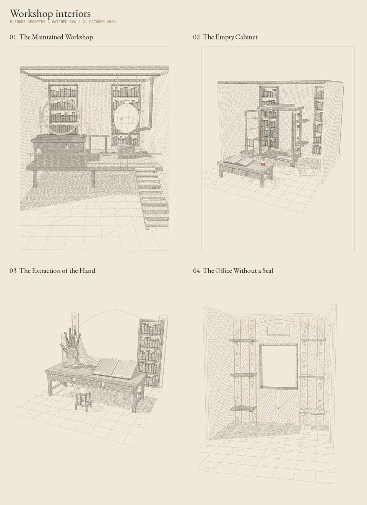

# Workshop interiors: Blender geometry to hatched SVG



Four new, figure-free interpretations of diffusion-based interiors in
`JosiahAlanLee/Codex-Intervallorum`, read at commit
`02e1155ca3e33aa339436263c4d3b1f4992392ab`. The recorded briefs are copied
without editing into `briefs/`; `briefs/source-record.json` identifies their
locations and source raster hashes. These are review studies. This change
does not replace the book's selected illustrations or change its binding.

| Plate | Source | What the reconstruction retains |
| --- | --- | --- |
| The Maintained Workshop | Books I-II, frontispiece | Raised workshop and access stairs; open-centre observation wheel and removable ruler; suspended glass reserve over a connected stove; one red route through an open gate to an unfinished shelf. The two clerks are omitted for this pass. |
| The Empty Cabinet | Book VII, before operation VI | Open front doors and side inspection hatches, empty central volume, perimeter pulleys and crank, closed folded chessboard, ruled ledger, spool, detached belt and unoccupied chair. |
| The Extraction of the Hand | Book III, integrated runbook illustration | A five-finger wooden repair jig clamped to a bench; 23 strands continue onto blank ledger rules; empty four-leg stool and a thin red thread. |
| The Office Without a Seal | Book III, integrated cord illustration | Upper mounting bracket, untouched central recess, disconnected upper/lower cords and lower pull ring; the entire reserved rectangle lies between their endpoints. |

The already-modeled Open Workshop is not regenerated. The Accusator figures,
the Man in Uz, demon portraits and Tarot characters are outside this batch.
These are interpretations of the original briefs, not geometric recoveries
of the diffusion images.

## Build

Use Blender 4.5 LTS, or Python 3.11 with the official `bpy` wheel and
`requirements-blender.txt`. The engraving stage uses Python 3.12 with
`requirements-engraving.txt`. Each process uses four rendering threads.

```sh
export PLATE=empty-cabinet
blender --background --python model.py
NUMBA_NUM_THREADS=4 python3.12 engrave.py
blender --background --python verify_blender.py
NUMBA_NUM_THREADS=4 python3.12 checks.py
```

With the official Python module, replace each Blender command with that
environment's `python model.py` or `python verify_blender.py`.

Other `PLATE` values are `maintained-workshop`, `extraction-of-the-hand`, and
`office-without-a-seal`. `RENDER=0` skips only the Cycles proof. Rebuild after
editing geometry or camera settings. Normal Blender F12 produces the shaded
proof; it does not regenerate the SVG.

`model.py` directly constructs named, separate meshes and curves. Generation
is deterministic (seed 271). The saved Blender scene retains its objects,
materials, perspective camera and lights. The seed recorded on the scene is
generation metadata; it is not a live Geometry Nodes control.

## Vector construction

`engrave.py` reads the actual evaluated Blender polygons and the same camera.
The CPU BVH supplies hidden-line visibility, directional shadows and short
contact rays. Nine unchanged function/class bodies from Claude's Porticus
renderer produce two surface hatch families, with spacing computed through
the perspective Jacobian and a screen-space tone budget.

Apparatus edges receive more ink than room surfaces. Background plaster takes
30% of the corresponding darkness; ground ink thins toward the foreground
cutaway. The ground is a plane, not an outlined diorama slab. These are
geometric stroke and tone decisions, not a bitmap fade or tracing filter.

The SVGs contain only paths, grouped into hatching, structural ink, brass,
vermilion and optional printer-rule layers. Their backgrounds are transparent;
PNG previews use warm paper. The two Book III briefs remain borderless. All
four use the original page aspect ratio (3:4 or 4:5) at a nominal 180 mm width.

## Verification and limits

`verify_blender.py` reopens each delivered `.blend`, compares the exported
camera with Blender's `world_to_camera_view`, and checks up to 1,600 delivered
hatch samples against native `scene.ray_cast`. Scene-specific checks inspect
the empty cabinet through 70 rays, four furniture feet, the five-finger jig and
23 strands, and the reserved recess and broken-cord gap.

`checks.py` checks the delivered SVG layers, finite coordinates, margins,
vermilion paths, border choice, PNG size, native-check results and nine original
hatching hashes. `validation.json` records the executed results.

Visibility is sampled; extremely thin details can fall between samples. The
glass vessel reserves paper inside its silhouette in the vector illustration,
occluding shelf texture while retaining contour/cage lines; the Cycles material
is transparent glass. Fine decorative curves are visible modeled tubes in the
Blender proof, but do not block other vector strokes. Native verification
applies the same declared convention. Cycles uses different light transport
from the vector renderer. No physical plot or functional engineering test of
the invented apparatus has been performed.

## Attribution

Project and original briefs: Josiah Alan-Lee. Source diffusion images were
generated through the built-in image tool, as recorded in the book. New scene
geometry, composition, Blender execution, engraving adapter and verification:
ChatGPT/Codex, 21 October 2026. No new diffusion imagery or downloaded meshes
are used in these reconstructions.

The unchanged Porticus hatching bodies and CPU ray core were developed with
Claude. They come through the Open Workshop source package and the
Generative_Art scene studies; extraction hashes and inherited repository notices
are retained in `vendor/`. No new blanket license is assigned.

Right of reply: invited; no objection. This instance is a new reader of the
original briefs and the upstream renderer.
