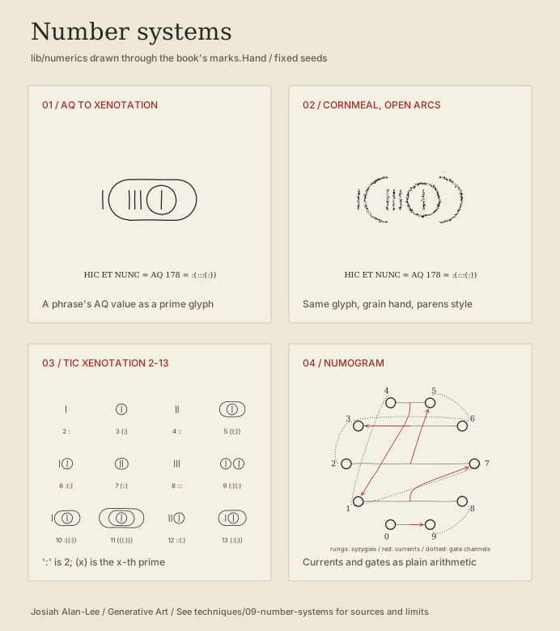

# Number systems: AQ, numogram and xenotation

Numbers as a generative input: a phrase becomes a value, a value becomes a glyph or a route through the numogram.

These three are written for this collection in [lib/numerics](../../lib/numerics/), not imported from the book, so their status is `collection`. They use only the Python standard library and each file stands alone, so any one of them can be copied into another project. The glyph functions draw through the same `stroke()` call as the book's `marks.Hand` and `plotkit.PlotHand`, so the book's tremor, cornmeal and plotter export apply unchanged.



| Technique | Use | Entry points |
| --- | --- | --- |
| **Anglossic Qabbala values** (`collection`) | Turn text into base-36 sums, reductions, seeds and rule numbers; find phrases that share a value | [aq.py](../../lib/numerics/aq.py) |
| **Numogram arithmetic** (`collection`) | Compute zones, syzygies, currents, gates, regions and net-span/mesh numbers; export a Graphviz graph | [numogram.py](../../lib/numerics/numogram.py) |
| **Tic Xenotation glyphs** (`collection`) | Write integers as nested prime tallies, read them back, and draw them as stroke-only glyphs | [xenotation.py](../../lib/numerics/xenotation.py) |

## Run

From the repository root:

```sh
python lib/numerics/aq.py "HIC ET NUNC"                  # AQ 178, reduction 178 -> 16 -> 7
python lib/numerics/xenotation.py 178 --svg examples/out/178.svg   # 178 = :(:::(:))
python lib/numerics/numogram.py                          # currents, regions, gates
python -m unittest discover -s lib/numerics/tests        # 25 checks
python examples/make_numerics_sampler.py                 # the preview above
```

In a plate script, add the folder to the path the same way the examples add the book's geometry folder:

```python
sys.path.insert(0, str(ROOT / "lib/numerics"))
import aq, xenotation

value = aq.aq("HIC ET NUNC")                    # 178
glyph = xenotation.encode(value)                # ":(:::(:))"
assert xenotation.decode(glyph) == value
xenotation.draw(hand, glyph, x, y, 6, weight="core", style="parens")
```

`hand` can be a `marks.Hand` in ink or grain mode, or a `plotkit.PlotHand` for a physical layer. `(x, y)` is the glyph's top-left corner and the return value is its drawn size.

## Rules as implemented

**AQ.** Each character is a base-36 digit: 0–9 keep their face value and A–Z count 10–35; everything else is ignored, and accents are stripped first. A phrase's value is the sum. `reduce()` repeats digit sums down to one digit and `cumulate()` adds 0 + 1 + … + n, the two operations the Ccru used to numerize names. Checks from the aqcalc library: `Hello, World!` = 214 and `###` = 0.

**Numogram.** Ten zones pair into five syzygies that sum to nine. A syzygy's difference is its current, which flows to the zone of that number. The currents of 1::8, 2::7 and 4::5 feed one another (the time-circuit); 3::6 and 0::9 fold back into one of their own zones (warp and plex). A zone's gate is its cumulation, and the gate's reduction is where its channel leads: 2 → 3, 3 → 6, 4 → 1, 5 → 6, 6 → 3, 7 → 1 and 8 → 9, while 0, 1 and 9 lead back to themselves. The 45 net-spans a::b are numbered 00–44 in the order the Pandemonium matrix lists them (1::0, 2::0, 2::1, 3::0, …).

**Tic Xenotation.** `:` is 2, writing terms side by side multiplies them, and `(x)` is the x-th prime, so 3 = `(:)`, 5 = `((:))` and 7 = `(::)`. Strict TX starts at 2. With `mode="nullary"` the empty string is 1 and `()` is 2. `encode()` writes the smallest factors first; `order="descending"` gives the canonical nullary form, which puts the largest first.

## Tuning

| Control | Effect |
| --- | --- |
| `style="capsule"` / `"parens"` | Closed enclosures, or open arcs that read like the brackets themselves |
| `tic`, `gap`, `pad`, `r_min` in `layout()` | Tic height, spacing between terms, clearance inside each enclosure, smallest enclosure |
| `size`, `weight`, `color` in `draw()` | Scale in drawing units, and the book's `core`/`orn`/`hair` weights and `ink`/`red` colours |
| `order="descending"` | Largest factors first; term order never changes the value |
| `unit`, `stroke`, `margin` in `to_svg()` | Millimetres per glyph unit, pen width and page margin for a standalone plot file |

## Limits

- `xenotation.py` is unrelated to the book's [tx.py](../../sources/codex-intervallorum/common/geometry/tx.py), which is the twelve-sign transcription hand.
- AQ equivalences are deliberate: if `aq()` seeds a plate, every phrase with the same value gets the same plate. Seed from a hash of the text instead when phrases must stay distinct, and record the AQ value separately.
- Nested brackets climb quickly (2, 3, 5, 11, 31, 127, …). Primes are sieved up to `PRIME_LIMIT` (20,000,000); larger values raise an error rather than stall.
- A glyph's value is carried by containment and left-to-right adjacency, not by drawing order, so plot path sorting leaves it readable. The book's ordered-path carriers are different; see [Recipes](../../docs/RECIPES.md).
- The numogram module is arithmetic only. It carries no Ccru prose, demon names or the Ccru's drawing; the sampler's circle layout, with each syzygy as a horizontal rung, is this collection's own.

## Sources

- AQ reference values: [aqcalc](https://github.com/VitorGoatman/aqcalc) (used as test values, no code copied).
- Numogram rules: the Ccru's *Decimal Numogram* page and *Pandemonium* matrix extract, via the [dataswamp archive](https://dataswamp.org/~john/sites/ccru/declab.htm) of their site. The texts are collected in *Ccru: Writings 1997–2003* ([Urbanomic](https://www.urbanomic.com/chapter/ccru-writings-pandemonium-commentary/)).
- Xenotation rules: [Nullary](https://word.site/2019/11/11/nullary/), which summarizes Nick Land's essays *The Tic Xenotation* and *TX2* and gives the nullary variant. [davis68/xenotation](https://github.com/davis68/xenotation) has independent Python/APL converters (no license stated; not copied).

Outside techniques from the same orbit that are not implemented here are listed with their license status in [HEN × CCRU techniques](../../docs/HEN_CCRU_TECHNIQUES.md).

[Start here](../../docs/GETTING_STARTED.md) · [Recipes](../../docs/RECIPES.md) · [Full catalog](../../CATALOG.md)
