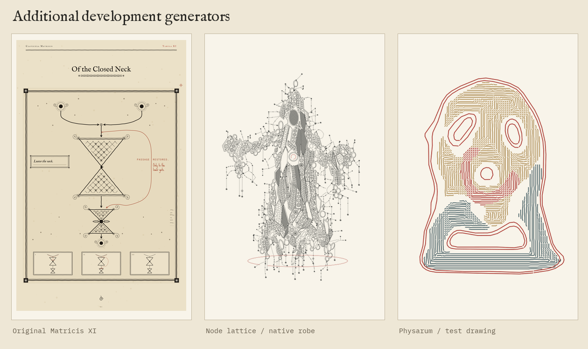

# Additional development generators

Art-only additions from the development repository, selected at the author’s request. Original source fingerprints and portability changes are recorded in the [manifest](../../catalog/development-art-manifest.json). The public-book snapshot remains separate.

| Generator | Start here | Controls and useful combinations |
| --- | --- | --- |
| Original Matricis | [Plate runner](../../sources/development-art/books/01_matricis/generator/build_v2.py) and [engineering hand](../../sources/development-art/books/01_matricis/generator/eng.py) | Earlier plate variants, folds, text-bearing strips, gates, routes and frames; pair with the existing stroke or grain hands |
| Chalk and cornmeal | [Material renderer](../../sources/development-art/books/01_matricis/generator/meal.py) | Dark-board marks and pale grain; the branching plate and network plate share this ground |
| XI plotter converter | [Converter](../../sources/development-art/books/01_matricis/plotter/build.py) | Pen width, hatch spacing, physical page size, Hershey lettering and registration; includes its source drawing |
| Image-fed cultures | [Physarum CLI](../../sources/development-art/books/03_escalationum/physarum/physarum_plot.py) | Station/fidelity, per-pen populations, faithful/feral competition or symbiosis, marked territories, home regions; topo/network/fibers/hatch/marks output |
| Node lattice | [Open the interactive HTML locally](../../sources/development-art/common/lattice/node-lattice.html) or [CLI](../../sources/development-art/common/lattice/plate.mjs) | Native robe/chair or eleven stored host masks; cell size, drape, roses, fray, drips, dissolution and pen mode |

The lattice’s stored masks work without source rasters. Re-tracing masks or rebuilding the original Physarum comparison study requires the corresponding art assets from a book checkout. The short examples use native geometry or a synthetic input instead.

See [commands and module index](../../docs/DEVELOPMENT_ART.md). Runtime validation and limits are recorded there; none of these outputs has been tested on a physical plotter.
