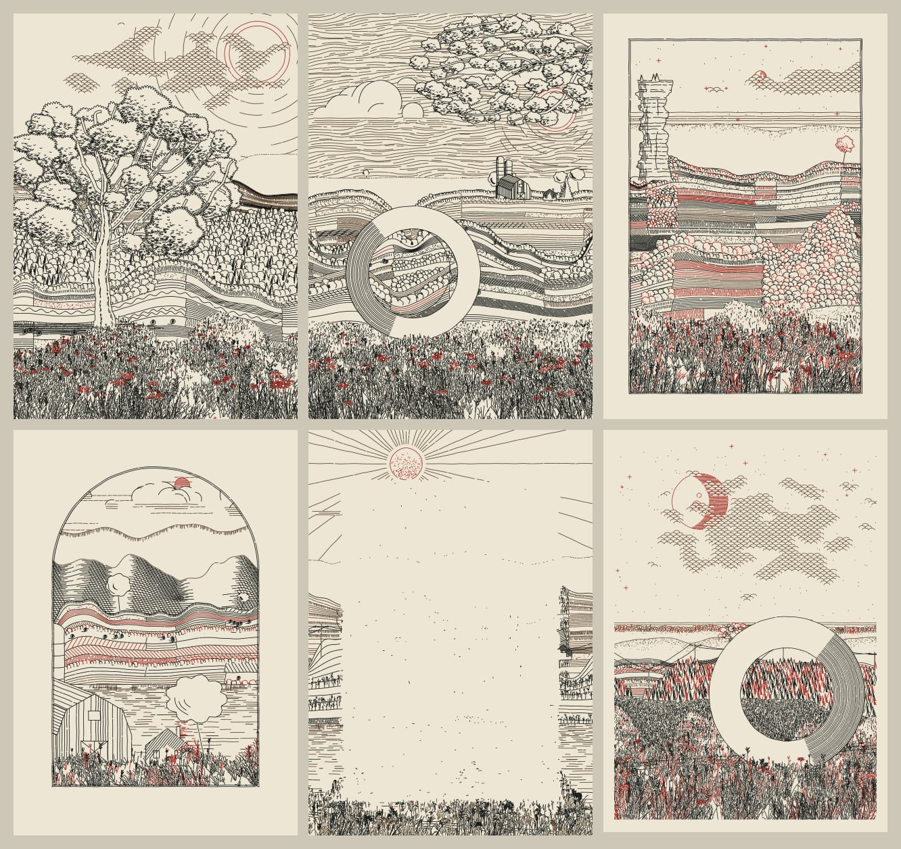

# Landscape plates: Driftless Plates

Hidden-line landscapes sized to the book's pages, from one seeded generator.

[Driftless Plates](../../studies/driftless-plates/README.md) is a study with its own runtime: plain JavaScript, no dependencies, running in a browser or in Node. Its status is `study`. Every technique below lives in [engine.js](../../studies/driftless-plates/engine.js), and the symbols named are the functions to read or lift out.



| Technique | Use | Entry points |
| --- | --- | --- |
| **Hidden-line drawing against an occlusion mask** (`study`) | Draw near to far, clipping each stroke against what is already drawn, so the output needs no hidden-line pass | `Mask`, `Scene.line`, `Scene.fill`, `Scene.halo` |
| **Contour-strip farmland** (`study`) | Offset strips down a ridge that relax toward level, divided into fields of rows, ticks, stipple, bales or woods | `buildBands`, `farm`, `patchRows`, `patchTicks`, `bales` |
| **Space-colonization trees and boughs** (`study`) | Grow branch skeletons toward attraction points in a crown, taper them by pipe model, dress them in clustered foliage | `colonize`, `drawBranches`, `oak`, `bough`, `foliageCluster` |
| **Tufted meadow and wildflowers** (`study`) | Fill a foreground in depth order with occluding tufts and seasonal flowers that drift in patches | `tallGround`, `tuft`, `plant`, `plantPick` |
| **Ruled structures and monuments** (`study`) | Silos, gambrel barns, water towers, sandstone towers and geometric monuments shaded by line spacing | `silo`, `barn`, `waterTower`, `rockTower`, `monument` |
| **Print hand and text clearing** (`study`) | Add wobble, ink skips, ruled overshoot and misregistration; fade or lighten linework inside the book's text block | `post`, `textZone`, `misregistration` |
| **Plot export with pen-travel ordering** (`study`) | Write millimetre SVG with one layer per pen, ordered to shorten pen-up travel, and estimate plot time | `toSVG`, `orderPaths`, `plotStats` |

## Run

From the study folder:

```sh
node cli.js --count 6                                    # Codex 7 × 10 in plates into out/
node cli.js --seeds e2 --zone codex --zone-mode fade     # clear the Codex text block
node cli.js --count 6 --format codexPlot                 # A4 plot masters inside the validator's extent
node test.js
```

Or open [index.html](../../studies/driftless-plates/index.html) in a browser.

## Book sizes

The trim, text block, plot-master extent and inks come from the pinned book snapshot: `binding/bind.py`, the frame shared by the Septimus and parable builders, `common/plot/plate.py`, `common/plot/plotkit.py` and `binding/backmatter.py`. The study README [lists each line](../../studies/driftless-plates/README.md#codex-sizes), and `test.js` fails if the snapshot and the generator disagree.

## Tuning

| Control | Effect |
| --- | --- |
| Flora, Land, Built, Sky | Bias which subject Auto picks and how much of the page each motif takes |
| Density | Tightens or loosens line spacing and mark counts across the plate; plot time follows |
| Imperfection | Wobble, ink skips, ruled overshoot and misregistration together; 0 turns them off |
| Text area and treatment | `codex` uses the book's text block; Fade out thins the lines, Lighten moves them to the tint pen |
| Ink strength | Mixes every ink toward the paper, for plates that sit behind type |

## Limits

- The mask is a raster of about 0.13 mm cells on a Codex page, so occlusion is exact only to that resolution.
- A seed reproduces exactly within one JavaScript engine; another engine can round trigonometry differently.
- Physical plotting was not tested.

[Start here](../../docs/GETTING_STARTED.md) · [Recipes](../../docs/RECIPES.md) · [Full catalog](../../CATALOG.md)
