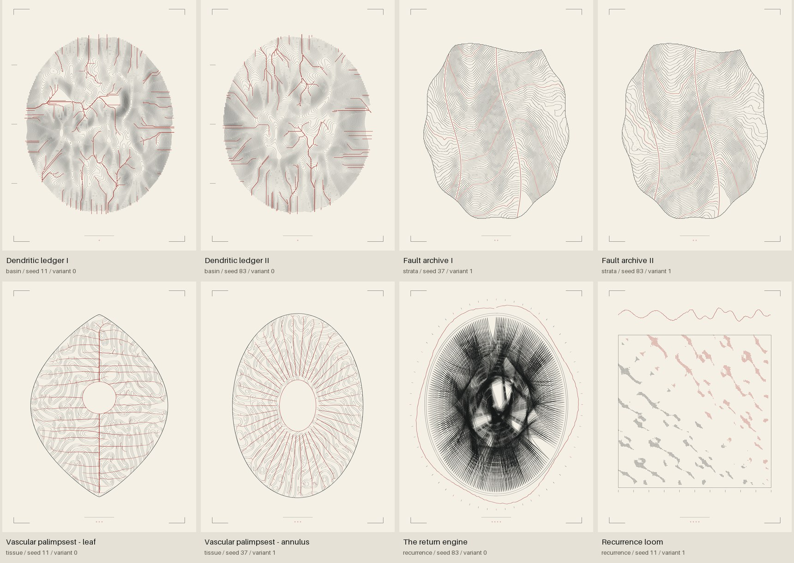

# Geological, biological and time-series process art

Four runnable studies written for this collection. These extend the book's
contour, two-ink and growth vocabulary with new process models. They are not
part of the preserved source snapshot or an existing bound edition.



| Study | Implemented process and combination | Useful book application |
| --- | --- | --- |
| **Dendritic ledger** | Depression conditioning → D8 runoff accumulation → stream-power-inspired incision and hillslope diffusion → contours with red drainage | Catchments, extraction systems, branching infrastructure, territorial plates |
| **Fault archive** | Implicit age field → folding → offsets across two faults → interrupted contours, red marker beds and sparse bedding hatches | Historical strata, institutional rupture, a seal or apparatus cut from a geological specimen |
| **Vascular palimpsest** | Gray–Scott chemistry → concentration-biased attraction points → space colonization → clipped red trees over black chemical contours | Leaf/organ studies, material growing around a seal, colonized architectural surfaces |
| **Return engine / recurrence loom** | Time series → delay embedding → standardized distances → recurrence pairs → curved seal or textile-like matrix | Repeated incidents, operational telemetry, return and memory motifs with an explicit data key |

## Run

From the repository root, with Python 3.10 or newer:

```bash
python -m pip install -r requirements-process-art.txt
python examples/make_process_art.py --seeds 11 --pixels 2000
python examples/make_process_art.py --study tissue --seeds 37 --variants 1 --pixels 2000
python examples/make_process_art.py --study recurrence --csv measurements.csv --column latency --seeds 11 --variants 0
python -m unittest discover -s lib/process_art/tests -v
```

The default is 24 candidates: four studies × three seeds × two variants. Use
one seed and variant for a fast first look. Output defaults to
`examples/out/process-art/`; it is not a download or network operation.

Each plate writes:

| File | Contents |
| --- | --- |
| `.svg` | Transparent, stroke-only, 170 × 220 mm; explicit black/red attributes; actual clipped geometry |
| `.png` | Paper-ground preview at the requested width; `--transparent` exports ink on alpha instead |
| `.json` | Seed, process parameters, drawing choices, source identity, stroke count and SVG hash |
| `.npz` | Raw arrays for reuse: height/area/receivers, stratigraphic age/masks, chemical concentrations/tree ancestry, or recurrence matrix/row indices |
| `-input.csv` | Exact synthetic time series for the demonstration recurrence images |

The curated [selection manifest](../../examples/previews/process-art/selection.json)
records the chosen images and aesthetic reasons. It is a human/model editorial
selection, not a beauty score or a claim that the selected parameters are
scientifically preferable. Rebuild the chosen set and ZIP with
`python examples/package_process_art.py --out examples/out/process-art-selected`.

## Inputs and tuning

| Control | Change and consequence |
| --- | --- |
| `seed` | Reproducible initial terrain, perturbations and attraction-point placement |
| Catchment `incision`, `steps` | More channel cutting; drainage and contours come from the evolved field, not separately drawn fractals |
| Strata `fold`, `throw` | More contorted beds or larger discontinuities; the fault gap remains unbridged |
| Chemistry `feed`, `kill`, `steps` | Change the actual chemical regime; inspect the exported V array before selecting contour levels |
| Colonization `step`, `influence`, `kill` | Branch length, reach and attractor retirement; preserve `0 < step < kill < influence` |
| Recurrence `dimension`, `delay`, `epsilon`, `theiler` | Change what counts as a repeated state; these are analysis settings, not cosmetic density knobs |

Model controls live in [models.py](../../lib/process_art/models.py); composition
presets live in [studies.py](../../lib/process_art/studies.py). Variant 0/1 selects
declared presets; the JSON records the actual values. The two tissue variants
use different chemical parameters and envelopes. The two recurrence variants
also use different thresholds; do not compare their densities as a controlled
experiment.

CSV input needs a header and a numeric column, with at most 600 rows. Original
row order is retained. Empty strings, `NA`, `NaN` and `null` mark missing values;
their embedding windows are omitted with original row numbers preserved. Other
non-numeric or infinite values fail. No interpolation, timestamp inference,
sorting or resampling happens. For irregular measurements, aggregate to a
declared cadence first. The sidecar records the CSV filename, column and SHA-256.

## Reuse in Codex Intervallorum

The tested target is public book main `b789e03f30034bc8403f8a40aaf83842885aaad5`.
This PR adds tools here; it does not install art into the book or alter ciphers.

1. **Native paths.** Use `common/plot/svgimport.py:strokes_from_svg()` on an
   exported SVG, then `place()` with source box `(0, 0, 170, 220)`. This route
   preserves pen widths and ink assignments. Clip or mask decorative art before
   placing any separately encoded carrier. The output deliberately avoids SVG
   transforms and inherited color attributes that this importer does not read.
2. **Existing hands.** `plate.draw(hand, origin=(x,y), scale=k)` replays geometry
   through `marks.Hand` or `PlotHand`. It maps widths to the book's core/orn/hair
   categories, so this route changes the precise width hierarchy. A grain-mode
   `marks.Hand` can supply the existing cornmeal treatment to the new scaffold.
3. **Illustrated pages.** Use `--transparent` PNGs with the book's existing raster
   placement helpers. The preview paper ground is presentation only; the SVG
   contains no background. A 2000-pixel-wide plate is about 299 ppi at 170 mm.
4. **Image-fed growth / architecture.** Normalize `v`, `area` or `age` into the
   food/height/mask input expected by a downstream study. These exported fields
   make the composition possible; a full Photophobic/Blender adapter is future
   work. Do not treat this as an already implemented surface simulation.

### Three concrete combinations

- Render Fault archive's red marker beds through the existing cornmeal Hand
  while retaining solid black strata. The process scaffold stays identical.
- Use an eroded catchment's accumulation field as food for the existing
  image-fed Physarum tool. The basin supplies geography; the agent model supplies
  an additional trace network. Keep both fields to distinguish their origins.
- Place a numerics seal in Vascular palimpsest's empty aperture. The chemical
  contours and vein paths are geometrically clipped out of that space; keep
  seal strokes in a separate layer and run its existing decoder afterward.

The first combination has the generic `draw(hand)` adapter. The second and
third are documented integration recipes, not completed plate builds.

Read the [R&D notes and primary sources](../../docs/PROCESS_ART_RESEARCH.md) for
equations, implementation choices, model scope and follow-up experiments.
