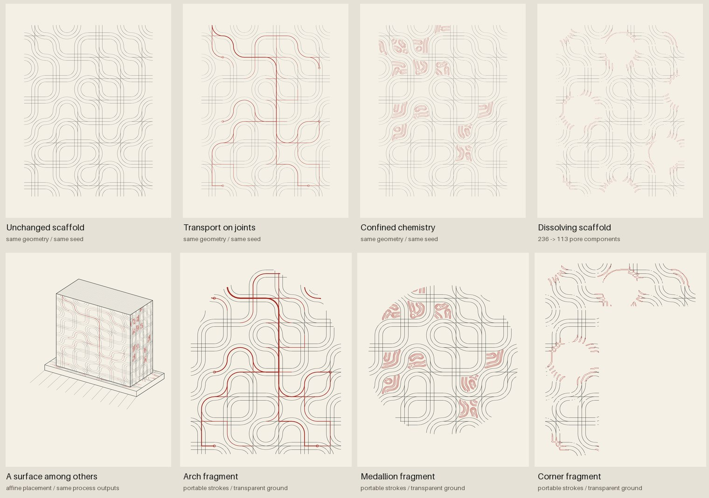

# Textile grammar as one component

A small transfer experiment following the author's Wright/textile suggestion:
one repeatable scaffold, three process couplings, and portable fragments. It is
intended for a panel, border, surface or local interruption in a larger drawing.



## What was transferred

The design references are the Wright office's integration of geometry, ornament
and architectural drawing, and the Taliesin textile work. The actual geometric
method is a Truchet/Smith-derived tile grammar with original nested curves,
stepped paths and explicit cross junctions. No Wright textile was traced or
reproduced. This first experiment tests the behavior of a constrained repeat;
it does not reconstruct a historical textile's full design grammar.

Shared ports at .35, .50 and .65 of each tile edge keep adjacent motifs joined.
Related orientations form larger bands; the seed changes a small number of
whole motif orientations. Every process in the comparison uses identical
scaffold geometry and the same seed. Rendering widths differ to keep the added
process visible.

| Version | What actually changes | What the red strokes mean |
| --- | --- | --- |
| Control | Nothing beyond the seeded construction | No process overlay |
| Transport on joints | Pressure-driven flow adapts conductance on the scaffold graph | Flow magnitude controls the width of selected conduit paths |
| Confined chemistry | Gray–Scott reaction/diffusion runs inside the rasterized compartments | Contours of the computed V concentration |
| Dissolving scaffold | Acid diffuses from eight pore vents and consumes material | Contours of an acid/material reaction-front indicator; black scaffold paths are split where material is lost |

The transport model solves Kirchhoff balance on the largest connected component.
One unit of flow enters at a source, with equal withdrawals at up to six distinct
drain nodes. Source pressure is the zero gauge. Each iteration adapts edge
conductance with `D <- .82 D + .18 (.015 + abs(Q)/max(abs(Q)))`.
This is inspired by adaptive Physarum transport, not a reproduction of the
earlier free-agent Physarum or a physiological vascular-growth solver.

The chemical model uses conservative face fluxes with zero permeability through
scaffold walls. Seven large pore components are selected for inoculation;
individual patches and concentrations are retained. The field is simulated
under those barriers, rather than calculated freely and clipped afterward.

Dissolution uses `permeability=.025+.19*(1-material)`, followed by material loss
`.022*acid*material` and acid consumption `.35*loss` each step. Vent concentration
is replenished to 1. These dimensionless choices make an illustrative reaction
front. Material cannot regrow in this model. In the selected 6 × 8 scaffold,
the four-neighbor pore-component count changes from **236 to 113** after 2,200
steps at the recorded raster resolution and material threshold. That number
describes this representation, not a real material or a general result.

Graph and raster topologies are different representations: graph crossings
connect only at explicit endpoints, while intersecting raster strokes form
solid walls. A crossed pair of drawn conduits can therefore be an overpass.
Keep the accompanying arrays when interpreting either model.

## Run and reuse

Uses the existing `requirements-process-art.txt` dependencies:

```bash
python examples/make_textile_study.py --out examples/out/textile-process --update-preview
python examples/make_textile_study.py --seed 41 --out examples/out/textile-41
python -m unittest discover -s lib/process_art/tests -v
```

`--zip FILE.zip` packages the demonstration. The default width is 2,000 pixels;
`--pixels 1000` makes smaller previews. Each mode produces a paper PNG, alpha
PNG, editable panel SVG, a borderless component SVG, numeric NPZ and settings.
The packet also includes an architectural placement and three clipped fragments.
The architectural drawing is an affine display projection of the same process
outputs; it does not simulate growth on a three-dimensional building.

The component API adds no frame, lettering or cipher:

```python
from lib.process_art.drawing import Plate
from lib.process_art.textile import run, draw_component

textile, state = run(seed=17, mode="chemistry")
page = Plate("A local material")
draw_component(page, textile, "chemistry", state, box=(90, 40, 60, 80))
```

Omit `clip` or supply a Shapely polygon in destination millimetres. Clipping is
baked into paths, so the existing restricted book SVG importer can read the
result. A component's SVG is 132 × 176 mm without paper or surrounding furniture;
scale it into a wall panel or illustration slot, or replay its `Plate` through
the existing ink/cornmeal Hands. The demonstration includes an arch, medallion
and corner cut-out as examples of this local use.

The reproducible settings record the iteration counts, raster resolution,
source/drain convention, reaction parameters, SVG hash and measured results.
The manifest also fingerprints the generating source. No physical plot or
complete Codex binding was produced in this experiment.

## References and attribution

- [Frank Lloyd Wright Foundation: Graphic design, geometry and
  abstraction](https://franklloydwright.org/this-work-continues-frank-lloyd-wright-and-graphic-design/).
- [Jennifer Gray: Marion Mahony's graphic
  representation](https://franklloydwright.org/a-powerful-brand-marion-mahony/).
  The drawing reference includes Mahony Griffin's authorship, not just Wright's
  architectural authorship.
- [MoMA: Taliesin textile, Design 101, 1955](https://www.moma.org/collection/works/174045).
- [Smithsonian: Wright textile design
  studies](https://www.aaa.si.edu/collections/frank-lloyd-wright-textile-design-studies-10453).
  This collection credits Ling Po with executing these particular studies.
- [Robert J. Krawczyk, Truchet to Sol LeWitt Revisited (2020)](https://doi.org/10.1016/j.patter.2020.100084),
  describing and extending the Truchet/Smith tiling precedent. See also Cyril
  Stanley Smith, *The Tiling Patterns of Sebastien Truchet and the Topology of
  Structural Hierarchy*, Leonardo 20(4), 373–385 (1987).
- [Tero, Kobayashi and Nakagaki (2007)](https://doi.org/10.1016/j.jtbi.2006.07.015),
  adaptive transport through flow/thickness feedback. The normalization, floor,
  discrete update and multiple prescribed drains above are this study's choices.
- [Pearson (1993)](https://arxiv.org/abs/patt-sol/9304003), Gray–Scott pattern
  formation; the conservative wall operator and compartment inoculation are
  the additions here.

Prepared with ChatGPT/Codex for Josiah Alan-Lee on 20 October 2026. The code and
compositions are independent implementations. No third-party code, museum
images, textile scans, or historical glyphs are bundled; no blanket license is
assigned by this addition.
