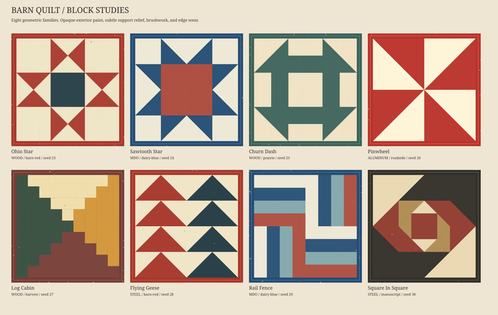
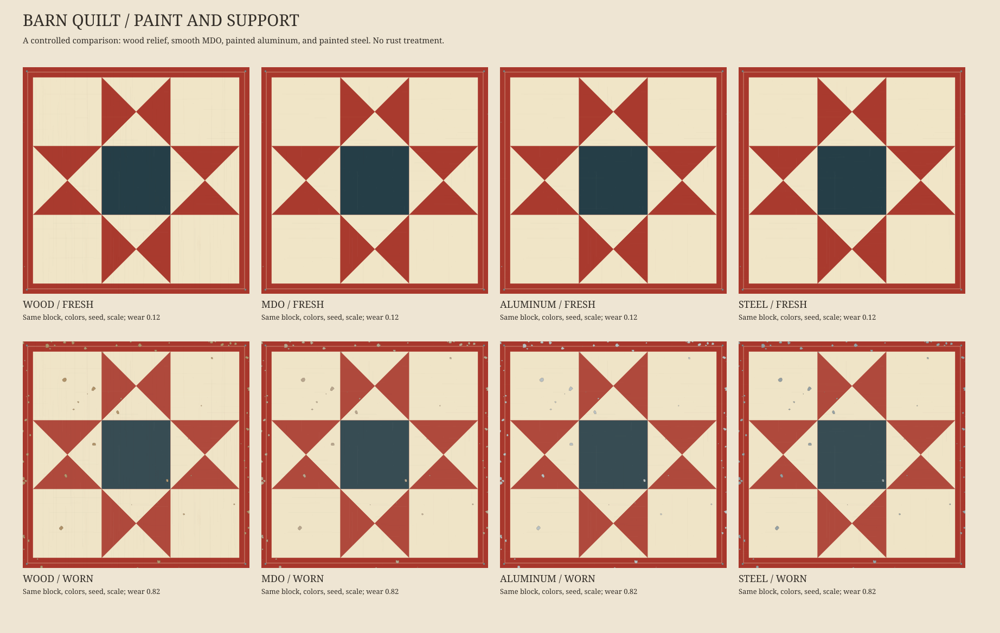

# Barn quilt squares

A first SVG generator for painted quilt-block panels: eight geometric families,
six palettes, support-specific marks, brushwork, fading, and chipped edges.
Generation needs **Python 3.10+ and its standard library only**.



## First panel

Run from the repository root:

```sh
python lib/barn_quilts/generator.py --pattern ohio-star --material wood \
  --palette barn-red --seed 23 --texture 0.65 --wear 0.25 \
  --output examples/out/barn-quilt.svg
```

SVGs contain ordinary filled polygons, editable paths, clip paths, and a JSON
recipe in `<metadata>`. There are no embedded bitmaps, filter effects, network
requests, or external font dependencies in the standalone panels. Physical size
defaults to 200 mm square; `--size-mm` changes the export dimensions.

## Geometry and controls

These are independent constructions of familiar block families. Names, color
placement, and variants differ between makers; this is not a historical pattern
catalog or a reproduction of any maker's complete quilt.

| `--pattern` | Construction in this implementation | `--detail` |
| --- | --- | --- |
| `ohio-star` | Nine-patch grid, four quarter-square hourglasses, center square | Ignored |
| `sawtooth-star` | Four flying-geese units around a large center square | Ignored |
| `churn-dash` | Corner half-square triangles, paired edge bars, open center | Ignored |
| `pinwheel` | Four rotated half-square-triangle units | Ignored |
| `log-cabin` | Sequential strips spiraling around a center square | Spiral rounds |
| `flying-geese` | Two columns of triangle-and-sky units | Rows per column |
| `rail-fence` | Four alternating horizontal/vertical strip blocks | Rails per block |
| `square-in-square` | Nested midpoint diamonds and corner triangles | Nesting rounds |
| `random` | Seeded choice of one of the eight families | As above |

`--detail` accepts 2–8, default 4. `--rotation` accepts 0/90/180/270 degrees.
`--colorway` cycles the three colored roles through 0/1/2 while keeping the light
ground. Geometry remains exact: changing surface seed or material never jitters
shared vertices. The seed controls surface marks and the `random` selections;
fixed named families do not invent a new topology for every seed.

Palettes: `barn-red`, `dairy-blue`, `harvest`, `prairie`, `roadside`, `manuscript`,
or a seeded `random` choice. `manuscript` and the muted palettes are book/art
choices; they are not recommendations for long-distance roadside visibility.
For custom colors:

```sh
python lib/barn_quilts/generator.py --pattern sawtooth-star \
  --colors '#f1e9d4,#154b73,#a94335,#c69a49' --border 0.035 \
  --output examples/out/custom-star.svg
```

The four colors are light, main, contrast, and secondary. Each pattern uses the
roles it needs; several classic blocks require only two or three colors.
`--border` is the fraction of panel width occupied by each painted border,
from 0 to 0.2. `--hardware` adds four optional screw heads.

## Paint and support



| `--material` | What changes visually |
| --- | --- |
| `wood` | Faint continuous grain and knot relief beneath paint; warm exposed chips |
| `mdo` | Smooth painted sign-board finish and pale composite/primer chips; no open wood grain |
| `aluminum` | Smooth painted panel, sparse fine scuffs, light cool exposed chips |
| `steel` | Denser directional scuffs and darker cool chips; no red-rust treatment |

The consulted trail guides document MDO and aluminum composite particularly
clearly. Steel is an optional material study requested for this generator,
including the visual idea of painted stainless sheet; it is not a claim that
stainless is the standard barn-quilt support.

`--texture` controls mark density/strength, 0–1. `--wear` independently controls
paint fading and chip frequency/size, 0–1. Chips favor the board perimeter;
colored polygon boundaries are paint edges, not seams between separate boards.
The support is continuous across color changes. Brush passes are clipped to
individual painted regions. Bare-substrate marks occur inside exposed chips.
The finish is a stylized vector approximation, not a calibrated materials or
aging model. It does not simulate peeling layers, cracks, wood joinery, or a
reflective-metal lighting model. Most substrate characteristics should be hidden
by opaque paint, especially on freshly painted MDO or metal.

```sh
# Fresh metal, with slight paint texture.
python lib/barn_quilts/generator.py --material steel --texture .35 --wear .03 \
  --output examples/out/painted-steel.svg

# Color geometry with all surface marks and fading disabled.
python lib/barn_quilts/generator.py --mode flat --output examples/out/flat.svg

# Single-color shared-edge drawing; support, wear, and hardware are omitted.
python lib/barn_quilts/generator.py --pattern log-cabin --mode outline \
  --output examples/out/outline.svg
```

The outline export splits long edges at T-junctions before deduplicating them,
so a long log beside several short logs is not drawn twice. Its pen width is
0.25 mm at the declared size. It contains block-partition edges, including edges
between adjacent polygons of the same color; it is a construction/plot drawing,
not a sewing template, masking-tape cut list, or optimized pen-travel plan.

## Compose with existing generators

```python
from lib.barn_quilts import QuiltSpec, block, render_fragment

# Normalized polygon data for a facade, color mask, or another drawing hand.
patches = block("churn-dash")

# The fragment occupies 1000 x 1000 units. Place/scale its containing group.
panel = render_fragment(QuiltSpec(pattern="ohio-star", texture=.4),
                        id_prefix="east-barn-panel")
placed = f'<g transform="translate(80 120) scale(.08)">{panel}</g>'
```

Use a unique `id_prefix` per occurrence when embedding several identical panels.
Keep the `<defs>` that travel with each fragment. The SVG can also be used as a
Blender surface input after the normal image/vector import step. Direct adapters
to Driftless Plates, Physarum, and scene projection are future work; no existing
landscape or book plate is modified by this addition.

## Samples and verification

```sh
python examples/make_barn_quilt_sampler.py
python -m unittest discover -s lib/barn_quilts/tests -v

# Optional preview rasterization; only this step needs CairoSVG and Pillow.
python examples/make_barn_quilt_sampler.py --png
```

The sampler writes eight block SVGs, eight controlled support/age SVGs, flat and
outline proofs, two SVG contact sheets, and a recipe/hash manifest. Committed
proofs are under [examples/previews/barn-quilts](../../examples/previews/barn-quilts/).
The tests check area and sampled coverage, T-junction deduplication, XML/ID
integrity, deterministic output, all family/material/mode combinations, invalid
inputs, and the CLI. Surface marks are compact vector subpaths where practical.

[Research and source register](../../research/barn-quilts/README.md) ·
[Generator source](../../lib/barn_quilts/generator.py)
