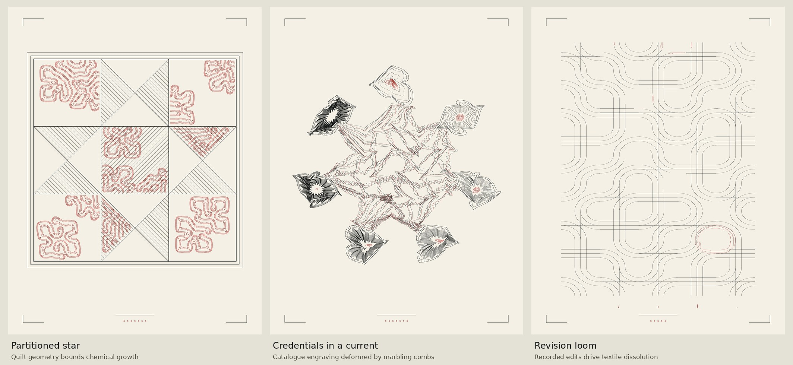

# Combination studies

Three original experiments, prepared with ChatGPT/Codex. These are art studies,
not historical reconstructions, evidence for the book's arguments, or additions
to its installed plates. They do not modify Blender or Driftless.



## Partitioned star — quilt geometry × confined chemistry

**Failure:** a chemical motif can obscure the block, and neither resemblance
nor this combination establishes a historical relationship between quilts,
marbling or ritual diagrams.

The existing Ohio Star partition supplies both the ruled block drawing and
impermeable walls on a 321 × 321 raster. The existing Gray–Scott chemistry is
inoculated in seven large compartments and cannot diffuse across those walls.
The red contours are computed there, rather than clipping an unrelated field.
Patch roles choose sparse diagonal hatching. The output uses stroke geometry;
it does not carry the painted wood/metal support finish.

Try a different quilt family or inoculate individual star points next. This
could become a local painted panel, a floor inset, a curtain or a small page
ornament. Placement in a scene is not implemented here.

## Credentials in a current — guilloché × marbling combs

**Failure:** deformation can sacrifice the original diagram's readability.
This is a candidate for a seal or ornament fragment; it should not replace an
explanatory diagram that must remain easy to read.

The actual seven catalogue offices and twenty-one passages first construct the
engraving with the existing authority/legion/competence mappings. Two sets of
alternating comb shears then deform every path. Ink assignments and original
path identities survive, but visual count-reading is not promised. Source
guilloché has intentional intersections; the marbling print repair is not
applied to this composition. `strength=0` is the undeformed control and `1` is
the selected study; the accepted range is 0–2.

The resulting pointed rosettes and folded bands suggest smaller credentials,
watermarks, an institutional sun, or a diagram whose ornament is undergoing
strain. These are proposed uses, not implemented book changes.

## Revision loom — manuscript history × textile dissolution

**Failure:** the public history starts with an import and contains little
subsequent turnover, so the selected example's visible erosion is sparse.
It is weaker as a standalone image than the other two. A longer *public*
history or a deliberately chosen revision interval would give it more range.

Each row corresponds to one manuscript and each column to a recorded version.
The change fraction is `(inserted + removed characters) / (previous + current
characters)`, using the existing Git-blame identity. The import column has no
predecessor and is set to zero. A change locates a reagent source in that tile;
source intensity is explicitly amplified as `.15 + .85 sqrt(change)`.
Conservative diffusion and irreversible loss then remove actual scaffold
material. This is an artistic material analogy, not a measurement of damage,
quality, contribution or authorship. The sidecar preserves the exact dates,
commits, manuscript names, turnover matrix and vent mapping.

## Rebuild and reuse

```sh
python -m pip install -r requirements-process-art.txt
python examples/make_combination_studies.py --out examples/out/combinations
python -m unittest discover -s lib/codex_palette/tests -v
```

The script writes three 170 × 220 mm SVGs, paper/transparent PNGs, parameter
JSON, NPZ process arrays and a labelled contact sheet. Numeric source inputs
come from the committed `codex-palette` previews; no outside dataset or museum
image is bundled. `lib/codex_palette/combinations.py` exposes the three
builders separately. The SVGs use the same `Plate`/`Hand` interface as the
process studies and can be read with the book's `svgimport`; no text or cipher
carrier is embedded in these art paths.

The selected previews and manifest are committed here. The downloadable source
bundle includes all three paper/alpha PNGs and process arrays. Physical plotting
and full book binding were not performed.
