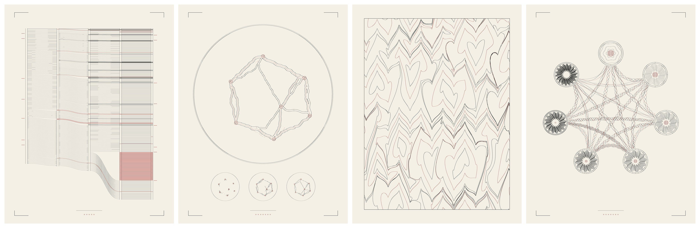

# Codex palette: revision bands, tube networks, marbling and guilloché

Four runnable studies written for this collection from leads in the
[Codex palette research](../../docs/CODEX_PALETTE_RESEARCH.md). Two read the
book's own records: its public Git history and the Escalationum catalogue. One
reruns a book input, Nota V's seven nodes, under a different model. One is a
finishing technique for the bound volume. None of them is installed in the
book.

[Combination studies](COMBINATIONS.md) add three original trials: quilt edges
as chemical barriers, guilloché deformed by marbling combs, and recorded
manuscript turnover driving textile dissolution. They leave Blender and
Driftless unchanged and are not installed book plates.



| Study | What it draws | Book use |
| --- | --- | --- |
| **History Flow** | Each revision of the manuscripts is a column whose length is its character count. Lines that survive into the next revision are carried across as threads; their ink and spacing give the class of the commit that last changed them | The volume's own production record (the Clavis, Book VI's closing sections) |
| **Tero tubes** | A tube network grown between Nota V's food nodes in the Notoria's disc arena by Kirchhoff flow and flux-adapted conductivity; walls outlined; the strongest tubes' centre lines and the food nodes in red; tubes strong at the middle inset but given up by the end dashed in red; three earlier states below | A slime-mould figure from tube dynamics rather than agents, beside the Notoria's Jones fields |
| **Marbled sheet** | Closed-form marbling — drops, then a back-and-forth gel-git comb, then optionally a fine nonpareil comb — applied to polylines and clipped to the sheet | Endpapers and pastedowns that can be plotted |
| **Credentials** | Seven rose-engine rosettes and twenty-one wave bands from the catalogue's numbers, on the heptagon of the book's seal matrix | Book III: "authority is a quantity of ornament" taken literally |

## Run

From the repository root, with Python 3.10 or newer and `git`:

```bash
python -m pip install -r requirements-process-art.txt
python examples/make_codex_palette.py                    # recorded inputs, no clone needed
git clone https://github.com/JosiahAlanLee/Codex-Intervallorum
python examples/make_codex_palette.py --codex Codex-Intervallorum
python examples/make_codex_palette.py --study tubes --variants 0 1 2 --seeds 53 71
python examples/make_codex_palette.py --study history --codex Codex-Intervallorum --rev main --spacing time
python -m unittest discover -s lib/codex_palette/tests -v
```

Without `--codex`, History Flow and the credentials rebuild from
`examples/previews/codex-palette/history-input.json` and `guilloche-input.json`.
With it, they read the book at `--rev` (default: the pinned snapshot
`b789e03`). The tube study takes about a minute at 2,400 steps; the others take
seconds. Output defaults to `examples/out/codex-palette/`, which is not
committed. `--package` copies the selected plates, inputs, manifest and contact
sheet into the preview folder. Its manifest records the resolved commit for
each input-bearing study and the actual preview sizes. A mixed-revision pack
lists all revisions and leaves the single `book_revision` field null. The
tubes still use the pinned snapshot's nodes when `--rev` selects a newer
history or catalogue; the marbling has no book-data revision.

Each plate writes `.svg` (170 × 220 mm, stroke-only, black and red groups),
`.png`, `.json` (parameters, inputs, stroke count, pen-down length, SVG hash) and
`.npz` (the process state: per-version character counts, tube conductivities,
drop tags or the rosette legions).

## Studies and their limits

**History Flow** ([historyflow.py](../../lib/codex_palette/historyflow.py)).
After Viégas, Wattenberg and Dave (2004). Versions are the first-parent commits
that changed any of the nine manuscripts, stacked in reading order. Survival is
Git blame identity — originating commit, original path and line — so an edited
line counts as new text from the editing commit. Classes and their evidence are
recorded per commit:

| Class | Evidence | Drawn as |
| --- | --- | --- |
| `base` | Present at the first drawn version, here the import of 18 October | Sparse black threads |
| `codex` | Merged from a `codex/` branch | Dense black threads |
| `claude` | Authored as Claude or carrying a `Co-Authored-By: Claude` trailer; or merged from a `claude/` branch | Dense red threads |
| `direct` | None of the above | Sparse red threads |

The trailer is checked before the branch, so a Claude-co-authored commit on a
`codex/` branch counts as `claude`. A thread's class is the last commit to
change the line. It is not first authorship, and the plate assigns no share of
authorship. Work done by one
model under another's branch, or relayed by the author, is classed by what the
repository records. The public history begins at an import, so most text is
`base`; the private development repository has the longer record and the same
command runs on it locally. Red rules beside the outer columns mark where one
manuscript ends and the next begins. `--spacing time` places columns by commit
time instead of evenly.

**Tero tubes** ([tubes.py](../../lib/codex_palette/tubes.py)). Tero, Kobayashi and
Nakagaki (2007) and Tero et al. (2010). A jittered triangular mesh fills the
disc; each step a random pair of food nodes acts as source and sink, the
Kirchhoff pressures are solved exactly, and conductivity relaxes toward
`q^γ/(1+q^γ)` of the flux it carried. The nodes and arena come from the book's
`notae.py` and `physarum.py`, and a test checks them against the snapshot. The [textile study](../12-process-art/TEXTILE.md)'s
transport adapts conductance with a normalised rule on a fixed scaffold; this
study uses Tero's saturating response and random food-node pairs on a free mesh.

| Variant | γ, flux | Result |
| --- | --- | --- |
| 0 | 1.8, 2.0 | A single loop through six nodes, the seventh on a spur |
| 1 | 1.15, 1.0 | A loop with parallel, redundant tubes and cross-links through the centre node (selected) |
| 2 | 1.15, 0.2 | A loop with three cross-links from the centre node; conductivities stay lower |

Values of γ below 1 keep a dense, unconverged braid at this step count. Wall
width grows with the square root of conductivity relative to the strongest
tube, so widths are comparable within a plate, not between variants; this is a
drawing choice, not Poiseuille's fourth-power law. The model is not calibrated to an
organism and is not a control run for Nota V.

**Marbled sheet** ([marbling.py](../../lib/codex_palette/marbling.py)). Lu, Jaffer
et al. (2012). Segments are resampled to 0.5 mm before each operation. The
continuous tine map is a shear; a drop maps the punctured plane outside a
new disc and is singular at its centre. Neither statement guarantees that
finite, simplified polylines will stay separate. The final print pass rounds
to the SVG grid, nodes any self-intersections, and cuts 0.08 mm gaps in later
paths where they meet earlier paths. This is 0.08 mm clearance from those
earlier paths; near-parallel overlaps can lose longer stretches. It checks the rounded result for
crossings. This is an explicit print repair, not exact fluid topology; its
counts and removed length are recorded under `print_repair`. Variant 0 is the
stone ground (64 sites, three concentric drops each), 1 adds an 18-tine gel-git
(selected), 2 adds an 88-tine nonpareil comb. The tank is larger than the paper
and the result is clipped, as a sheet is lifted from a larger bath. The second
ring of each drop is red.

**Credentials** ([guilloche.py](../../lib/codex_palette/guilloche.py)). The mapping
is declared, not discovered:

| Catalogue field | Drawn as |
| --- | --- |
| authority (0–6) | 3 + 4 × authority rose-engine passes with 6 + 2 × authority lobes |
| office legions | Reeds on the rosette's rim, like a coin's milled edge (Paimon's 200, Foras's one) |
| competence (6 − authority) | Plain red rings at the centre: six for Foras, none for Bael |
| passage legions | Wave crests along the passage band |
| passage mark (1–12) | Phase of the band's red strand, read as a clock hour |

Bands stop at every seal's rim. The plate takes the catalogue's own sentence
literally; it measures nothing about any organisation.

## Reuse in Codex Intervallorum

The SVGs follow the process-art export, so the routes in that
[guide](../12-process-art/README.md#reuse-in-codex-intervallorum) apply:
`svgimport.strokes_from_svg()` then `place()` with source box
`(0, 0, 170, 220)`, or `plate.draw(hand)` through `marks.Hand` or `PlotHand`.
A test reads a marbled sheet back through the book's importer.

- The marbled sheet has no furniture and its own border, for use as an endpaper.
- History Flow and the credentials carry no lettering. Their sidecar JSON holds
  the key; a caption or legend should be set in the book's own hand.
- The tube study's conductivities are in the NPZ; thresholding them differently
  redraws the network without rerunning the model.

Physical plotting was not tested. Pen-down lengths: History Flow 22.5 m,
credentials 15.7 m, marbled sheet about 9.8 m after print repair, tubes 3.2 m.
