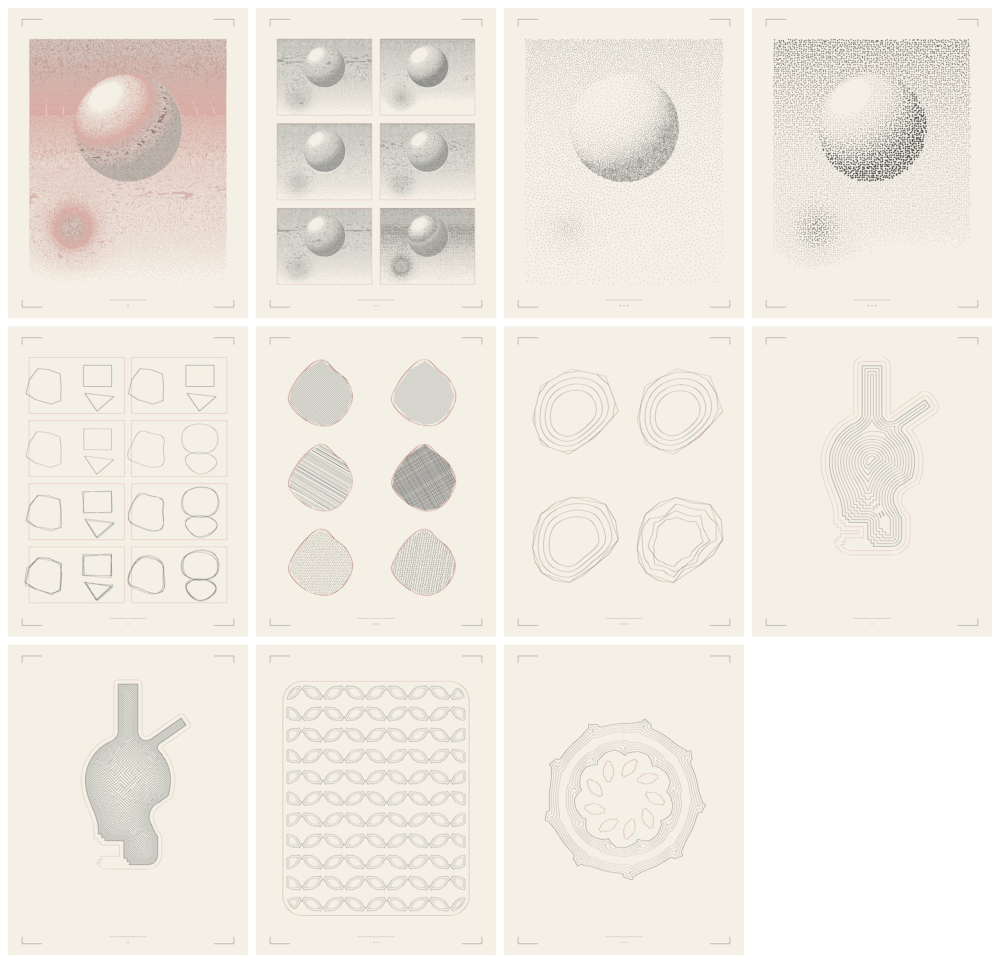

# thi.ng ports: raster to pen, fuzzy passes and distance fields

Three packages written for this collection from Karsten Schmidt's thi.ng
libraries, after the survey in [thi.ng and toxiclibs](../../docs/THING_TECHNIQUES.md).
Each is an independent Python implementation of what the package documents
and the formulas it cites; none is a translation of the TypeScript. All three
draw on the collection's 170 × 220 mm two-ink `Plate`, so the book's
`svgimport` reads their output.



| Package | What it draws | After |
| --- | --- | --- |
| [`lib/halftone`](../../lib/halftone/) | Error-diffusion and Bayer dithers; a dithered bitmap traced into hairline runs; Poisson-disc and stratified stipples whose density or dot size carries the tone | `pixel-dither`, `geom-trace-bitmap`, `poisson` |
| [`lib/fuzz`](../../lib/fuzz/) | Shapes drawn in several jittered passes, straight or curved; hatch, dot and composed fills; subdivision curves and polygon-to-Bézier conversion | `geom-fuzz`, `geom-subdiv-curve`, `geom-splines` |
| [`lib/sdf2d`](../../lib/sdf2d/) | Analytic 2-D shapes combined with chamfered, rounded, smooth or stepped booleans and repeated in grids, mirrors or polar sectors; sampled to nested contours or hatched by sign | `geom-sdf` (formulas: Quilez, hg_sdf) |

## Run

From the repository root, with Python 3.10 or newer:

```bash
python -m pip install -r requirements-process-art.txt
python examples/make_thing_ports.py                               # all twelve plates
python examples/make_thing_ports.py --study halftone --kernels atkinson stucki --cell .45
python examples/make_thing_ports.py --study stipple --variants 1
python examples/make_thing_ports.py --study apparatus --variants 1
python -m unittest discover -s lib/halftone/tests -v
python -m unittest discover -s lib/fuzz/tests -v
python -m unittest discover -s lib/sdf2d/tests -v
```

Output defaults to `examples/out/thing-ports/`, which is not committed. Each
plate writes `.svg` (170 × 220 mm, stroke-only, black and red groups), `.png`,
`.json` (parameters, counts, pen-down length, SVG hash and size) and `.npz`
(the tone array, quantised image, sampled field, points or control polygon).
`--package` copies the selected plates, manifest and contact sheet into the
preview folder; SVGs above about 700 kB (the halftone and stipple plates, 2–5
MB) are recorded in the manifest by hash and size instead of being committed.
The halftone plates take about 5 s each, the tone-driven stipple about 20 s,
everything else under 3 s. The raster input is a synthetic specimen (a lit
sphere over a ramp, with grain) so that no outside image is bundled; every
study takes a `tone` array for real input.

## Halftone ([`dither.py`](../../lib/halftone/dither.py), [`trace.py`](../../lib/halftone/trace.py), [`poisson.py`](../../lib/halftone/poisson.py))

```python
from lib.halftone import error_diffuse, ordered_dither, masks, trace_runs, to_mm, poisson_sample, tone_radius
q = error_diffuse(tone, "atkinson", levels=3, serpentine=True)   # tones 0 black … 1 white
dark, mid = masks(q, 3)                                            # one boolean mask per non-white tone
traced = trace_runs(dark, ("h", "v", "d1", "d2", "p"), min_len=2, max_len=30)
segments, points = to_mm(traced, cell=.38, origin=(15, 22))
fn, r_min = tone_radius(tone, bounds, .5, 2.8, gamma=1.15)
dots = poisson_sample(bounds, fn, rng, min_radius=r_min, quality=1200)
```

- Kernels: `floyd-steinberg`, `jarvis-judice-ninke`, `stucki`, `burkes`,
  `sierra`, `sierra-two-row`, `sierra-lite`, `atkinson`, `diffusion-row`,
  `diffusion-column`, `diffusion-2d`; `ordered_dither(size)` tiles a Bayer
  matrix of 2, 4, 8 or 16. `levels` above 2 gives a multi-tone image whose
  masks the plate assigns to different pens.
- The tracer consumes pixels in the order of `directions`; a pixel is used
  once, runs are straight between pixel centres, and `max_len` breaks long
  runs. It is not a contour tracer. Run order is raster order; nothing is
  sorted, so an encoded carrier keeps its drawing order.
- `poisson_sample` throws darts with the exclusion radius evaluated at the
  candidate, retrying each rejected candidate along a short random walk, and
  stops after `quality` consecutive failures. A radius function needs
  `min_radius` for the hash grid. `stratified_grid` places one jittered point
  per cell.
- Plates: `halftone_plate` (three tones, black in ink and mid in red),
  `kernels_plate` (six dithers on one crop, red frames bounding each),
  `stipple_plate` (variant 0 uniform, 1 tone-driven radius, 2 stratified
  grid with tone-sized dots; dots above 0.15 mm are spirals at 0.11 mm pitch).

Limits: error diffusion runs as a Python loop (numba is used when installed);
a 412 × 458 pixel plate takes about half a second. The halftone plate is 41,538
strokes and 35.8 m of pen-down travel at a 0.38 mm cell, which is what a
halftone costs; coarsen `--cell` for a shorter plot. The specimen's exact
mid-grey quantises without error at three levels, so error diffusion leaves
long horizontal runs there; real tone is not that flat.

## Fuzz ([`fuzz.py`](../../lib/fuzz/fuzz.py), [`curves.py`](../../lib/fuzz/curves.py))

```python
from lib.fuzz import fuzzy_polygon, hatch_fill, dot_pen, hatch_pen, compose, subdivide, polygon_to_cubic
passes = fuzzy_polygon(points, rng, passes=3, jitter=.4, curve=True)   # three polylines
lines = hatch_fill(polygon, spacing=1.0, angle=30, rng=rng, jitter=.25, inset=.6)
fill = compose(hatch_pen(1.4, 60, passes=2, cross=True), dot_pen(1.7, radius=.12))
rough = subdivide(points, "displace", 3, closed=True, rng=rng, amplitude=.2)
segments = polygon_to_cubic(points, "break", tightness=1/3)             # (p0, c1, c2, p3) per edge
```

- `fuzzy_polygon` jitters the vertices independently per pass; with `curve`
  each pass is the break-point spline through its jittered vertices, so
  corners round (a square becomes a rounded square at tightness 1/3).
  `fuzzy_line` resamples first so the jitter is per step.
- `hatch_fill` works at any angle, alternates direction so the pen travels
  back and forth, insets the polygon, and jitters line offsets and end
  points. `dot_fill` returns points on a staggered grid; `dots_as_rings` makes
  them plottable. Fills are functions `fill(polygon, rng) -> polylines`;
  `compose` concatenates them. `hatch_pen` and `dot_pen` are presets.
- `subdivide` schemes: `chaikin`, `cubic` (Lane–Riesenfeld), `dlg`
  (Dyn–Levin–Gregory four-point, interpolating), `midpoint`, `thirds`,
  `displace` (midpoint displacement along the normal, amplitude decaying by
  `decay` each iteration). Open curves keep their end points.
- `polygon_to_cubic` modes: `break` (vertices on the curve, tangent along the
  neighbour chord, handles `tightness` × edge length or × mean edge length
  with `uniform`) and `midpoint` (vertices as control points; the curve runs
  through the edge midpoints; tightness 2/3 is the degree-elevated quadratic).
- Plates: `passes_plate` (exact, then one to three passes, straight on the
  left and curved on the right), `fills_plate` (six fills on one blob with a
  two-pass red outline), `subdivision_plate` (four schemes, one to four
  iterations nested).

Limits: no overshoot, ink skips or pressure; the Driftless print hand has
those. Jittered hatch lines can cross the polygon edge by about the jitter.
Fills are not merged across overlapping shapes unless `union` is used first.

## Distance fields ([`sdf.py`](../../lib/sdf2d/sdf.py), [`grid.py`](../../lib/sdf2d/grid.py))

```python
from lib.sdf2d import sdf, sample, levels, hatch_by_sign
body = sdf.union_smooth(sdf.circle(30, (85, 96)), sdf.rounded_box(21, 34, 7, (85, 122)), 12)
shape = sdf.subtract_steps(body, sdf.box(24, 7, (58, 146)), 7, 3)
tiles = sdf.translate(sdf.repeat_mirror(glyph, 15.0), (cx, cy))
values, xs, ys = sample(shape, (15, 22, 155, 196), .25)
bands = levels(values, xs, ys, [0, -2, -4, -6], simplify=.02)      # {iso: [polylines]}
hatch = hatch_by_sign(sdf.band(shape, 4, 8), bounds, spacing=1.0, angle=135, step=.2)
```

- Primitives: `circle`, `box`, `rounded_box`, `segment`, `polyline`,
  `polygon` (exact, signed), `ellipse` (approximate), `triangle`. Negative
  inside, in the points' units.
- Booleans: `union`, `intersect`, `subtract`, each with `_chamfer(r)`,
  `_round(r)`, `_smooth(k)` and `_steps(r, n)` variants after hg_sdf, the
  intersection and subtraction forms derived by De Morgan.
- Domain: `translate`, `rotate(degrees, center)`, `scale`, `mirror_x`,
  `mirror_y`, `repeat(period)`, `repeat_mirror(period)`, `repeat_polar(n,
  center)`, `offset`, `annular`, `band(lo, hi)`. Repeats act about the origin:
  build the glyph at the origin, repeat it, then translate the tiling.
- `sample` evaluates the field on a grid; `contours` and `levels` run
  ContourPy's marching squares; `hatch_by_sign` walks parallel lines, keeps
  the runs where the field is negative and refines each crossing by linear
  interpolation, so no polygon is ever built.
- Plates: `apparatus_plate` (variant 0: 2 mm inner contours and red outer
  offsets of a vessel built from smooth, rounded, chamfered and stepped
  booleans; variant 1: the same field hatched by sign in 4 mm bands,
  alternating 45° and 135°), `tiling_plate` (variant 0: a stepped glyph
  mirrored every 15 mm inside a rounded frame; variant 1: a nine-fold polar
  repeat smoothly joined to a ring, with five inner offsets).

Limits: polar repeats fold the plane into one sector, so shapes not
symmetric about the sector axis show seams, as in `geom-sdf`. Stepped
operators are periodic in the field, so stairs reappear in inner contours.
Contour accuracy is the grid's (0.25 mm here); the exact field is available
at any point, so a finer grid is a parameter, not a rewrite. No 3-D: the
"SDF ray-hatching" lead in the palette research is a different renderer.

## Reuse in Codex Intervallorum

The SVGs follow the process-art export, so the routes in that
[guide](../12-process-art/README.md#reuse-in-codex-intervallorum) apply:
`svgimport.strokes_from_svg()` then `place()` with source box
`(0, 0, 170, 220)`, or `plate.draw(hand)` through `marks.Hand` or `PlotHand`.
A test reads a halftone plate back through the book's importer. The fills and
fuzzy passes take any polygon, so a book figure's silhouette can be hatched
or redrawn in passes directly; the halftone tracer and stipplers take any
tone array, including a page scan.

Physical plotting was not tested. Pen-down lengths: halftone 35.8 m, kernels
24.4 m, stipples 6.7–16.5 m, fills 12.3 m, fuzzy passes 4.8 m, subdivision
3.2 m, apparatus 3.4 and 5.1 m, tilings 7.5 and 3.5 m.
